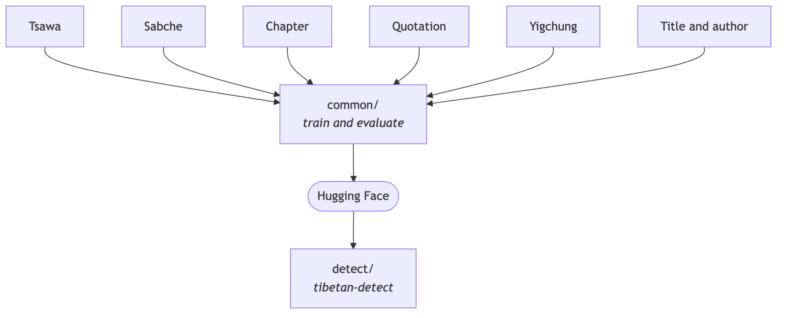

# Tibetan layer detection

One token-classification model per layer of a Tibetan pecha (OpenPecha `.opf`): root text (Tsawa), outline headings (Sabche), chapter breaks (Chapter), quotations, small-print notes (Yigchung), and the title and author of each work. This repository builds the datasets, trains and evaluates each layer's model, and holds the `detect/` package that runs the published models over a finished text.

- **In:** annotated OpenPecha books (`.opf` layers) and BDRC volumes.
- **Out:** datasets and models in the [BDRC organisation on Hugging Face](https://huggingface.co/BDRC), and layer output (JSON, HTML, `.opf`) from `detect/`.

## Pipeline



<sub>Chart source: [pipeline.mmd](docs/pipeline.mmd)</sub>

Each layer folder builds its dataset; `common/` trains and scores one model per layer; the models are published and `detect/` runs them on a book.

## Layers

Hugging Face visibility was read from the Hub on 2026-11-18. A private repo opens only for BDRC members who are logged in.

| Layer | Folder README | Model | Dataset |
|---|---|---|---|
| Tsawa (root text) | [tsawa/](tsawa/README.md) | [Bo-Tsawa-Detection](https://huggingface.co/BDRC/Bo-Tsawa-Detection) (public) | [Bo-Tsawa-Dataset](https://huggingface.co/datasets/BDRC/Bo-Tsawa-Dataset) (private) |
| Sabche (outline headings) | [sabche/](sabche/README.md) | [Bo-Sabche-Detection](https://huggingface.co/BDRC/Bo-Sabche-Detection) (private) | [Bo-Sabche-Dataset](https://huggingface.co/datasets/BDRC/Bo-Sabche-Dataset) (private) |
| Chapter (chapter breaks) | [chapter/](chapter/README.md) | [Bo-Chapter-Detection](https://huggingface.co/BDRC/Bo-Chapter-Detection) (private) | [Bo-Chapter-Dataset](https://huggingface.co/datasets/BDRC/Bo-Chapter-Dataset) (private) |
| Quotation (quotations in commentaries) | [quotation/](quotation/README.md) (code is in a separate repository) | [Bo-Quotation-Detection](https://huggingface.co/BDRC/Bo-Quotation-Detection) (private) | [Bo-Quotation-Dataset](https://huggingface.co/datasets/BDRC/Bo-Quotation-Dataset) (public) |
| Yigchung, general (small-print notes) | [yigchung/](yigchung/README.md) | [Bo-Yigchung-Detection](https://huggingface.co/BDRC/Bo-Yigchung-Detection) (public) | [Bo-Yigchung-Dataset](https://huggingface.co/datasets/BDRC/Bo-Yigchung-Dataset) (public) |
| Yigchung, classified (four genres) | [yigchung/](yigchung/README.md) | [Bo-Yigchung-Classified-Detection](https://huggingface.co/BDRC/Bo-Yigchung-Classified-Detection) (private) | [Bo-Yigchung-Classified-Dataset](https://huggingface.co/datasets/BDRC/Bo-Yigchung-Classified-Dataset) (private) |
| Title | [title_author/](title_author/README.md) | [Bo-Title-Detection](https://huggingface.co/BDRC/Bo-Title-Detection) (private) | [Bo-Title-Dataset](https://huggingface.co/datasets/BDRC/Bo-Title-Dataset) (private) |
| Author | [title_author/](title_author/README.md) | [Bo-Author-Detection](https://huggingface.co/BDRC/Bo-Author-Detection) (private) | [Bo-Author-Dataset](https://huggingface.co/datasets/BDRC/Bo-Author-Dataset) (private) |

Shared folders: [detect/](detect/README.md) (the inference package and its four console commands) and [common/](common/README.md) (fetch, train, evaluate, zero-shot, annotation audit). Spelling correction lives in a separate repository, [tenzinyonten/TiSpell](https://github.com/tenzinyonten/TiSpell).

## Quick start

Python 3.10 or newer.

```bash
python3 -m venv .venv && source .venv/bin/activate
pip install -r requirements.txt     # scripts in the layer folders
pip install .                       # the tibetan-* commands from detect/
# Detect every layer in one book
tibetan-detect --text book.txt --all --json --html --out results/
```

Private BDRC repos need a Hugging Face token: set `HF_TOKEN` or run `huggingface-cli login`. All options are in [detect/README.md](detect/README.md).

## How a layer is built

1. Build the dataset with the scripts in the layer's `src/` (order and commands are in its README).
2. Train with `common/train_layer.py --label-name <LAYER>`; on a fresh Vast.ai box run `bash setup_vast.sh` first.
3. Score with `common/eval_viterbi_iou.py`: span F1 at IoU 0.5, Viterbi decoding.
4. Publish the dataset and the model as `BDRC/Bo-<Layer>-Dataset` and `BDRC/Bo-<Layer>-Detection`, with a card for each in the layer's `docs/`.
5. Add the layer to `detect/layer_config.py` so `detect/` can load it.

## Docs

- [docs/layer_template.md](docs/layer_template.md): the folder and README format every layer follows.
- [docs/pipeline_and_data.md](docs/pipeline_and_data.md): the OpenPecha `.opf` layout, the data batches, and the original Tsawa pipeline.
- [tenzinyonten/sabche-zeroshot-eval](https://github.com/tenzinyonten/sabche-zeroshot-eval): the Sabche zero-shot evaluation (Gemini and Claude against mmBERT).
