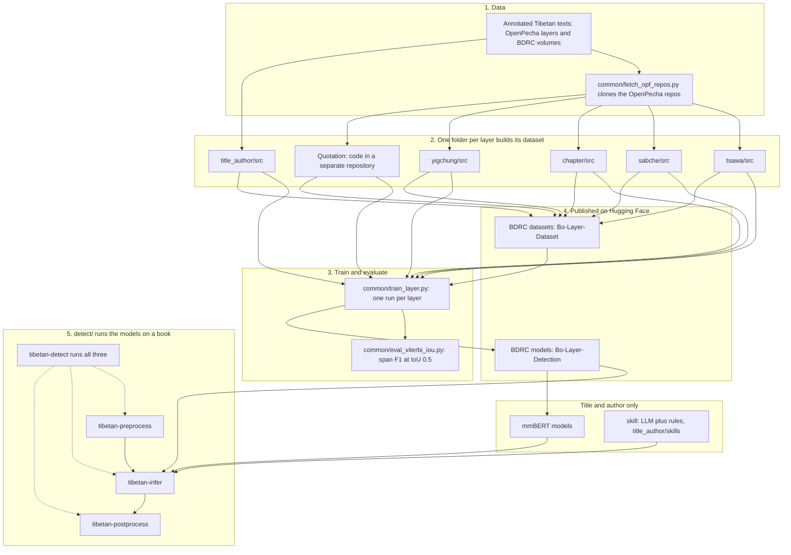

# Tibetan layer detection

One token-classification model per layer of a Tibetan pecha (OpenPecha `.opf`): root text (Tsawa), outline headings (Sabche), chapter breaks (Chapter), quotations, small-print notes (Yigchung), and the title and author of each work. This repository holds the code that builds the datasets, trains and evaluates each layer's model, and the `detect/` package that runs the published models over a finished text.

The trained models and datasets are published in the [BDRC organisation on Hugging Face](https://huggingface.co/BDRC). Every layer folder has its own README with a flowchart of its scripts, a table of what each script does and when to use it, the exact commands, and its results.

## How the whole system fits together



Reading the chart: each layer folder (step 2) turns annotated text into a dataset and publishes it, `common/train_layer.py` trains one model per layer from that dataset, and the model is published (step 4). `detect/` then loads the published models, cuts a book into windows, predicts spans, decodes them, and writes JSON, HTML or `.opf` output. For the title and author, `detect/` can use the mmBERT models or the LLM skill, chosen per field. The dashed arrows mean that `tibetan-detect` calls the three stages for you.

## The layers

Open a layer's folder README for its flowchart and script reference. Hugging Face visibility was read from the Hub on 2026-11-17; a private repo opens only for BDRC members who are logged in.

| Layer | What it marks | Folder README | Dataset | Model |
|---|---|---|---|---|
| Tsawa | root text (རྩ་བ) | [`tsawa/`](tsawa/README.md) | [Bo-Tsawa-Dataset](https://huggingface.co/datasets/BDRC/Bo-Tsawa-Dataset) (private) | [Bo-Tsawa-Detection](https://huggingface.co/BDRC/Bo-Tsawa-Detection) (public) |
| Sabche | outline headings | [`sabche/`](sabche/README.md) | [Bo-Sabche-Dataset](https://huggingface.co/datasets/BDRC/Bo-Sabche-Dataset) (private) | [Bo-Sabche-Detection](https://huggingface.co/BDRC/Bo-Sabche-Detection) (private) |
| Chapter | chapter breaks (ལེའུ) | [`chapter/`](chapter/README.md) | [Bo-Chapter-Dataset](https://huggingface.co/datasets/BDRC/Bo-Chapter-Dataset) (private) | [Bo-Chapter-Detection](https://huggingface.co/BDRC/Bo-Chapter-Detection) (private) |
| Quotation | quotations in commentaries | [`quotation/`](quotation/README.md) (code in a separate repository) | [Bo-Quotation-Dataset](https://huggingface.co/datasets/BDRC/Bo-Quotation-Dataset) (public) | [Bo-Quotation-Detection](https://huggingface.co/BDRC/Bo-Quotation-Detection) (private) |
| Yigchung, general | small-print interlinear notes (ཡིག་ཆུང་), all genres | [`yigchung/`](yigchung/README.md) | [Bo-Yigchung-Dataset](https://huggingface.co/datasets/BDRC/Bo-Yigchung-Dataset) (public) | [Bo-Yigchung-Detection](https://huggingface.co/BDRC/Bo-Yigchung-Detection) (public) |
| Yigchung, classified | the same, for four genres only (liturgy, prayer, sadhana, songs) | [`yigchung/`](yigchung/README.md) | [Bo-Yigchung-Classified-Dataset](https://huggingface.co/datasets/BDRC/Bo-Yigchung-Classified-Dataset) (private) | [Bo-Yigchung-Classified-Detection](https://huggingface.co/BDRC/Bo-Yigchung-Classified-Detection) (private) |
| Title | the title of a work | [`title_author/`](title_author/README.md) | [Bo-Title-Dataset](https://huggingface.co/datasets/BDRC/Bo-Title-Dataset) (private) | [Bo-Title-Detection](https://huggingface.co/BDRC/Bo-Title-Detection) (private) |
| Author | the author of a work | [`title_author/`](title_author/README.md) | [Bo-Author-Dataset](https://huggingface.co/datasets/BDRC/Bo-Author-Dataset) (private) | [Bo-Author-Detection](https://huggingface.co/BDRC/Bo-Author-Detection) (private) |
| Spelling | spelling errors | separate repository: [tenzinyonten/TiSpell](https://github.com/tenzinyonten/TiSpell) | | |

Naming: models are `BDRC/Bo-<Layer>-Detection`, datasets `BDRC/Bo-<Layer>-Dataset`. Each layer's `docs/` folder holds copies of its Hugging Face cards.

## What is in each folder

| Folder | What it is | README |
|---|---|---|
| [`tsawa/`](tsawa/) | Tsawa dataset builders, audits, analysis | [README](tsawa/README.md) |
| [`sabche/`](sabche/) | Sabche dataset build and zero-shot baselines | [README](sabche/README.md) |
| [`chapter/`](chapter/) | Chapter dataset build, error analysis | [README](chapter/README.md) |
| [`quotation/`](quotation/) | Quotation cards and the map of its code in the other repository | [README](quotation/README.md) |
| [`yigchung/`](yigchung/) | Yigchung: general benchmark and the classified (genre) system | [README](yigchung/README.md) |
| [`title_author/`](title_author/) | Title and author: mmBERT, the rule script, the LLM skill, GEPA | [README](title_author/README.md) |
| [`detect/`](detect/) | The inference package and the four console commands | [README](detect/README.md) |
| [`common/`](common/) | Shared scripts: fetch, train, evaluate, zero-shot, annotation audit | [README](common/README.md) |
| [`docs/`](docs/) | [Layer folder template](docs/layer_template.md) and the [OpenPecha data and original Tsawa pipeline notes](docs/pipeline_and_data.md) | |
| `data/` | Shared tables (`data/shared/`), id lists, raw `.opf` clones (gitignored) | |

Book text paths and the frozen document split are shared by more than one layer: `data/shared/tsawa_audit.csv` and `data/shared/split_v3_frozen.csv`.

## Quick start

Python 3.10 or newer.

```bash
python3 -m venv .venv
source .venv/bin/activate
pip install -r requirements.txt     # to run the scripts in the layer folders
pip install .                       # to get the tibetan-* commands from detect/
```

Detect every layer in one book (see [`detect/README.md`](detect/README.md) for all options):

```bash
tibetan-detect --text book.txt --all --json --html --out results/
```

The three stages by hand:

```bash
tibetan-preprocess --input data/raw_opf/ --out preprocessed/
tibetan-infer --input preprocessed/ --out predictions/ --all --device cuda
tibetan-postprocess --input predictions/ --source preprocessed/ --out output/ --json --html --opf
```

Models in private BDRC repos need a Hugging Face token: set `HF_TOKEN` or run `huggingface-cli login`.

## How a layer is built

1. Build the dataset with the scripts in the layer's `src/` (order and commands are in its README).
2. Train with `common/train_layer.py --label-name <LAYER>`. On a fresh Vast.ai box, run `bash setup_vast.sh` first; for example `python common/train_layer.py --smoke-test --output-dir /workspace/runs/smoke`.
3. Score with `common/eval_viterbi_iou.py`: span F1 at IoU 0.5, Viterbi decoding.
4. Publish the dataset and the model in the BDRC organisation, with a card for each in the layer's `docs/`.
5. Add the layer to `detect/layer_config.py` so `detect/` can load it.

## More

- [`docs/layer_template.md`](docs/layer_template.md): the folder and README every layer follows.
- [`docs/pipeline_and_data.md`](docs/pipeline_and_data.md): the OpenPecha `.opf` layout, the data batches, and the original Tsawa pipeline.
- [`tenzinyonten/sabche-zeroshot-eval`](https://github.com/tenzinyonten/sabche-zeroshot-eval): the Sabche zero-shot evaluation (Gemini and Claude against mmBERT).
