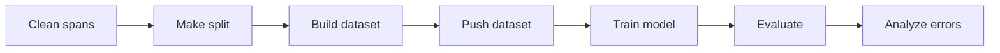

# Chapter (ལེའུ)

Finds **chapter and section headings** in Tibetan Buddhist books: the heading line that opens a division (a numbered chapter line, the title of a work inside a collected volume, a plain section title, or front matter such as a table of contents). One binary token classifier (labels `O`, `B-CHAPTER`, `I-CHAPTER`), fine-tuned from `jhu-clsp/mmBERT-base`. Chapter spans are short and sparse: about 0.18% of tokens.

- **In:** the `Chapter.yml` layers of the OpenPecha books, plus the book list `data/shared/tsawa_audit.csv`.
- **Out:** the dataset [BDRC/Bo-Chapter-Dataset](https://huggingface.co/datasets/BDRC/Bo-Chapter-Dataset) and the model [BDRC/Bo-Chapter-Detection](https://huggingface.co/BDRC/Bo-Chapter-Detection). Both are private (read from the Hub, 2026-11-17); a 404 means you need access from the owner.
- **In the whole system:** `detect/` runs this model on a text (the `chapter` entry in [layer_config.py](../detect/layer_config.py)). The data scripts live here in `src/`; training and scoring use the shared scripts in [common/](../common/).



Each box is one script in the table below. The frozen split and the shared book list are inputs, so they are not drawn. The cards are in [docs/](docs/): [model card](docs/model_card.md), [dataset card](docs/dataset_card.md), [Hugging Face notes](docs/huggingface.md).

## Main pipeline

| Script | What it does | When to run |
|---|---|---|
| [clean_chapter_spans.py](src/clean_chapter_spans.py) | Cleans raw chapter spans and flags bad books. | First; rerun on new annotations. |
| [prepare_chapter_split.py](src/prepare_chapter_split.py) | Makes the frozen train, validation and test split. | After cleaning; test split is frozen. |
| [build_chapter_dataset.py](src/build_chapter_dataset.py) | Tokenizes books into BIO windows for mmBERT. | After the split. |
| [check_chapter_leakage.py](src/check_chapter_leakage.py) | Reports long spans shared with train. | Optional, after the split. |
| [push_chapter_dataset.py](src/push_chapter_dataset.py) | Uploads the dataset and its card to the Hub. | After building the dataset. |
| [train_layer.py](../common/train_layer.py) | Fine-tunes mmBERT for the Chapter layer. | On a GPU machine. |
| [eval_viterbi_iou.py](../common/eval_viterbi_iou.py) | Scores a model: Viterbi decoding, span F1. | After training; validation first. |
| [analyze_chapter_errors.py](src/analyze_chapter_errors.py) | Lists missed and false-positive spans. | After a validation evaluation. |
| [test_chapter_cleanup.py](tests/test_chapter_cleanup.py) | Tests Chapter post-processing and config. | After changing `detect/` or config. |

`train_layer.py` and `eval_viterbi_iou.py` are shared scripts in [common/](../common/).

## How to run

All commands run from the repository root.

```bash
# 1. Clean the spans and flag bad books
python chapter/src/clean_chapter_spans.py
# 2. Make the frozen train/validation/test split
python chapter/src/prepare_chapter_split.py --keep-v3
# 3. Build the BIO dataset (8,192-token windows)
python chapter/src/build_chapter_dataset.py
# 4. Optional: check leakage
python chapter/src/check_chapter_leakage.py
# 5. Push the dataset and its card (private)
python chapter/src/push_chapter_dataset.py --private --repo-id BDRC/Bo-Chapter-Dataset
# 6. Train on a GPU machine
python common/train_layer.py --label-name CHAPTER --weight-scheme sqrt_inv \
    --epochs 8 --evals-per-epoch 4 --output-dir /workspace/runs/chapter_bio_sqrt
# 7. Upload the model and docs/model_card.md to the Hub by hand (no script)
# 8. Evaluate on validation, then analyze the errors
python common/eval_viterbi_iou.py --model BDRC/Bo-Chapter-Detection --dataset BDRC/Bo-Chapter-Dataset \
    --split validation --break-penalty 4.0 --dump-spans scratch/chapter/chapter_val_spans.jsonl
python chapter/src/analyze_chapter_errors.py --spans scratch/chapter/chapter_val_spans.jsonl \
    --pred-key viterbi_bp4.0 --tag val
python -m unittest chapter/tests/test_chapter_cleanup.py
```

**The test split is frozen: do not re-run step 2 casually, and score test once.** **Analyze errors on validation only, never test.**

### Step details

<details><summary>1. Clean the spans</summary>

Reads `data/shared/tsawa_audit.csv` and the `layers/v001/Chapter.yml` of each book; writes `chapter/data/processed/chapter_spans_clean.csv` and `chapter_book_verdicts.csv`. No `Chapter.yml` is rewritten. It snaps cut edges inside a syllable to the nearest boundary within 3 characters (the end stops before the trailing shad), trims the overlaps this creates, and merges spans separated only by shad, tsheg or spaces (never a newline). A book is `exclude` when more than 30% of its spans still have an edge mid-syllable, or when it has at least 3 spans and under 50% are heading-shaped (old-batch books whose offsets drift partway through). No flags.

</details>

<details><summary>2. Make the split</summary>

A greedy multi-objective assignment, best of 14 seeds, gives a book-level split of 83 / 8.5 / 8.5 by window count. It balances window share, Chapter spans per window, the share of short spans (under 30 characters) and the old-batch share. Hard constraints: one book in one split, at least 30 books in validation and in test. With `--keep-v3`, books already in the tsawa `data/shared/split_v3_frozen.csv` keep their split. Writes `chapter_split_frozen.csv` and a report at `scratch/chapter/splits/chapter_split_report.json` (gitignored). Other flag: `--out PATH`.

</details>

<details><summary>3. Build the dataset</summary>

Uses the mmBERT tokenizer, 8,192-token windows and stride 5,120. Reuses `label_tokens`, `sliding_windows` and `pack_window` from `common/build_tsawa_dataset.py`. Nothing is re-cleaned here. Writes `chapter/data/processed/chapter_dataset/` (gitignored) and `chapter_dataset_stats.json`. Flags: `--audit-csv`, `--sidecar`, `--split-file`, `--tokenizer`, `--max-length 8192`, `--stride 5120`, `--out-dir`, `--stats-json`, and `--limit N` for debugging.

</details>

<details><summary>4. Check leakage</summary>

A read-only report using verbatim shingle matching: how many long (at least 40 characters) Chapter spans in validation and test also appear verbatim in a train book, and how many book pairs share text. It prints to the terminal and has no flags. It is informational only: text shared between books is not treated as leakage in this project.

</details>

<details><summary>5. Push the dataset</summary>

Pushes the local `DatasetDict` to the Hub, then uploads `docs/dataset_card.md` as the repo `README.md` and a `label_map.json`. It does not re-tokenize. Needs a Hugging Face login with write access. Other flags: `--local-dir`, `--card`.

</details>

<details><summary>6. Train</summary>

Run on Vast.ai (see `../setup_vast.sh`). The weight scheme is `sqrt_inv` because Chapter is about 0.18% of tokens. Training can also read the local `chapter_dataset` folder instead of the Hub copy.

</details>

<details><summary>7. Upload the model</summary>

Upload the trained model and `docs/model_card.md` (as the model README) to `BDRC/Bo-Chapter-Detection`. This is done by hand; no script in this folder does it.

</details>

<details><summary>8. Evaluate</summary>

Score on **validation** first and look at errors only there. The test split is frozen and was not scored during training; score it once.

`eval_viterbi_iou.py`: `--dump-spans` writes per-window gold and predicted spans as JSONL (keys such as `viterbi_bp4.0`). Other flags: `--sweep`, `--batch-size`, `--device`, `--limit`, `--out`. The metric is span F1 at IoU 0.5 in character offsets, greedy one-to-one matching, Viterbi decoding with break penalty 4.0, whole-book scores. The model card names `training/test_metrics.json` in the model repo as the machine-readable test metrics.

`analyze_chapter_errors.py`: light, no model. It maps predicted token spans back to characters, removes duplicates from overlapping windows, matches them to the cleaned gold at IoU 0.5, and prints per-book results, what kinds of gold spans are missed and what the false positives look like. It writes the missed and false-positive lists as CSV to `--out-dir` (default `scratch/chapter`; copies of the validation ones are in `results/`). Other flag: `--show` (default 25). Reading test errors and then changing the model would use up the frozen test split.

`test_chapter_cleanup.py`: tests the `༼...༽` stub-extend rule (`extend_to_closing_bracket` in `detect/decode.py`) and the Chapter `LayerConfig` flags. If `scratch/chapter/chapter_test_spans.jsonl` exists, it also checks that the rules reproduce F1 about 0.8448 on that dump and that the stubs in P000110 and P000275 extend to an exact gold match.

The decoding rules used at inference (a `༼` stub under about 10 characters extends to just before the next `༽`; no tsheg extension, no small-gap merge) are in `detect/layer_config.py`.

</details>

## Results

Numbers are copied from the [model card](docs/model_card.md) and the zero-shot READMEs.

| System | Split | F1 | P | R |
|---|---|---|---|---|
| Bo-Chapter-Detection (mmBERT, Viterbi 4.0) | test, 36 books | 0.829 | 0.768 | 0.899 |
| same | test, old batch (16 books) | 0.863 | 0.853 | 0.873 |
| same | test, new batch (20 books) | 0.800 | 0.705 | 0.924 |
| [Claude Sonnet 5, zero-shot](results/zeroshot/claude-sonnet-5/README.md) | test, 36 books | 0.302 | 0.196 | 0.651 |
| [Gemini 3.1 Flash Lite, zero-shot](results/zeroshot/gemini-3.1-flash-lite/README.md) | test, 36 books | 0.540 | 0.400 | 0.829 |

<details><summary>Details</summary>

The test split has 258 gold spans in 36 books; the model predicts 302 spans, Claude made 856 predictions and Gemini 535. The Gemini prompt was edited after looking at Claude's test errors, so its run is not independent of the test set. Training data: 308 / 34 / 36 books and 9,165 / 965 / 940 windows (train / validation / test), 378 books in all after 16 drifted books were excluded.

</details>

## Experiments and baselines

The zero-shot LLM baselines were run with shared scripts in `common/zeroshot/`, which handle the `chapter` layer. Only their outputs are kept here, in [results/zeroshot/](results/zeroshot/).

| Script | What it does | When to run |
|---|---|---|
| [claude_batch.py](../common/zeroshot/claude_batch.py) | Runs the Claude zero-shot baseline. | Only to repeat it; costs money. |
| [run_layer_zeroshot.py](../common/zeroshot/run_layer_zeroshot.py) | Runs the Gemini zero-shot baseline. | Only to repeat the baseline. |

Not part of the Chapter flow: [test_drop_quoted_tsawa.py](tests/test_drop_quoted_tsawa.py) tests tsawa and quotation code (see Known issues).

<details><summary>How to run the baselines</summary>

`claude_batch.py` runs Claude Sonnet 5 on the test windows through the Message Batches API. **It sends nothing without `--yes`, which spends money.** It reads the prompt `docs/prompts/gemini_chapter_anchors.md` and writes a per-window cache.

```bash
python common/zeroshot/claude_batch.py --layer chapter plan --groups 3
python common/zeroshot/claude_batch.py --layer chapter create --group g1 --books ... [--yes]
python common/zeroshot/claude_batch.py --layer chapter poll --group g1
python common/zeroshot/claude_batch.py --layer chapter fetch --group g1
```

`run_layer_zeroshot.py` uses 16,000-character windows (overlap 2,000) and scores anchors against the gold at IoU 0.5; with `--locate-only` it only re-scores a finished cache. Other flags: `--provider gemini` or `anthropic`, `--model`.

```bash
python common/zeroshot/run_layer_zeroshot.py --layer chapter --books <ids> --out scratch/chapter/claude/test --locate-only
```

The prompt [docs/prompts/gemini_chapter_anchors.md](docs/prompts/gemini_chapter_anchors.md) is a draft written from train and validation books only.

</details>

## Known issues

<details><summary>Show</summary>

- [test_drop_quoted_tsawa.py](tests/test_drop_quoted_tsawa.py) tests `drop_quoted_tsawa` and `layers_for_run` in `detect/`: tsawa and quotation code, not the Chapter layer, although the file sits here. Run it with `python -m unittest chapter/tests/test_drop_quoted_tsawa.py` after changing `detect/postprocess.py` or `detect/infer.py`.
- `tests/test_chapter_cleanup.py` skips its frozen-dump tests unless `scratch/chapter/chapter_test_spans.jsonl` exists; that file is gitignored and not in the repo.
- `docs/dataset_card.md` still has `license: other` in its front matter; the workplan says to leave the licence line out until a licence is chosen.
- The model repo's `training/test_metrics.json` could not be read here (the repo is private), so the model-card numbers above are copied from the card, not re-checked against it.
- The Gemini zero-shot run is not independent of the test set (see Results).

</details>

## Folder layout

<details><summary>Show</summary>

```
chapter/
├── README.md
├── src/
│   ├── clean_chapter_spans.py         # snap edges, merge same-line fragments, exclude drifted books
│   ├── prepare_chapter_split.py       # frozen, stratified book-level split
│   ├── build_chapter_dataset.py       # BIO DatasetDict for mmBERT
│   ├── check_chapter_leakage.py       # read-only shingle-match leakage report
│   ├── push_chapter_dataset.py        # push the dataset to Hugging Face (with the card)
│   └── analyze_chapter_errors.py      # validation error analysis from a dump-spans file
├── tests/
│   ├── test_chapter_cleanup.py        # Chapter post-processing and config tests
│   └── test_drop_quoted_tsawa.py      # drop_quoted_tsawa / layers_for_run tests (tsawa and quotation)
├── data/processed/
│   ├── chapter_spans_clean.csv        # cleaned span sidecar
│   ├── chapter_book_verdicts.csv      # keep / exclude per book, with reason
│   ├── chapter_split_frozen.csv       # frozen split (test is frozen)
│   ├── chapter_dataset_stats.json     # window, book, span and label counts
│   └── chapter_dataset/               # built Arrow dataset (gitignored, made by step 3)
├── docs/
│   ├── dataset_card.md                # also the Hugging Face README of the dataset
│   ├── model_card.md                  # also the Hugging Face README of the model
│   ├── huggingface.md                 # repo links and visibility
│   └── prompts/gemini_chapter_anchors.md  # zero-shot prompt (draft)
└── results/
    ├── chapter_val_per_book.csv       # validation score per book
    ├── chapter_val_missed.csv         # validation gold spans the model missed
    ├── chapter_val_false_positives.csv  # validation predictions with no matching gold
    └── zeroshot/                      # zero-shot baselines on test
        ├── claude-sonnet-5/           # README, test/summary.json, test/run_info.json, test/spans/
        └── gemini-3.1-flash-lite/     # same layout
```

Scripts here import shared code from `common/` and read book text paths from `data/shared/tsawa_audit.csv`; nothing reads from `scratch/` (the split script only writes a report there, and the error-analysis script writes there by default).

</details>
