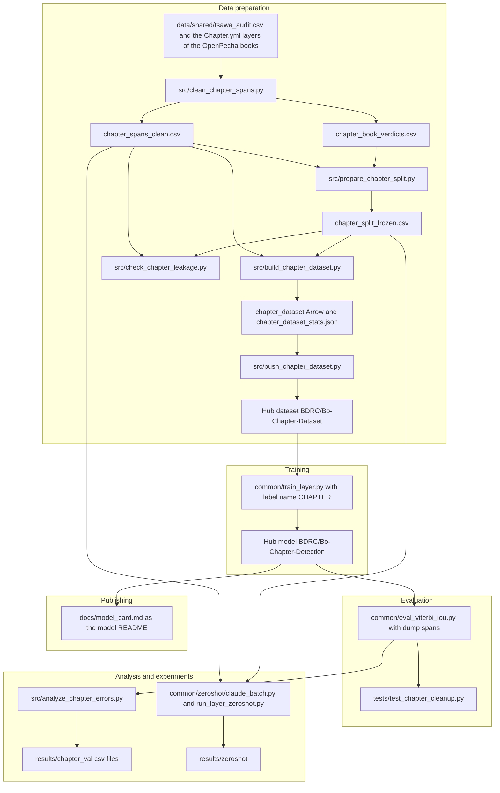

# Chapter (ལེའུ)

This folder builds the data for, trains and checks the **Chapter** layer: one binary token classifier (BIO labels `O`, `B-CHAPTER`, `I-CHAPTER`) that finds chapter and section headings in Tibetan Buddhist books. A Chapter span is the heading line that opens a division of a book (a numbered chapter line, the title of a work inside a collected volume, a plain section title, or front matter such as a table of contents). Spans are short and sparse: Chapter is about 0.18% of tokens. In the whole system this is one of the per-layer models that the `detect/` package runs on a text (its settings are the `chapter` entry in [`../detect/layer_config.py`](../detect/layer_config.py)). The model is fine-tuned from `jhu-clsp/mmBERT-base`. The data scripts live here in `src/`; training and scoring use the shared scripts in [`../common/`](../common/).

## Hugging Face

| | Repo | Visibility (read from the Hub, 2026-11-17) | Card |
|---|---|---|---|
| Model | [BDRC/Bo-Chapter-Detection](https://huggingface.co/BDRC/Bo-Chapter-Detection) | private | [`docs/model_card.md`](docs/model_card.md) |
| Dataset | [BDRC/Bo-Chapter-Dataset](https://huggingface.co/datasets/BDRC/Bo-Chapter-Dataset) | private | [`docs/dataset_card.md`](docs/dataset_card.md) |

Each card is also the README of its Hub repo. More details are in [`docs/huggingface.md`](docs/huggingface.md). If a page returns 404, the repo is private and needs access from its owner.

## Flowchart



The nodes are plain labels; the check was done by hand (no `mmdc` or `npx` was available). Training can also read the local `chapter_dataset` folder instead of the Hub copy; the flowchart shows the Hub path because that is what `docs/model_card.md` describes.

## Script reference

All commands are run from the repository root. Paths below that start with `data/processed/` mean `chapter/data/processed/`.

### Data preparation

| Script | What it does | When to use it | How to run | Reads -> Writes |
|---|---|---|---|---|
| [`src/clean_chapter_spans.py`](src/clean_chapter_spans.py) | Builds the cleaned span sidecar without rewriting any `Chapter.yml`. Snaps cut edges inside a syllable to the nearest boundary within 3 characters (the end stops before the trailing shad), trims overlaps this creates, merges spans separated only by shad, tsheg or spaces (never a newline), and gives each book a verdict. A book is `exclude` when more than 30% of its spans still have an edge mid-syllable, or when it has at least 3 spans and under 50% are heading-shaped (old-batch books whose offsets drift partway through). | First step, and again if the raw annotations change. | `python chapter/src/clean_chapter_spans.py` (no flags) | `data/shared/tsawa_audit.csv`, the `layers/v001/Chapter.yml` of each book -> `data/processed/chapter_spans_clean.csv`, `data/processed/chapter_book_verdicts.csv` |
| [`src/prepare_chapter_split.py`](src/prepare_chapter_split.py) | Frozen, stratified book-level split (train, val, test), 83 / 8.5 / 8.5 by window count. A greedy multi-objective assignment, best of 14 seeds, balances window share, Chapter spans per window, share of short spans (under 30 characters) and old-batch share. Hard constraints: one book in one split, at least 30 books in val and in test. With `--keep-v3`, books already in the tsawa `split_v3_frozen.csv` keep their split. | After cleaning. The test split is frozen: do not re-run casually. | `python chapter/src/prepare_chapter_split.py --keep-v3` (also `--out PATH`) | `data/shared/tsawa_audit.csv`, `chapter_spans_clean.csv`, `chapter_book_verdicts.csv`, `data/shared/split_v3_frozen.csv` -> `data/processed/chapter_split_frozen.csv`, a report at `scratch/chapter/splits/chapter_split_report.json` (gitignored) |
| [`src/build_chapter_dataset.py`](src/build_chapter_dataset.py) | Builds the BIO `DatasetDict` for mmBERT. Reuses `label_tokens`, `sliding_windows` and `pack_window` from `common/build_tsawa_dataset.py`. Windows are 8,192 tokens with stride 5,120. Nothing is re-cleaned here. | After the split is made. | `python chapter/src/build_chapter_dataset.py` (flags: `--audit-csv`, `--sidecar`, `--split-file`, `--tokenizer`, `--max-length 8192`, `--stride 5120`, `--out-dir`, `--stats-json`, `--limit N` for debugging) | `tsawa_audit.csv`, `chapter_spans_clean.csv`, `chapter_split_frozen.csv` -> `data/processed/chapter_dataset/` (gitignored), `data/processed/chapter_dataset_stats.json` |
| [`src/check_chapter_leakage.py`](src/check_chapter_leakage.py) | Read-only leakage report using verbatim shingle matching: how many long (at least 40 characters) Chapter spans in val and test also appear verbatim in a train book, and how many book pairs share text. Informational only: text shared between books is not treated as leakage in this project. | Optional check after the split. | `python chapter/src/check_chapter_leakage.py` (no flags) | `tsawa_audit.csv`, `chapter_spans_clean.csv`, `chapter_split_frozen.csv` -> prints to the terminal |

### Training

| Script | What it does | When to use it | How to run | Reads -> Writes |
|---|---|---|---|---|
| [`../common/train_layer.py`](../common/train_layer.py) (shared, not in this folder) | Fine-tunes mmBERT with `--label-name CHAPTER`. The weight scheme is `sqrt_inv` because Chapter is about 0.18% of tokens. | On a GPU machine (Vast.ai, see `../setup_vast.sh`). | `python common/train_layer.py --label-name CHAPTER --weight-scheme sqrt_inv --epochs 8 --evals-per-epoch 4 --output-dir /workspace/runs/chapter_bio_sqrt` | the dataset -> `/workspace/runs/chapter_bio_sqrt` |

### Publishing

| Script | What it does | When to use it | How to run | Reads -> Writes |
|---|---|---|---|---|
| [`src/push_chapter_dataset.py`](src/push_chapter_dataset.py) | Pushes the local `DatasetDict` to the Hub, then uploads `docs/dataset_card.md` as the repo `README.md` and a `label_map.json`. Does not re-tokenize. Needs a Hugging Face login with write access. | After building and checking the dataset. | `python chapter/src/push_chapter_dataset.py --private --repo-id BDRC/Bo-Chapter-Dataset` (`--local-dir` and `--card` are also flags) | `data/processed/chapter_dataset/`, `docs/dataset_card.md` -> Hub dataset repo |

The model card [`docs/model_card.md`](docs/model_card.md) is uploaded by hand as the model repo README; no script in this folder does it.

### Evaluation

| Script | What it does | When to use it | How to run | Reads -> Writes |
|---|---|---|---|---|
| [`../common/eval_viterbi_iou.py`](../common/eval_viterbi_iou.py) (shared) | Scores a model with Viterbi decoding and span F1 at IoU 0.5. `--dump-spans` writes per-window gold and predicted spans as JSONL (keys such as `viterbi_bp4.0`). | After training, on validation first. | `python common/eval_viterbi_iou.py --model BDRC/Bo-Chapter-Detection --dataset BDRC/Bo-Chapter-Dataset --split validation --break-penalty 4.0 --dump-spans scratch/chapter/chapter_val_spans.jsonl` (also `--sweep`, `--batch-size`, `--device`, `--limit`, `--out`) | model and dataset -> `--out` JSON and the dump |
| [`tests/test_chapter_cleanup.py`](tests/test_chapter_cleanup.py) | Unit tests for the Chapter post-processing: the `༼...༽` stub-extend rule (`extend_to_closing_bracket` in `detect/decode.py`) and the Chapter `LayerConfig` flags. If `scratch/chapter/chapter_test_spans.jsonl` exists, it also checks that the rules reproduce F1 about 0.8448 on that dump and that the stubs in P000110 and P000275 extend to an exact gold match. | After changing `detect/` post-processing or the Chapter config. | `python -m unittest chapter/tests/test_chapter_cleanup.py` from the repo root | `detect/`, `chapter_spans_clean.csv`, `tsawa_audit.csv`, optional dump -> pass or fail |
| [`tests/test_drop_quoted_tsawa.py`](tests/test_drop_quoted_tsawa.py) | Unit tests for `drop_quoted_tsawa` and `layers_for_run` in `detect/`. They are about tsawa and quotation, not Chapter, although the file sits here. | After changing `detect/postprocess.py` or `detect/infer.py`. | `python -m unittest chapter/tests/test_drop_quoted_tsawa.py` from the repo root | `detect/` -> pass or fail |

### Analysis and experiments

| Script | What it does | When to use it | How to run | Reads -> Writes |
|---|---|---|---|---|
| [`src/analyze_chapter_errors.py`](src/analyze_chapter_errors.py) | Error analysis from an `eval_viterbi_iou.py --dump-spans` file. Light, no model: maps predicted token spans back to characters, removes duplicates from overlapping windows, matches them to the cleaned gold at IoU 0.5, prints per-book results, what kinds of gold spans are missed and what the false positives look like, and writes missed and false-positive lists as CSV. Use it on the **validation** dump only: reading test errors and then changing the model would use up the frozen test split. | After a validation evaluation, to see what to fix. | `python chapter/src/analyze_chapter_errors.py --spans scratch/chapter/chapter_val_spans.jsonl --pred-key viterbi_bp4.0 --tag val` (also `--out-dir`, default `scratch/chapter`, and `--show`, default 25) | the dump, `tsawa_audit.csv`, `chapter_spans_clean.csv` -> CSV files in `--out-dir`; copies of the validation ones are in `results/` |

### Experiments and one-off scripts

No script in `chapter/src/` is a legacy or one-off script. The zero-shot LLM baselines were run with shared scripts in `common/zeroshot/` (they handle the `chapter` layer) and only their outputs are kept here, in [`results/zeroshot/`](results/zeroshot/):

| Script | What it does | When to use it | How to run | Reads -> Writes |
|---|---|---|---|---|
| [`../common/zeroshot/claude_batch.py`](../common/zeroshot/claude_batch.py) (shared) | Runs Claude Sonnet 5 on the test windows through the Message Batches API. Nothing is sent without `--yes`, which spends money. | Only to repeat the Claude baseline. | `python common/zeroshot/claude_batch.py --layer chapter plan --groups 3`, then `create --group g1 --books ... [--yes]`, `poll --group g1`, `fetch --group g1` | prompt `docs/prompts/gemini_chapter_anchors.md` -> a per-window cache |
| [`../common/zeroshot/run_layer_zeroshot.py`](../common/zeroshot/run_layer_zeroshot.py) (shared) | Runs Gemini on 16,000-character windows (overlap 2,000) and scores anchors against the gold at IoU 0.5; with `--locate-only` it only re-scores a finished cache. | Only to repeat a zero-shot baseline. | `python common/zeroshot/run_layer_zeroshot.py --layer chapter --books <ids> --out scratch/chapter/claude/test --locate-only` (also `--provider gemini or anthropic`, `--model`) | the split, the cleaned spans and the prompt -> spans and scores |

The prompt [`docs/prompts/gemini_chapter_anchors.md`](docs/prompts/gemini_chapter_anchors.md) is a draft written from train and validation books only.

## Step by step: from raw data to a published model

1. Clean the spans and decide which books to keep:
   ```bash
   python chapter/src/clean_chapter_spans.py
   ```
2. Make the frozen book-level split:
   ```bash
   python chapter/src/prepare_chapter_split.py --keep-v3
   ```
3. Build the BIO dataset (tokenizes with mmBERT, 8,192-token windows, stride 5,120):
   ```bash
   python chapter/src/build_chapter_dataset.py
   ```
4. Optionally check leakage:
   ```bash
   python chapter/src/check_chapter_leakage.py
   ```
5. Push the dataset and its card (private):
   ```bash
   python chapter/src/push_chapter_dataset.py --private --repo-id BDRC/Bo-Chapter-Dataset
   ```
6. Train on Vast (see `../setup_vast.sh`). `sqrt_inv` weights because Chapter is about 0.18% of tokens:
   ```bash
   python common/train_layer.py --label-name CHAPTER --weight-scheme sqrt_inv \
       --epochs 8 --evals-per-epoch 4 --output-dir /workspace/runs/chapter_bio_sqrt
   ```
7. Upload the model and `docs/model_card.md` (as the model README) to `BDRC/Bo-Chapter-Detection`. This is done outside these scripts.

### How to evaluate

Score on **validation** first and look at errors only there. The test split is frozen and was not scored during training; score it once.

```bash
python common/eval_viterbi_iou.py --model BDRC/Bo-Chapter-Detection --dataset BDRC/Bo-Chapter-Dataset \
    --split validation --break-penalty 4.0 --dump-spans scratch/chapter/chapter_val_spans.jsonl
python chapter/src/analyze_chapter_errors.py --spans scratch/chapter/chapter_val_spans.jsonl \
    --pred-key viterbi_bp4.0 --tag val
python -m unittest chapter/tests/test_chapter_cleanup.py
```

The metric is span F1 at IoU 0.5 in character offsets, greedy one-to-one matching, Viterbi decoding with break penalty 4.0, whole-book scores. The model card names `training/test_metrics.json` in the model repo as the machine-readable test metrics. The decoding rules used at inference (a `༼` stub under about 10 characters extends to just before the next `༽`; no tsheg extension, no small-gap merge) are in `detect/layer_config.py`.

## Results

Numbers are copied from [`docs/model_card.md`](docs/model_card.md) and the zero-shot READMEs.

| System | Split | F1 | Precision | Recall |
|---|---|---|---|---|
| Bo-Chapter-Detection (mmBERT, Viterbi bp 4.0) | test, 36 books (258 gold spans) | 0.829 | 0.768 | 0.899 |
| same | test, old batch (16 books) | 0.863 | 0.853 | 0.873 |
| same | test, new batch (20 books) | 0.800 | 0.705 | 0.924 |
| Claude Sonnet 5, zero-shot ([README](results/zeroshot/claude-sonnet-5/README.md)) | test, 36 books | 0.302 | 0.196 | 0.651 |
| Gemini 3.1 Flash Lite, zero-shot ([README](results/zeroshot/gemini-3.1-flash-lite/README.md)) | test, 36 books | 0.540 | 0.400 | 0.829 |

The model predicts 302 spans for the 258 gold spans. Claude made 856 predictions and Gemini 535. The Gemini prompt was edited after looking at Claude's test errors, so its run is not independent of the test set. Training data: 308 / 34 / 36 books and 9,165 / 965 / 940 windows (train / validation / test), 378 books in all after 16 drifted books were excluded.

## Folder layout

```
chapter/
├── README.md                          # this file
├── src/
│   ├── clean_chapter_spans.py         # snap edges, merge same-line fragments, exclude drifted books
│   ├── prepare_chapter_split.py       # frozen, stratified book-level split
│   ├── build_chapter_dataset.py       # BIO DatasetDict for mmBERT
│   ├── check_chapter_leakage.py       # read-only shingle-match leakage report
│   ├── push_chapter_dataset.py        # push the dataset to Hugging Face (with the card)
│   └── analyze_chapter_errors.py      # validation error analysis from a dump-spans file
├── tests/
│   ├── test_chapter_cleanup.py        # Chapter post-processing and config tests
│   └── test_drop_quoted_tsawa.py      # drop_quoted_tsawa / layers_for_run tests (tsawa and quotation)
├── data/processed/
│   ├── chapter_spans_clean.csv        # cleaned span sidecar
│   ├── chapter_book_verdicts.csv      # keep / exclude per book, with reason
│   ├── chapter_split_frozen.csv       # frozen split (test is frozen)
│   ├── chapter_dataset_stats.json     # window, book, span and label counts
│   └── chapter_dataset/               # built Arrow dataset (gitignored, made by step 3)
├── docs/
│   ├── dataset_card.md                # also the Hugging Face README of the dataset
│   ├── model_card.md                  # also the Hugging Face README of the model
│   ├── huggingface.md                 # repo links and visibility
│   └── prompts/gemini_chapter_anchors.md  # zero-shot prompt (draft)
└── results/
    ├── chapter_val_per_book.csv       # validation score per book
    ├── chapter_val_missed.csv         # validation gold spans the model missed
    ├── chapter_val_false_positives.csv  # validation predictions with no matching gold
    └── zeroshot/                      # zero-shot baselines on test
        ├── claude-sonnet-5/           # README, test/summary.json, test/run_info.json, test/spans/
        └── gemini-3.1-flash-lite/     # same layout
```

Numbers and cleaning details are in [`docs/dataset_card.md`](docs/dataset_card.md). Scripts here import shared code from `common/` and read book text paths from `data/shared/tsawa_audit.csv`; nothing reads from `scratch/` (the split script only writes a report there, and the error-analysis script writes there by default).

## Known issues

- `tests/test_drop_quoted_tsawa.py` tests tsawa and quotation code, not the Chapter layer.
- `tests/test_chapter_cleanup.py` skips its frozen-dump tests unless `scratch/chapter/chapter_test_spans.jsonl` exists; that file is gitignored and not in the repo.
- `docs/dataset_card.md` still has `license: other` in its front matter; the Hub workplan says to leave the licence line out until a licence is chosen.
- The model repo's `training/test_metrics.json` could not be read here (the repo is private), so the model-card numbers above are copied from the card, not re-checked against it.
- The Gemini zero-shot run is not independent of the test set (see Results).
