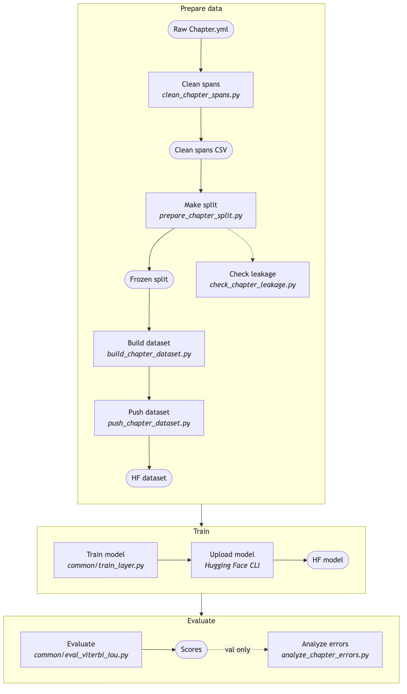

# Chapter (ལེའུ)

Finds **chapter and section headings** in Tibetan Buddhist books: the heading line that opens a division (a numbered chapter line, the title of a work inside a collected volume, a plain section title, or front matter such as a table of contents). One binary token classifier (labels `O`, `B-CHAPTER`, `I-CHAPTER`), fine-tuned from `jhu-clsp/mmBERT-base`. Chapter spans are short and sparse: about 0.18% of tokens.

- **In:** the `Chapter.yml` layers of the OpenPecha books, plus the book list `data/shared/tsawa_audit.csv`.
- **Out:** a dataset and a model on Hugging Face (see below).
- **In the whole system:** `detect/` runs this model on a text (the `chapter` entry in [layer_config.py](../detect/layer_config.py)). The data scripts live here in `src/`; training and scoring use the shared scripts in [common/](../common/).

## Folder layout

```
chapter/
├── src/             scripts: clean, split, build, push, analyze
├── tests/           tests for Chapter post-processing
├── data/processed/  cleaned spans, book verdicts, frozen split, stats
├── docs/            model card, dataset card, zero-shot prompt
└── results/         validation tables and zero-shot baselines
```

## Hugging Face

| | Repo | Visibility |
|---|---|---|
| Model | [BDRC/Bo-Chapter-Detection](https://huggingface.co/BDRC/Bo-Chapter-Detection) ([card](docs/model_card.md)) | private |
| Dataset (train, validation) | [BDRC/Bo-Chapter-Dataset](https://huggingface.co/datasets/BDRC/Bo-Chapter-Dataset) ([card](docs/dataset_card.md)) | private |
| Benchmark (test) | [BDRC/Bo-Chapter-Benchmark](https://huggingface.co/datasets/BDRC/Bo-Chapter-Benchmark) ([card](docs/benchmark_card.md)) | public |

The model is private (read from the Hub, 2026-11-17). Datasets read from the Hub on 2026-11-25 (training data private, benchmark public); a 404 on a private repo means you need access from the owner. The dataset and benchmark cards match the Hub READMEs apart from script names, which are current here.

## Pipeline



<sub>Chart source: [pipeline.mmd](docs/pipeline.mmd)</sub>

Squares are steps with the script that runs them; rounded boxes are files; dashed arrows are optional steps. The **benchmark** is the frozen test split: it is scored once and never used to tune or to analyze errors (errors are analyzed on validation only). The zero-shot LLM runs (Claude Sonnet 5, Gemini 3.1 Flash Lite) use the same benchmark books; their results are in [results/zeroshot/](results/zeroshot/). The cards are in [docs/](docs/).

## Main pipeline

| Script | What it does | When to run |
|---|---|---|
| [clean_chapter_spans.py](src/clean_chapter_spans.py) | Cleans raw chapter spans and flags bad books. | First; rerun on new annotations. |
| [prepare_chapter_split.py](src/prepare_chapter_split.py) | Makes the frozen train, validation and test split. | After cleaning; benchmark is frozen. |
| [build_chapter_dataset.py](src/build_chapter_dataset.py) | Tokenizes books into BIO windows for mmBERT. | After the split. |
| [push_chapter_dataset.py](src/push_chapter_dataset.py) | Uploads the dataset and its card to the Hub. | After building the dataset. |
| [train_layer.py](../common/train_layer.py) | Fine-tunes mmBERT for the Chapter layer. | On a GPU machine. |
| [eval_viterbi_iou.py](../common/eval_viterbi_iou.py) | Scores a model: Viterbi decoding, span F1. | After training; validation first. |

`train_layer.py` and `eval_viterbi_iou.py` are shared scripts in [common/](../common/).

## How to run

All commands run from the repository root.

```bash
# 1. Clean the spans and flag bad books
python chapter/src/clean_chapter_spans.py
# 2. Make the train/validation/test split. The benchmark (test split) is frozen: score it once.
python chapter/src/prepare_chapter_split.py --keep-v3
# 3. Build the BIO dataset (8,192-token windows)
python chapter/src/build_chapter_dataset.py
# 4. Push the dataset and its card (private)
python chapter/src/push_chapter_dataset.py --private --repo-id BDRC/Bo-Chapter-Dataset
# 5. Train on a GPU machine
python common/train_layer.py --label-name CHAPTER --weight-scheme sqrt_inv \
    --epochs 8 --evals-per-epoch 4 --output-dir /workspace/runs/chapter_bio_sqrt
# 6. Upload the model and docs/model_card.md (as README.md) to BDRC/Bo-Chapter-Detection with the Hugging Face CLI
# 7. Evaluate on validation
python common/eval_viterbi_iou.py --model BDRC/Bo-Chapter-Detection --dataset BDRC/Bo-Chapter-Dataset \
    --split validation --break-penalty 4.0 --dump-spans scratch/chapter/chapter_val_spans.jsonl
```

## Optional tools

- **Check leakage**: reports long spans shared with train. `python chapter/src/check_chapter_leakage.py`
- **Analyze errors**: lists missed and false-positive spans. Validation only, never test. `python chapter/src/analyze_chapter_errors.py --spans scratch/chapter/chapter_val_spans.jsonl --pred-key viterbi_bp4.0 --tag val`
- **Tests**: `python -m unittest chapter/tests/test_chapter_cleanup.py` tests the Chapter post-processing rules and config.

## Results

Benchmark (test split). Numbers are copied from the [model card](docs/model_card.md) and the zero-shot READMEs.

| Model | F1 | P | R |
|---|---|---|---|
| Bo-Chapter-Detection (all 36 books) | 0.829 | 0.768 | 0.899 |
| Bo-Chapter-Detection (old batch, 16 books) | 0.863 | 0.853 | 0.873 |
| Bo-Chapter-Detection (new batch, 20 books) | 0.800 | 0.705 | 0.924 |
| [Claude Sonnet 5, zero-shot (all 36 books)](results/zeroshot/claude-sonnet-5/README.md) | 0.302 | 0.196 | 0.651 |
| [Gemini 3.1 Flash Lite, zero-shot (all 36 books)](results/zeroshot/gemini-3.1-flash-lite/README.md) | 0.540 | 0.400 | 0.829 |

The Gemini prompt was edited after seeing Claude's test errors, so its score is not independent.

## Zero-shot baselines

Zero-shot baselines (Claude, Gemini) were run with the shared scripts in [common/zeroshot/](../common/zeroshot/).
Results are in [results/zeroshot/](results/zeroshot/).

## Known issues

<details><summary>Show 3 known issues</summary>

- `tests/test_chapter_cleanup.py` skips its frozen-dump tests unless `scratch/chapter/chapter_test_spans.jsonl` exists; that file is gitignored and not in the repo.
- The model repo's `training/test_metrics.json` could not be read here (the repo is private), so the model-card numbers above are copied from the card, not re-checked against it.
- The Gemini zero-shot run is not independent of the test set (see Results).

</details>

## All files

<details><summary>Show the full file tree</summary>

```
chapter/
├── README.md
├── src/
│   ├── clean_chapter_spans.py         # snap edges, merge same-line fragments, exclude drifted books
│   ├── prepare_chapter_split.py       # frozen, stratified book-level split
│   ├── build_chapter_dataset.py       # BIO DatasetDict for mmBERT
│   ├── check_chapter_leakage.py       # read-only shingle-match leakage report
│   ├── push_chapter_dataset.py        # push the dataset to Hugging Face (with the card)
│   └── analyze_chapter_errors.py      # validation error analysis from a dump-spans file
├── tests/
│   └── test_chapter_cleanup.py        # Chapter post-processing and config tests
├── data/processed/
│   ├── chapter_spans_clean.csv        # cleaned span sidecar
│   ├── chapter_book_verdicts.csv      # keep / exclude per book, with reason
│   ├── chapter_split_frozen.csv       # frozen split (test is frozen)
│   ├── chapter_dataset_stats.json     # window, book, span and label counts
│   └── chapter_dataset/               # built Arrow dataset (gitignored, made by step 3)
├── docs/
│   ├── dataset_card.md                # also the Hugging Face README of the dataset
│   ├── model_card.md                  # also the Hugging Face README of the model
│   └── prompts/gemini_chapter_anchors.md  # zero-shot prompt (draft)
└── results/
    ├── chapter_val_per_book.csv       # validation score per book
    ├── chapter_val_missed.csv         # validation gold spans the model missed
    ├── chapter_val_false_positives.csv  # validation predictions with no matching gold
    └── zeroshot/                      # zero-shot baselines on test
        ├── claude-sonnet-5/           # README, test/summary.json, test/run_info.json, test/spans/
        └── gemini-3.1-flash-lite/     # same layout
```

Scripts here import shared code from `common/` and read book text paths from `data/shared/tsawa_audit.csv`; nothing reads from `scratch/` (the split script only writes a report there, and the error-analysis script writes there by default).

</details>
