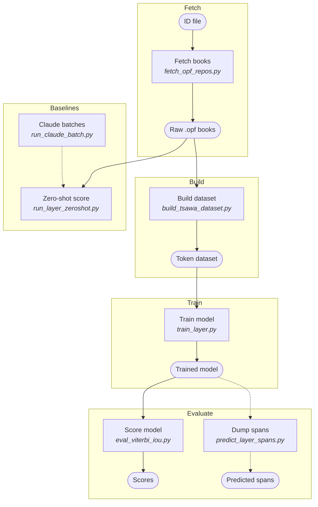

# common/ (shared scripts)

Scripts that more than one layer uses: fetching the raw `.opf` books, the windowed token-classification dataset builder, the training loop, the Viterbi scorer, prediction dumping, the zero-shot LLM baselines and the annotation audit. Each layer folder (`tsawa/`, `sabche/`, `chapter/`, `yigchung/`, `title_author/`) keeps only its own data preparation and error analysis in `src/` and calls into `common/` for the rest. `common/` is not a layer: it has no model and no Hugging Face repo. `quotation/` has no code in this repo, so its use of `common/` cannot be checked here.

- **In:** OpenPecha `.opf` books (`data/raw_opf/`), the book list `data/shared/tsawa_audit.csv`, a token dataset (local or on the Hub) and a trained model.
- **Out:** raw books, token datasets, trained models, scores and predicted spans, zero-shot baseline scores.
- **In the whole system:** the layer READMEs give the exact command for their layer. The inference package that runs the published models is [detect/](../detect/); it keeps its own copies of the windowing and Viterbi functions, and `eval_viterbi_iou.py` here imports its decoder from `detect/decode.py`.

## Folder layout

```
common/
├── fetch_opf_repos.py ... predict_layer_spans.py   12 scripts: fetch, build, train, evaluate
├── zeroshot/            LLM baseline runner, Claude batch runner, two libraries
└── annotation_audit/    audit scripts, their CSV and Markdown outputs, emma/ handoff lists
```

## Pipeline



Squares are steps with the script that runs them; rounded boxes are files; dashed arrows are optional steps. Between Fetch and Build each layer's own `src/` cleans its spans and freezes its split, and its `build_*_dataset.py` calls `build_tsawa_dataset.py`. Baselines read the raw books as gold.

## Main pipeline

| Script | What it does | When to run |
|---|---|---|
| [fetch_opf_repos.py](fetch_opf_repos.py) | Clones OpenPecha `.opf` repos listed in an ID file. | First, to get the books. |
| [build_tsawa_dataset.py](build_tsawa_dataset.py) | Builds the windowed BIO token dataset; layer builders import it. | After cleaning spans and the split. |
| [train_layer.py](train_layer.py) | Training loop for one layer (`--label-name`). | On a GPU machine. |
| [eval_viterbi_iou.py](eval_viterbi_iou.py) | Scores a model: Viterbi decoding, IoU 0.5 span F1. | After training; validation first. |
| [predict_layer_spans.py](predict_layer_spans.py) | Saves every predicted and gold span per document. | To analyze errors later. |

## How to run

All commands run from the repository root. Flags, defaults and the files each script reads and writes are in its docstring and `--help`.

```bash
# 1. Fetch the books (writes data/raw_opf/<ID>.opf/ and data/raw_opf/_manifest.csv)
python common/fetch_opf_repos.py --ids-file data/ids/newdata.txt
# 2. Build the dataset (a layer's own build script usually does this; see its README)
python common/build_tsawa_dataset.py --split-file <frozen_split.csv> --out-dir <dataset_dir>
# 3. Train on a GPU machine; --label-name is TSAWA, SABCHE, CHAPTER, YIGCHUNG or TITLE_AUTHOR
python common/train_layer.py --label-name CHAPTER --scheme bio --weight-scheme sqrt_inv \
    --epochs 8 --evals-per-epoch 4 --output-dir runs/chapter
# 4. Score on validation; the test split is frozen, score it once at the end
python common/eval_viterbi_iou.py --model <path_or_repo> --dataset <path_or_repo> \
    --split validation --break-penalty 4.0 --dump-spans scratch/<layer>/val_spans.jsonl
# 5. Save predicted spans per document (optional)
python common/predict_layer_spans.py --label-name CHAPTER --model runs/chapter/best \
    --dataset <path_or_repo> --splits validation --out predictions_validation.json
```

**The test split is frozen: `train_layer.py` scores it at the end unless you pass `--skip-test`. Score it once.**

## Optional tools

- **Check boundaries**: tests that span edges sit on syllable boundaries; its helpers are imported by the layers' boundary scripts. `python common/check_boundary_snapping.py --audit-csv data/shared/tsawa_audit.csv --raw-opf-dir data/raw_opf --out tsawa/data/processed/boundary_check.csv`
- **Particle rule**: tests forbidding tsawa labels on closing particles at decode time. `python common/eval_particle_rule.py --model <repo> --dataset <ds> --break-penalty 12.0`
- **Model files**: [tsawa_feat_model.py](tsawa_feat_model.py) (clause features, `--use-features`) and [tsawa_crf_model.py](tsawa_crf_model.py) (CRF head, `--use-crf`) are imported by the trainers, not run.
- **Zero-shot libraries**: [run_gemini_chunks.py](zeroshot/run_gemini_chunks.py) and [run_gemini_locate.py](zeroshot/run_gemini_locate.py) are imported by `run_layer_zeroshot.py`; copied unchanged from the quotation benchmark repo.
- **Annotation audit**: read-only checks on `data/raw_opf`, run manually when the data changes; they write reports next to the scripts. Run `audit_annotations.py`, `scan_missed_verses.py`, `analyze_cross_layer.py`, `check_prose.py`, then `build_audit_report.py`: `python common/annotation_audit/audit_annotations.py`. The other tools: `analyze_layer_venn.py`, `build_book_check.py P000078`, `build_sabche_check.py P000078`.

## Which layer uses what

| Layer | Shared scripts it uses |
|---|---|
| tsawa | build, `check_boundary_snapping`, train, `eval_viterbi_iou`, `eval_particle_rule`, audit |
| sabche | build, `check_boundary_snapping`, train, `predict_layer_spans`, zero-shot runners |
| chapter | build, `check_boundary_snapping`, train, `eval_viterbi_iou`, zero-shot runners |
| yigchung | build, train, `predict_layer_spans` |
| title_author | build, train |

## Zero-shot baselines: how to run

The Gemini and Claude baselines for Sabche and Chapter use two scripts here. Both cut each book into 16,000-character windows overlapping by 2,000, cut at a shad; the model returns span anchors (`head`, `tail`, optional `frame`), the locator turns them into offsets, and spans are scored at IoU 0.5. The prompts are zero-shot drafts built from train and validation books only. Results are in `chapter/results/zeroshot/` and `sabche/results/`.

- `run_layer_zeroshot.py` runs Gemini (default `gemini-3.1-flash-lite`, needs `GEMINI_API_KEY`) or `--provider anthropic`, caches each reply and scores. **With `--locate-only` it makes no API call and only re-scores a finished cache.**
- `run_claude_batch.py` runs Claude Sonnet 5 through the Message Batches API (half price). **It sends nothing without `--yes`, which spends money.**

### Chapter baselines: how to run

The prompt is [`chapter/docs/prompts/gemini_chapter_anchors.md`](../chapter/docs/prompts/gemini_chapter_anchors.md).

```bash
# Claude: plan offline, create the batches, poll, fetch
python common/zeroshot/run_claude_batch.py --layer chapter plan --groups 3
python common/zeroshot/run_claude_batch.py --layer chapter create --group g1 --books ... [--yes]
python common/zeroshot/run_claude_batch.py --layer chapter poll --group g1
python common/zeroshot/run_claude_batch.py --layer chapter fetch --group g1
# Score the finished cache (no API call)
python common/zeroshot/run_layer_zeroshot.py --layer chapter --books <ids> --out scratch/chapter/claude/test --locate-only
```

### Sabche baselines: how to run

The prompt is [`sabche/docs/prompts/gemini_sabche_anchors.md`](../sabche/docs/prompts/gemini_sabche_anchors.md) (v1, built 2026-09-24 from train and validation statistics only). Gold is the cleaned spans and the frozen split of `sabche/`; the saved scores are [`sabche/results/README.md`](../sabche/results/README.md).

```bash
# Gemini: one run per set of books (paid; cached windows cost nothing on a re-run)
python common/zeroshot/run_layer_zeroshot.py --layer sabche --books <ids> --out <dir>
# Claude: plan offline, create, poll, fetch (writes scratch/sabche/claude/test and batches.json, gitignored)
python common/zeroshot/run_claude_batch.py --layer sabche plan --groups 3
python common/zeroshot/run_claude_batch.py --layer sabche create --group g1 --books <ids> [--yes]
python common/zeroshot/run_claude_batch.py --layer sabche poll --group g1
python common/zeroshot/run_claude_batch.py --layer sabche fetch --group g1
# Score the Claude replies (no API call)
python common/zeroshot/run_layer_zeroshot.py --layer sabche --books <ids> --out scratch/sabche/claude/test --locate-only
```

Claude was run in three batches (179 + 180 + 179 windows), about $5 per 180 windows at batch pricing. The Gemini model of the saved test run is not recorded in its log.

## Known issues

<details><summary>Show 1 known issue</summary>

- Scripts import each other by bare module name (for example `from eval_particle_rule import ...`), so run or import them with `common/` on the path. `eval_viterbi_iou.py` also needs the repo root on the path to import `detect/`.

</details>

## All files

<details><summary>Show the full file tree</summary>

```
common/
├── README.md
├── fetch_opf_repos.py             # clone .opf repos from an ID file (called by no code; see docs/pipeline_and_data.md)
├── check_boundary_snapping.py     # span-edge diagnostic; helpers imported by tsawa, sabche, chapter cleaning scripts
├── build_tsawa_dataset.py         # windowed BIO dataset builder and labelling helpers; imported by every layer builder
├── train_layer.py                 # training loop for every layer
├── tsawa_feat_model.py            # mmBERT with clause features; imported by the trainers
├── tsawa_crf_model.py             # mmBERT with a CRF head; imported by the trainers
├── eval_viterbi_iou.py            # Viterbi plus IoU 0.5 scorer; tsawa and chapter scripts read its span dump
├── eval_particle_rule.py          # closing-particle decode rule and shared scorer; imported by tsawa eval scripts
├── predict_layer_spans.py         # dump predicted token spans per document; used by yigchung scripts
├── zeroshot/
│   ├── run_layer_zeroshot.py      # Gemini or Anthropic zero-shot runner and scorer
│   ├── run_claude_batch.py            # Claude Message Batches runner; scored with run_layer_zeroshot.py
│   ├── run_gemini_chunks.py           # library: chunking at shads, gold inclusion check
│   └── run_gemini_locate.py           # library: anchor text to book offsets
└── annotation_audit/              # no layer imports these; saved CSV and Markdown outputs sit beside them
    ├── audit_annotations.py                   # commentary check, dropped books, short spans, cross-layer overlaps
    ├── scan_missed_verses.py       # verse-metre runs that no tsawa span touches
    ├── analyze_cross_layer.py    # layer conflicts, commentary without tsawa verse, offset-shift test
    ├── analyze_layer_venn.py  # tsawa/commentary breakdown, tiny sabche gold spans
    ├── check_prose.py             # verse or prose for zero-overlap books
    ├── build_audit_report.py                  # combines the CSVs into audit_report.md
    ├── build_book_check.py         # one-book HTML page with tsawa spans highlighted
    ├── build_sabche_check.py       # the same for sabche spans
    └── emma/                      # handoff lists (train.txt, eval.txt, test.txt and book lists)
```

`quotation/` has no code here, so its use of `common/` could not be checked. "No caller found" means nothing else in this repo mentions the script.

</details>
