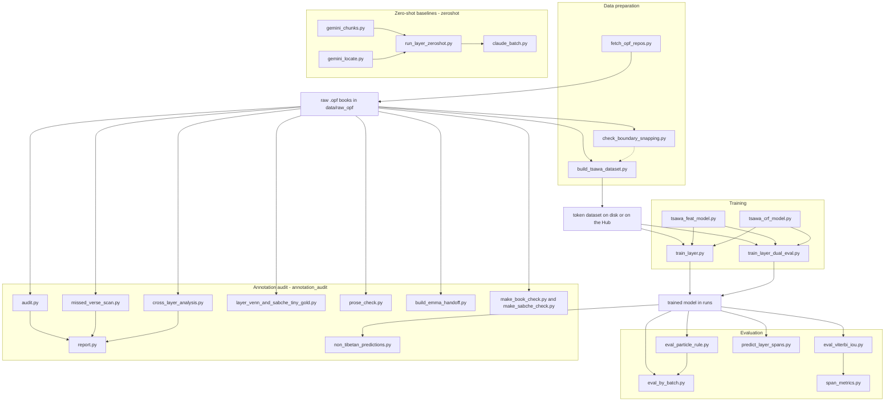

# common/ - scripts shared by the layer folders

`common/` holds the scripts that more than one layer uses: fetching the raw `.opf` books, the windowed token-classification dataset builder, the training loop, the Viterbi scorer, prediction dumping, the zero-shot LLM baselines, and the annotation audit. Each layer folder (`tsawa/`, `sabche/`, `chapter/`, `quotation/`, `yigchung/`, `title_author/`) keeps only its own data preparation and error analysis in its `src/` and calls into `common/` for the rest. The inference package that runs the published models is not here; it is [`../detect/`](../detect/), which carries its own copies of the windowing and Viterbi functions (`detect/windows.py`, `detect/decode.py`) so it does not depend on this folder. There are 26 Python scripts: 12 at the top level, 4 in `zeroshot/`, 10 in `annotation_audit/`.

How "Called by" was found: `grep -rIn` for each script name over every `.py`, `.md`, `.sh`, `.txt` and `.yaml` in the repo, outside `common/` (and inside `common/` for helpers). "no caller found" means nothing in this repo mentions it. `quotation/` has no code in this repo (it lives in `Webuddhist-tech/Tibetan-quotation-detection`), so its use of `common/` could not be checked from here.

## Flowchart



Solid arrows are data or imports verified in the code; the dotted arrow means the layer folders' own scripts (`tsawa/src/snap_tsawa_boundaries.py`, `sabche/src/clean_sabche_spans.py`, ...) import `check_boundary_snapping` helpers before building their datasets. `build_tsawa_dataset.py` is imported as a library by most layer dataset builders (see the table).

## Script reference

Run every command from the repo root.

### Data preparation

| Script | What it does | When to use it | How to run | Reads -> Writes | Called by (layer folders) |
|---|---|---|---|---|---|
| [`fetch_opf_repos.py`](fetch_opf_repos.py) | Clones OpenPecha `.opf` GitHub repos listed in an ID file (tries the `OpenPecha-Data` org by default, `gh` or plain git); fetch only, does not parse layers | first step, to get the books | `python common/fetch_opf_repos.py --ids-file data/ids/newdata.txt [--raw-dir data/raw_opf] [--batch TAG] [--org ORG] [--timeout 180] [--limit N] [--no-gh] [--no-skip-existing] [--dry-run]` | ID file -> `data/raw_opf/<ID>.opf/` and `data/raw_opf/_manifest.csv` | none in code; run from [`../docs/pipeline_and_data.md`](../docs/pipeline_and_data.md) |
| [`check_boundary_snapping.py`](check_boundary_snapping.py) | Diagnostic: checks that each tsawa span starts and ends on a syllable boundary (tsheg, shad, whitespace, document edge). Also exports helpers `BOUNDARY_CHARS`, `resolve_opf_root`, `check_span` | to audit span edges; its helpers are imported by the boundary scripts | `python common/check_boundary_snapping.py --audit-csv data/shared/tsawa_audit.csv --raw-opf-dir data/raw_opf --out tsawa/data/processed/boundary_check.csv` | audit CSV, raw `.opf` -> boundary CSV | tsawa (`src/snap_tsawa_boundaries.py`, `review_snap_diffs.py`, `resolve_overlaps.py`, `snap_quotation_boundaries.py`, `review_overlaps.py`), sabche (`src/clean_sabche_spans.py`), chapter (`src/clean_chapter_spans.py`) |
| [`build_tsawa_dataset.py`](build_tsawa_dataset.py) | Builds the windowed BIO token dataset from audited `.opf` repos (labels from `tsawa_spans_resolved.csv` by default; `--from-yaml` labels raw YAML); exports `label_tokens`, `pack_window`, `sliding_windows`, `special_token_ids`, `IGNORE_LABEL` | to make a training dataset; also imported as a library | `python common/build_tsawa_dataset.py [--raw-dir data/raw_opf] [--audit-csv data/shared/tsawa_audit.csv] [--source combined\|new\|old] [--tokenizer T] [--max-length 8192] [--stride 5120] [--seed 42] [--out-dir DIR] [--split-file CSV] [--quote-sidecar CSV] [--exclude-pechas IDS] [--ignore-spans-csv CSV] [--add-features] [--from-yaml] [--restrict-to-split] [--limit N]` | raw `.opf`, audit CSV, sidecar CSV -> a `DatasetDict` and `dropped_spans.csv` | tsawa (`src/build_v7_dataset.py` to `build_v10_dataset.py`, `patch_validation.py`, `push_tsawa_dataset.py`, `snap_quotation_boundaries.py`, `audit/tsawa_offset_correction_test.py`), sabche (`src/build_sabche_dataset.py`, `prepare_sabche_split.py`), chapter (`src/build_chapter_dataset.py`, `prepare_chapter_split.py`), yigchung (`src/build_genre_bio.py`), title_author (`src/ta_build_gold_dataset.py`, `ta_build_v3_addon.py`, `ta_strip_underscore.py`); `detect/` only cites it in docstrings |

### Training

| Script | What it does | When to use it | How to run | Reads -> Writes | Called by |
|---|---|---|---|---|---|
| [`train_layer.py`](train_layer.py) | The training loop for one layer (`--label-name`, default TSAWA; auxiliary quotation class; schemes from `SCHEMES`), class weights, Viterbi IoU@0.5 evaluation, early stopping | to train any layer model | `python common/train_layer.py --label-name CHAPTER --scheme bio --weight-scheme sqrt_inv --epochs 10 --output-dir runs/chapter` (other flags: `--dataset`, `--base-model`, `--break-penalty`, `--lr`, `--batch-size`, `--grad-accum`, `--weight-decay`, `--grad-clip`, `--warmup-ratio`, `--patience`, `--evals-per-epoch`, `--seed`, `--run-name`, `--use-features`, `--use-crf`, `--resume`, `--skip-test`, `--smoke-test`, `--no-bf16`, `--no-grad-checkpointing`) | dataset (local or Hub) -> checkpoints, `best/`, metrics under `--output-dir` | tsawa, sabche, chapter, yigchung, title_author (their READMEs and model cards give the command; no layer script imports it); `common/predict_layer_spans.py` imports it |
| [`train_layer_dual_eval.py`](train_layer_dual_eval.py) | A copy of `train_layer.py` plus `--classical-eval`: evaluates the `.opf` validation and `classical_validation` side by side, selects checkpoints only on the `.opf` score | tsawa dataset v8, which has the `classical_validation` and `classical_test` splits | same flags as `train_layer.py`, plus `--classical-eval` | as above | no caller found |
| [`tsawa_feat_model.py`](tsawa_feat_model.py) | mmBERT with 5-dimensional clause features for token classification | when training with `--use-features` on a dataset with a `features` column | imported, not run | - | `train_layer.py`, `train_layer_dual_eval.py`, `eval_by_batch.py` |
| [`tsawa_crf_model.py`](tsawa_crf_model.py) | mmBERT with a linear-chain CRF head | when training with `--use-crf` | imported, not run | - | `train_layer.py`, `train_layer_dual_eval.py` |

### Evaluation

| Script | What it does | When to use it | How to run | Reads -> Writes | Called by |
|---|---|---|---|---|---|
| [`eval_viterbi_iou.py`](eval_viterbi_iou.py) | Scores a model with Viterbi decoding and the team's IoU@0.5 span F1 (inclusive offsets, greedy one-to-one matching); `--sweep` tries break penalties | to score a model the way the other repos do | `python common/eval_viterbi_iou.py --model PATH_OR_REPO [--dataset Yontenn/formatting-tsawa-v6] [--split validation] [--break-penalty 2.0] [--sweep] [--batch-size 4] [--device cuda] [--limit N] [--out FILE.json] [--dump-spans FILE.jsonl]` | model, dataset -> metrics JSON, optional span dump | tsawa (`src/eval/rescore_masked.py` imports `score`; reads the `--dump-spans` file), chapter (`src/analyze_chapter_errors.py` reads its `--dump-spans` file) |
| [`eval_particle_rule.py`](eval_particle_rule.py) | Tests forbidding tsawa labels on closing particles (ཞེས་, ཅེས་, ...) at decode time, with no retraining; also defines `viterbi`, `spans`, `score`, `iou` | to test the particle rule; its helpers are imported | `python common/eval_particle_rule.py [--model Yontenn/mmbert-tsawa-bio-inv-v2] [--dataset ds_v2] [--split validation] [--break-penalty 12.0] [--device cuda] [--batch-size 4] [--limit N]` | model, dataset -> printed scores | tsawa (`src/eval/eval_merged.py`, `check_false_positives.py`, `show_old_fp.py`); `eval_by_batch.py` |
| [`eval_by_batch.py`](eval_by_batch.py) | Scores one tsawa model on validation, split by source batch (old versus new), to see whether a score gap is a data gap | to compare the old and new annotation batches | `python common/eval_by_batch.py [--model Yontenn/mmbert-tsawa-bio-inv-v2] [--dataset ds_v2] [--split validation] [--break-penalty 12.0] [--device cuda] [--batch-size 4]` | model, dataset -> printed scores per batch | no caller found |
| [`predict_layer_spans.py`](predict_layer_spans.py) | Saves every predicted token span (and the gold spans) per document, averaging window probabilities per token before Viterbi, as `train_layer.py` does in evaluation | to analyse a trained model's errors later | `python common/predict_layer_spans.py --label-name YIGCHUNG --model runs/yigchung/best --dataset REPO --splits validation --break-penalty 5.0 --out predictions_validation.json` | model, dataset -> predictions JSON | yigchung (`README.md`, `src/score_benchmark.py`, `src/analyze_predictions.py`) |
| [`span_metrics.py`](span_metrics.py) | Scores the same predictions under both "50% match" definitions (IoU at least 0.5, gold coverage at least 0.5) | to see how much the match definition changes F1 | `python common/span_metrics.py --csv scratch/tsawa/analysis/missed_v2_io_val_all.csv [--label NAME]` | the CSV written by `show_missed_spans.py` (not in this repo) -> printed table | no caller found |

### Zero-shot LLM baselines (`zeroshot/`)

These score a general LLM with no training: 16,000-character windows overlapping by 2,000, cut at a shad; the model returns span anchors, the locator turns them into offsets, and spans are scored at IoU 0.5.

| Script | What it does | When to use it | How to run | Reads -> Writes | Called by |
|---|---|---|---|---|---|
| [`zeroshot/run_layer_zeroshot.py`](zeroshot/run_layer_zeroshot.py) | Runs Gemini (or Anthropic with `--provider anthropic`) per window for a layer, caches each reply, and scores against gold; `--locate-only` re-scores a finished cache without an API call | to get the zero-shot baseline for tsawa, quotation, sabche or chapter. Paid unless `--locate-only` | `python common/zeroshot/run_layer_zeroshot.py --books P000084 ... [--layer tsawa\|quotation\|sabche\|chapter] [--out scratch/tsawa/zeroshot] [--model gemini-3.1-flash-lite] [--provider gemini\|anthropic] [--window 16000] [--overlap 2000] [--rpm 15] [--max-windows N] [--locate-only]` (needs `GEMINI_API_KEY`) | gold `.opf`, prompt -> per-window reply cache and scores | sabche (`results/README.md` scores with `--layer sabche --locate-only`); `claude_batch.py` runs it for scoring |
| [`zeroshot/claude_batch.py`](zeroshot/claude_batch.py) | Runs Claude on the test windows of sabche or chapter through the Message Batches API (half price), reusing the same windows, prompt and cache format. Nothing is sent without `--yes` | for a cheaper Claude baseline. Paid | `python common/zeroshot/claude_batch.py --layer chapter plan --groups 3`, then `... create --group g1 --books P000083 ... [--yes]`, `... poll --group g1`, `... fetch --group g1`; score with `run_layer_zeroshot.py --locate-only` | windows -> `scratch/<layer>/claude/` | sabche (`results/README.md` records the three batches) |
| [`zeroshot/gemini_chunks.py`](zeroshot/gemini_chunks.py) | Library: cuts text into chunks at shads and checks gold-span inclusion. Copied verbatim from the quotation benchmark repo | imported, not run | - | - | `run_layer_zeroshot.py` |
| [`zeroshot/gemini_locate.py`](zeroshot/gemini_locate.py) | Library: recovers book offsets from the LLM's span text (`str.find`, then a fuzzy fallback). Copied verbatim from the quotation benchmark repo | imported, not run | - | - | `run_layer_zeroshot.py`; documented in tsawa (`docs/prompts/gemini_tsawa_anchors.md`) |

#### Chapter baselines: how to run

The Chapter zero-shot results are in `chapter/results/zeroshot/`; this is how they were produced. The prompt is [`chapter/docs/prompts/gemini_chapter_anchors.md`](../chapter/docs/prompts/gemini_chapter_anchors.md), a draft written from train and validation books only.

`claude_batch.py` runs Claude Sonnet 5 on the test windows through the Message Batches API and writes a per-window cache. **It sends nothing without `--yes`, which spends money.**

```bash
python common/zeroshot/claude_batch.py --layer chapter plan --groups 3
python common/zeroshot/claude_batch.py --layer chapter create --group g1 --books ... [--yes]
python common/zeroshot/claude_batch.py --layer chapter poll --group g1
python common/zeroshot/claude_batch.py --layer chapter fetch --group g1
```

`run_layer_zeroshot.py` runs Gemini on 16,000-character windows (overlap 2,000) and scores the anchors against the gold at IoU 0.5. With `--locate-only` it only re-scores a finished cache. Other flags: `--provider gemini` or `anthropic`, `--model`.

```bash
python common/zeroshot/run_layer_zeroshot.py --layer chapter --books <ids> --out scratch/chapter/claude/test --locate-only
```

### Annotation audit (`annotation_audit/`)

Read-only checks on `data/raw_opf`; they write reports and CSVs next to the scripts. All run from the repo root. The one folder that mentions this directory is `tsawa/README.md` ("the shared audit that also covers sabche and chapter stays in `common/annotation_audit/`"); no script in a layer folder imports these, so they are run by hand when the data changes.

| Script | What it does | When to use it | How to run | Reads -> Writes |
|---|---|---|---|---|
| [`audit.py`](annotation_audit/audit.py) | Annotation audit over tsawa, sabche and chapter: commentary check, dropped books, short spans, cross-layer overlaps | first, to find suspect books | `python common/annotation_audit/audit.py` | raw `.opf` -> `tsawa_commentary_check.csv`, `tsawa_dropped_books.csv`, `short_spans.csv`, `cross_layer_overlaps.csv` |
| [`missed_verse_scan.py`](annotation_audit/missed_verse_scan.py) | Finds runs of 4 or more consecutive verse-metre clauses (7, 9, 11 or 13 syllables) that no tsawa span touches (possible missed tsawa) | to find under-annotated books | `python common/annotation_audit/missed_verse_scan.py` | raw `.opf` -> `missed_tsawa_by_book.csv`, `missed_tsawa_summary.md` |
| [`cross_layer_analysis.py`](annotation_audit/cross_layer_analysis.py) | Cross-layer analysis: commentary without tsawa verse, layer conflicts, an offset-shift test | to look at how layers disagree | `python common/annotation_audit/cross_layer_analysis.py` | raw `.opf` -> `cross_layer_analysis.md`, `commentary_no_tsawa_verse.csv`, `cross_layer_conflicts.csv`, `tsawa_offset_shift_test.csv` |
| [`layer_venn_and_sabche_tiny_gold.py`](annotation_audit/layer_venn_and_sabche_tiny_gold.py) | Tsawa/commentary four-way breakdown over all books, and tiny sabche gold spans per split | to size the tsawa/commentary overlap and spot tiny sabche labels | `python common/annotation_audit/layer_venn_and_sabche_tiny_gold.py` | raw `.opf` -> `layer_venn_and_sabche_tiny_gold.md`, `commentary_only_books.csv`, `sabche_tiny_gold.csv` |
| [`prose_check.py`](annotation_audit/prose_check.py) | For books with commentary but 0% tsawa overlap: does the tsawa text look like verse or prose | to triage the zero-overlap books | `python common/annotation_audit/prose_check.py` | raw `.opf` -> `zero_overlap_prose_check.csv` |
| [`report.py`](annotation_audit/report.py) | Combines the CSVs above into the audit report and lists under-annotated tsawa books (5 or fewer spans, 50 or more uncovered verse runs) | after the scripts above | `python common/annotation_audit/report.py` | the CSVs above -> `audit_report.md`, `under_annotated_tsawa_books.csv` |
| [`build_emma_handoff.py`](annotation_audit/build_emma_handoff.py) | Builds the tsawa re-annotation handoff lists (one problem book per line with what to do); dry run by default | to hand books to the annotator | `python common/annotation_audit/build_emma_handoff.py [--write]` | raw `.opf` -> `emma/train.txt`, `emma/eval.txt`, `emma/test.txt` (the folder also holds `book_ids.txt`, `train_books.txt`, `val_books.txt`; the scripts that write those were not identified) |
| [`make_book_check.py`](annotation_audit/make_book_check.py) | One-book HTML page with the tsawa spans highlighted | to read a book's flagged runs in context | `python common/annotation_audit/make_book_check.py P000078` | raw `.opf` -> an HTML page |
| [`make_sabche_check.py`](annotation_audit/make_sabche_check.py) | The same for sabche spans (never reads `Tsawa.yml`; handles the "Return to the table of contents" artifact) | to check sabche labels in a book | `python common/annotation_audit/make_sabche_check.py P000078 ...` | raw `.opf` -> an HTML page |
| [`non_tibetan_predictions.py`](annotation_audit/non_tibetan_predictions.py) | Counts predicted test spans with no Tibetan character, per layer | to measure that failure mode | `python common/annotation_audit/non_tibetan_predictions.py` | saved test predictions at paths hard-coded in the script (several under `scratch/` and the home folder, not in the repo) -> `non_tibetan_predictions.md` |

The CSV and Markdown files in `annotation_audit/` are the saved outputs of these scripts.

## Which layer uses what

| Layer | `common/` scripts it uses |
|---|---|
| tsawa | `build_tsawa_dataset.py`, `check_boundary_snapping.py`, `train_layer.py`, `eval_viterbi_iou.py`, `eval_particle_rule.py`, `zeroshot/gemini_locate.py` (documented), the audit in `annotation_audit/` |
| sabche | `build_tsawa_dataset.py`, `check_boundary_snapping.py`, `train_layer.py`, `zeroshot/run_layer_zeroshot.py`, `zeroshot/claude_batch.py` |
| chapter | `build_tsawa_dataset.py`, `check_boundary_snapping.py`, `train_layer.py`, `eval_viterbi_iou.py` (error analysis reads its dump) |
| yigchung | `build_tsawa_dataset.py`, `train_layer.py`, `predict_layer_spans.py` |
| title_author | `build_tsawa_dataset.py`, `train_layer.py` |
| quotation | not checkable here (code is in a separate repository) |
| detect | none at run time; it only cites `build_tsawa_dataset.py` and `eval_viterbi_iou.py` as the source of its copied functions |

## Folder layout

```
common/
  fetch_opf_repos.py          clone .opf repos from an ID file
  check_boundary_snapping.py  span-edge diagnostic and shared helpers
  build_tsawa_dataset.py      windowed BIO dataset builder and labelling helpers
  train_layer.py              training loop for every layer
  train_layer_dual_eval.py    train_layer.py plus classical validation
  tsawa_feat_model.py         mmBERT with clause features
  tsawa_crf_model.py          mmBERT with a CRF head
  eval_viterbi_iou.py         Viterbi plus IoU@0.5 scorer
  eval_particle_rule.py       closing-particle decode rule and shared scorer
  eval_by_batch.py            score split by old and new batch
  predict_layer_spans.py      dump predicted token spans per document
  span_metrics.py             IoU versus coverage match definitions
  zeroshot/                   LLM baselines (run_layer_zeroshot, claude_batch, gemini_chunks, gemini_locate)
  annotation_audit/           audit scripts, their CSV/Markdown outputs, and emma/ handoff lists
```

## Known issues

- Importing between scripts relies on `sys.path` (scripts import each other by bare module name, for example `from eval_particle_rule import ...`), so run or import them with `common/` on the path.
- `span_metrics.py` expects a CSV from `show_missed_spans.py`, which is not in this repo.
- `non_tibetan_predictions.py` reads prediction files from paths outside the repo; it cannot be re-run from a clean clone.
