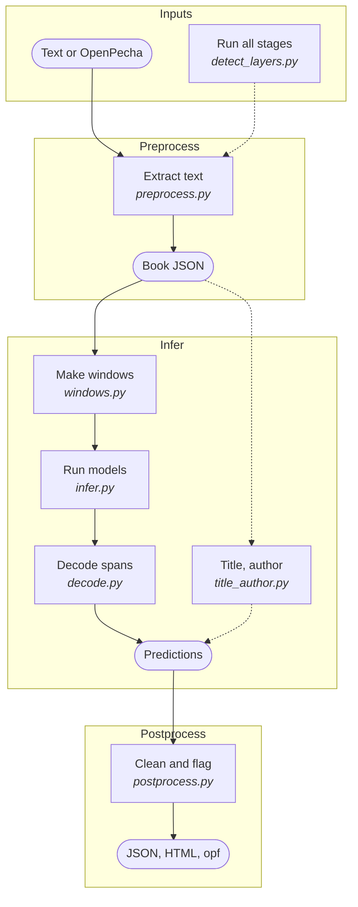

# Detect (inference package)

The installable Python package (`pip install .`, name `tibetan-layer-detection`) that runs the published per-layer models over a finished Tibetan text and returns or writes the predicted spans. It is not a layer: it is the last step of the whole system. Training and datasets live in the layer folders and in [common/](../common/); this package only loads the models they published and applies each model card's decoding settings. Three independent stages (preprocess, infer, postprocess), each with a console command, plus one command that runs all three.

- **In:** one `.txt` file, a folder of them, or OpenPecha book folders (anything with `base/v001.txt`).
- **Out:** per book a JSON (spans, confidence, `review_needed`), optionally HTML and OpenPecha `.opf` layers, plus a batch summary and a run log. Spans are end-exclusive character offsets into the Stage 1 text.
- **Python API:** `from detect import detect; detect("book.txt", layers=["all"])` runs the three stages in one process, with no checkpointing (use the commands for large batches).

## Folder layout

```
detect/
├── *.py        # the package: three stages, decoding, windows, config
└── tests/      # offline tests (stub tokenizer and LLM, no download)
```

## Hugging Face

Models it loads (repo ids from [layer_config.py](layer_config.py), visibility read from the Hub on 2026-11-18). A 404 means you need access from the owner; set `HF_TOKEN` or run `huggingface-cli login`.

| Use | Repo | Visibility |
|---|---|---|
| tsawa | [BDRC/Bo-Tsawa-Detection](https://huggingface.co/BDRC/Bo-Tsawa-Detection) | public |
| sabche | [BDRC/Bo-Sabche-Detection](https://huggingface.co/BDRC/Bo-Sabche-Detection) | private |
| chapter | [BDRC/Bo-Chapter-Detection](https://huggingface.co/BDRC/Bo-Chapter-Detection) | private |
| quotation | [BDRC/Bo-Quotation-Detection](https://huggingface.co/BDRC/Bo-Quotation-Detection) | private |
| yigchung | [BDRC/Bo-Yigchung-Detection](https://huggingface.co/BDRC/Bo-Yigchung-Detection) | public |
| title | [BDRC/Bo-Title-Detection](https://huggingface.co/BDRC/Bo-Title-Detection) | private |
| author | [BDRC/Bo-Author-Detection](https://huggingface.co/BDRC/Bo-Author-Detection) | private |
| title and author, one joint model (optional) | [Yontenn/mmbert-title-author-run2](https://huggingface.co/Yontenn/mmbert-title-author-run2) | private |
| tokenizer fallback | [jhu-clsp/mmBERT-base](https://huggingface.co/jhu-clsp/mmBERT-base) | public |

The fallback tokenizer is used when a model's own `tokenizer_config.json` cannot be parsed by the installed `transformers`. The old 15-label `BDRC/Bo-Multilayer-Detection` is deliberately not used.

## Pipeline



Squares are steps with the script that runs them; rounded boxes are files; dashed arrows are optional or on request. Settings per layer are in [layer_config.py](layer_config.py).

## Main pipeline

Console commands are in `pyproject.toml`: `tibetan-preprocess`, `tibetan-infer`, `tibetan-postprocess`, `tibetan-detect`.

| Script | What it does | When to run |
|---|---|---|
| [preprocess.py](preprocess.py) | Stage 1: finds books, writes one JSON each. | First |
| [infer.py](infer.py) | Stage 2: runs the models, writes spans. | After Stage 1 |
| [postprocess.py](postprocess.py) | Stage 3: cleans, flags, writes JSON, HTML, `.opf`. | After Stage 2 |
| [detect_layers.py](detect_layers.py) | Runs all three stages under one folder. | Instead of the three |
| [decode.py](decode.py) | Viterbi decoding, confidence, window merging, cleanup rules. | Used by Stage 2 |
| [windows.py](windows.py) | Token windows of 8,190 tokens. | Used by Stage 2 |
| [title_author.py](title_author.py) | Title and author from the first and last 3,000 characters. | Stage 2, if requested |
| [layer_config.py](layer_config.py) | Repo, break penalty, stride, cleanup, threshold per layer. | Imported by Stages 2, 3 |
| [\_\_init\_\_.py](__init__.py) | The `detect()` Python function. | From Python |

## How to run

All commands run from the repository root.

```bash
# 0. Install (Python 3.9+; needs transformers, torch, pyyaml, numpy)
pip install .
# 1. One book, every layer, JSON and HTML
tibetan-detect --text book.txt --all --json --html --out results/
# 2. A folder, two layers
tibetan-detect --dir books/ --layers tsawa sabche --json --out results/
# 3. The three stages separately (resumable: a book with a predictions file is skipped)
tibetan-preprocess --input data/raw_opf/ --out preprocessed/
tibetan-infer --input preprocessed/ --out predictions/ --all --device cuda
tibetan-postprocess --input predictions/ --source preprocessed/ --out output/ --json --html --opf
# 4. Title from the model, author from the paid LLM skill (about Rs 0.29 per work)
tibetan-infer --input preprocessed/ --out predictions/ --layers title author \
    --title-system model --author-system skill
```

**The infer checkpoint only checks that `predictions/<id>.json` exists: after adding a layer, use a new `--out`.**

## Optional tools

- **Tests**: offline, no download. `python3 -m unittest discover -s detect/tests -p "test_*.py"`
- **Dual window**: runs each layer twice (full and half window) and flags disagreements, about twice the time. `tibetan-infer ... --dual-window`
- **Keep quoted tsawa**: Stage 3 drops tsawa spans covered 50% or more by predicted quotation. `tibetan-postprocess ... --keep-quoted-tsawa`

## Title and author

Not window layers: one forward pass over the first and last 3,000 characters gives one title (first span) and one author (last span). `--title-author-system model|skill|both` (or `--title-system`, `--author-system`) chooses the system per field; the skill is paid and needs `GEMINI_API_KEY` or `ANTHROPIC_API_KEY`. Test share correct (2,384 works): title model 0.842; author model 0.734, skill 0.756. Details are in the docstrings of [title_author.py](title_author.py) and [layer_config.py](layer_config.py), which also holds the per-layer decoding table.

## Known issues

<details><summary>Show 5 known issues</summary>

- `tibetan-detect` has no `--skip-quotation` option, although `tibetan-infer` has: through `tibetan-detect` the quotation model always runs when `tsawa` is selected.
- The infer checkpoint checks only that the predictions file exists, not which layers it holds.
- Yigchung is weak: test F1 0.471 on the published 77-book text (its card); treat its output as candidates for review. `infer.py` prints this caveat when the model loads.
- The sabche shad rule (drop a span under 8 characters unless a shad follows) is marked in `layer_config.py` as "shipped pending validation": it was tuned on the test split, so its gain (F1 0.9652 to 0.9665) is in-sample.
- A code comment in `layer_config.py` says all models are private; tsawa and yigchung are public (see the table above). Title and author review thresholds (0.7) are an untuned placeholder.

</details>

## All files

<details><summary>Show the full file tree</summary>

```
detect/
├── README.md
├── __init__.py         # detect(): the three stages in one process
├── preprocess.py       # Stage 1: text or .opf to preprocessed/<id>.json
├── infer.py            # Stage 2: windows, models, decoding, predictions/<id>.json
├── postprocess.py      # Stage 3: drop short, quoted and non-Tibetan spans; flags; JSON, HTML, .opf
├── detect_layers.py    # tibetan-detect: the three stages under one --out
├── decode.py           # BIO and BIOE Viterbi, confidence, window votes, cleanup rules
├── windows.py          # sliding windows and window packing (copied from common/)
├── title_author.py     # title and author: head and tail crop, model or LLM skill
├── layer_config.py     # LAYERS: repo, scheme, break penalty, stride, cleanup, threshold, colour
└── tests/
    ├── test_drop_quoted_tsawa.py  # tsawa spans covered by quotation are dropped; layers_for_run
    ├── test_non_tibetan.py    # spans with no Tibetan text are dropped
    ├── test_shad_rule.py      # sabche shad rule
    └── test_title_author.py   # title/author, stub tokenizer and LLM
```

</details>
