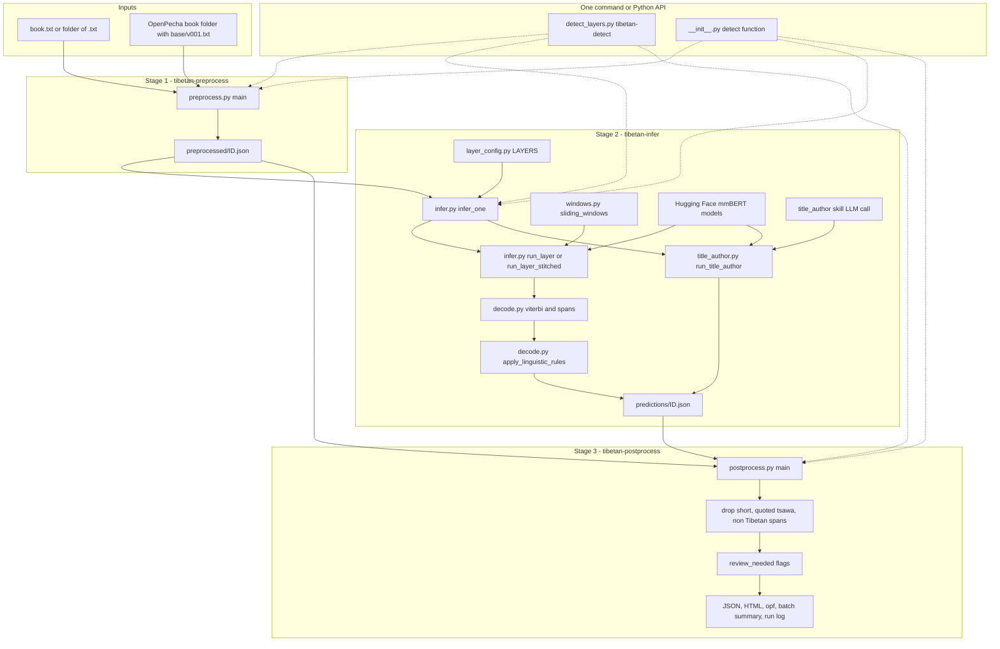

# detect/ - the inference package

`detect/` is the installable Python package (`pip install .`, name `tibetan-layer-detection`) that runs the published per-layer models over a finished Tibetan text and returns or writes the predicted spans. It is the last step of the whole system: training and datasets live in the layer folders (`tsawa/`, `sabche/`, `chapter/`, `quotation/`, `yigchung/`, `title_author/`) and in [`../common/`](../common/); this package only loads the models they published and applies the decoding settings that each model's own Hugging Face card documents. The pipeline has three independent stages (preprocess, infer, postprocess), each with its own console command, plus one command that runs all three.

## Hugging Face models it loads

Repo ids are copied from [`layer_config.py`](layer_config.py). "Anonymous API check" is the HTTP status of `https://huggingface.co/api/models/<repo>` called without a token on 2026-11-17: 200 means readable without login, 401 means a token is needed (private or gated). Set `HF_TOKEN` (or run `huggingface-cli login`) before running the private ones.

| Layer / use | Repo | Link | Anonymous API check |
|---|---|---|---|
| tsawa | `BDRC/Bo-Tsawa-Detection` | [link](https://huggingface.co/BDRC/Bo-Tsawa-Detection) | 200 |
| sabche | `BDRC/Bo-Sabche-Detection` | [link](https://huggingface.co/BDRC/Bo-Sabche-Detection) | 401 |
| chapter | `BDRC/Bo-Chapter-Detection` | [link](https://huggingface.co/BDRC/Bo-Chapter-Detection) | 401 |
| quotation | `BDRC/Bo-Quotation-Detection` | [link](https://huggingface.co/BDRC/Bo-Quotation-Detection) | 401 |
| yigchung | `BDRC/Bo-Yigchung-Detection` | [link](https://huggingface.co/BDRC/Bo-Yigchung-Detection) | 200 |
| title | `BDRC/Bo-Title-Detection` (`TITLE_MODEL`) | [link](https://huggingface.co/BDRC/Bo-Title-Detection) | 401 |
| author | `BDRC/Bo-Author-Detection` (`AUTHOR_MODEL`) | [link](https://huggingface.co/BDRC/Bo-Author-Detection) | 401 |
| title and author, joint model (optional, `--title-model` / `--author-model`) | `Yontenn/mmbert-title-author-run2` (`JOINT_MODEL`) | [link](https://huggingface.co/Yontenn/mmbert-title-author-run2) | 401 |
| tokenizer fallback | `jhu-clsp/mmBERT-base` | [link](https://huggingface.co/jhu-clsp/mmBERT-base) | 200 |

The tokenizer fallback is used when a model's own `tokenizer_config.json` cannot be parsed by the installed `transformers` (`infer.load_layer_model`), and `title_author.BASE_TOKENIZER` names it for the title/author crop. `BDRC/Bo-Multilayer-Detection` (the old 15-label joint model) is deliberately not used (see the `layer_config.py` docstring).

## Flowchart



Dotted arrows: `tibetan-detect` and `detect.detect()` call the three stages' `main()` in turn with intermediate folders `preprocessed/`, `predictions/`, `output/` under `--out`; they hold no detection logic of their own.

## Console commands (`pyproject.toml`)

| Command | Entry point | What it does |
|---|---|---|
| `tibetan-preprocess` | `detect.preprocess:main` | Stage 1: text files to one JSON per book |
| `tibetan-infer` | `detect.infer:main` | Stage 2: run the models, write spans per book |
| `tibetan-postprocess` | `detect.postprocess:main` | Stage 3: clean, flag, write JSON / HTML / .opf |
| `tibetan-detect` | `detect.detect_layers:main` | all three in one command |

Install: `pip install .` from the repo root (dependencies: `transformers`, `torch`, `pyyaml`, `numpy`; Python 3.9 or newer).

## Modules

| Module | What it does | When it runs |
|---|---|---|
| [`preprocess.py`](preprocess.py) | Finds inputs (a `.txt`, or any `base/v001.txt` at any depth), derives the book id (for `base/v001.txt` the grandparent folder name minus `.opf`, otherwise the file stem), reads UTF-8 (falls back to `errors="replace"` with a warning, skips empty or unreadable files), writes `{book_id, source_path, text, char_count, encoding, errors}` | Stage 1, once per book |
| [`windows.py`](windows.py) | `sliding_windows` (token windows of `content_len` with a stride, last window flush right), `special_token_ids`, `pack_window_for_inference` (CLS + tokens + SEP, padded, no labels). Copied from `common/build_tsawa_dataset.py` so the package does not need its dependencies | Stage 2, for every window layer |
| [`infer.py`](infer.py) | Loads each layer's model (cached for the run), windows the text (8,190 content tokens, max length 8,192), runs the model, decodes, cleans up, writes `predictions/<id>.json`. Skips a book whose prediction file already exists (checkpoint: file existence only, not which layers it holds). Adds `quotation` automatically when `tsawa` is requested (unless `--skip-quotation`) so Stage 3 can drop quoted tsawa | Stage 2 |
| [`decode.py`](decode.py) | BIO Viterbi (`viterbi`, `spans_from_bio`), BIOE Viterbi for quotation (`viterbi_bioe`, `spans_from_bioe`), softmax and span confidence, union merge of overlapping-window spans with window votes (2 or more windows agree: confidence +0.1, capped at 1.0; one window although another covered the text: -0.05), the cleanup rules in `apply_linguistic_rules`, and `merge_dual_window` | Stage 2, after each model call |
| [`title_author.py`](title_author.py) | The title/author layers: crop first and last 3,000 characters, one sequence, Viterbi, one title (first span) and one author (last span), and the model/skill choice (see below) | Stage 2, only when `title` or `author` is requested |
| [`layer_config.py`](layer_config.py) | `LAYERS` (per-layer repo, label scheme, break penalty, stride, colour, cleanup switches, review threshold), `TitleAuthorOptions`, the title/author repo ids | imported by Stages 2 and 3 |
| [`postprocess.py`](postprocess.py) | Joins predictions with the Stage 1 text; drops spans under 5 characters, tsawa spans covered at least 50% by predicted quotation spans (`--keep-quoted-tsawa` turns this off), and spans with no Tibetan character; sets `review_needed`; writes JSON, HTML, OpenPecha `.opf` layers, `_batch_summary.json` and a timestamped run log | Stage 3 |
| [`detect_layers.py`](detect_layers.py) | Runs the three stages in order under one `--out` | on demand, `tibetan-detect` |
| [`__init__.py`](__init__.py) | `detect(path, layers="all", ...)`: the same three stages in one process, returns the result dict (one book) or a list (a folder). No checkpointing, so use the console commands for large batches | on demand, from Python |
| [`tests/`](tests/) | `test_drop_quoted_tsawa.py`, `test_non_tibetan.py`, `test_shad_rule.py`, `test_title_author.py` (offline: stub tokenizer, stub LLM, no download) | `python -m unittest discover -s detect/tests` from the repo root |

### Decoding steps inside Stage 2

1. Tokenise the whole book with offset mapping and build windows (`sliding_windows`) of 8,190 tokens at the layer's stride.
2. Per window: logits, then BIO or BIOE Viterbi with the layer's `break_penalty`, then token spans mapped to character spans, with a softmax-based confidence.
3. Merge spans from overlapping windows (`merge_spans_with_votes`). Yigchung differs (see the next section).
4. `apply_linguistic_rules`, in this order: extend a short stub to the closing bracket, extend to the next tsheg, merge spans separated by a short punctuation gap, repair nested fragments, the shad rule, drop spans under 5 characters, drop spans with no Tibetan text. Which of these run is set per layer.
5. With `--dual-window`, steps 1 to 4 run twice (full and half window and stride) and `merge_dual_window` marks each span `both`, `full_only` or `half_only` (IoU 0.5); disagreement makes a span `review_needed`. It roughly doubles inference time.

## `layer_config.py`: how decoding differs per layer

Values below are read from `LAYERS` in [`layer_config.py`](layer_config.py); each carries a `source` string naming the model card file it came from.

| Layer | Scheme | Break penalty | Stride | Cleanup switches that differ from the default | Review threshold |
|---|---|---|---|---|---|
| tsawa | bio | 4.0 | 5120 | default (extend to tsheg and merge small gaps on) | 0.5 |
| sabche | bio | 4.0 | 5120 | extend to tsheg off, merge small gaps off, repair fragments on, shad rule on | 0.85 |
| chapter | bio | 4.0 | 5120 | extend to tsheg off, merge small gaps off, extend short stub to closing bracket on | 0.75 |
| quotation | bioe | 0.0 | 3613 | default | 0.65 |
| yigchung | bio | 1.0 | 4914 | default; `stitch_first_window` on | 0.5 |
| title | ta (labels read from the model) | 6.0 | none (`head_tail`) | extend to tsheg off, merge small gaps off | 0.7 |
| author | ta | 6.0 | none (`head_tail`) | same as title | 0.7 |

Notes taken from the code comments:

- Yigchung is decoded once over the whole book: a token's logits come only from the first window that covers it, matching how overlap was masked at training time (`infer.run_layer_stitched`). Its window votes are always 1. Its own card says to cite test F1 0.431, and `infer.py` prints that caveat when the model loads.
- Sabche and chapter turn off two default cleanup rules because they lowered F1 on their test sets (comments in `layer_config.py`). The sabche shad rule (drop a span under 8 characters unless a shad follows) is marked in the code as "shipped pending validation, not confirmed": it was tuned on the test split, so its gain (F1 0.9652 to 0.9665) is in-sample.
- `--review-threshold` overrides every layer; without it each layer uses its own `default_review_threshold`. The title and author thresholds (0.7) are marked in the code as an untuned placeholder.
- Layer colours for the HTML output are also in `LAYERS`.

## Title and author: model or skill

Title and author are not window layers. `title_author.py` builds one sequence, `[CLS] first 3,000 characters [SEP] last 3,000 characters [SEP]` (a work of 6,000 characters or fewer is one block), runs one forward pass, decodes with Viterbi (penalty 6 for a single-entity model, 12 for the joint model), and keeps one span per field: the first title span and the last author span. Spans are exact substrings of the input.

Two systems can answer, chosen per field by `TitleAuthorOptions` (`layer_config.py`):

| System | What it is | Cost |
|---|---|---|
| `model` (default) | `BDRC/Bo-Title-Detection` and `BDRC/Bo-Author-Detection`, one forward pass each; or the joint `Yontenn/mmbert-title-author-run2`, one pass for both fields if both options point at it | free, local |
| `skill` | the LLM skill in `../title_author/skills/tibetan-title-author/scripts/` (`title_author_skill.py`), imported only when used; default LLM `gemini-3.8-flash`; keys `GEMINI_API_KEY` or `ANTHROPIC_API_KEY` from the environment | paid, one call per book; `infer.py` prints an estimate of about Rs 0.29 per work at the batch price before the run |

The choice is fixed per field by flags, not decided per work by a rule:

- `--title-author-system model|skill|both` (default `model`): `both` runs the two systems side by side, as `title` / `author` from the model and `title_skill` / `author_skill` from the skill, and sets `systems_agree` (IoU of at least 0.5) on each span.
- `--title-system` and `--author-system` (`model` or `skill`) pick one system per field and cannot be combined with `both`. The comment in `layer_config.py` records that title from the model plus author from the skill scored best on the test split of 2,384 works (title 0.842, author 0.756); the joint model scored 0.833 and 0.711, the single-field models 0.842 and 0.734.
- If the skill fails the field gets an error entry; there is no silent fallback to the model.
- Review flags: a model span is flagged by confidence against the threshold; a skill span has no confidence, so it is flagged only when the skill itself set `review_needed` (its reasons go into `review_reasons`).
- `.opf` output for title and author is not implemented: `--title-author-opf` stops with an error and `--opf` writes the other layers only.

The skill itself (modes, flags, server) is documented in [`../title_author/`](../title_author/).

## Examples

```bash
# one book, every layer, JSON and HTML
tibetan-detect --text book.txt --all --json --html --out results/

# a folder, two layers
tibetan-detect --dir books/ --layers tsawa sabche --json --out results/

# the three stages by hand (resumable: a book with an existing predictions file is skipped)
tibetan-preprocess --input data/raw_opf/ --out preprocessed/
tibetan-infer --input preprocessed/ --out predictions/ --all --device cuda
tibetan-postprocess --input predictions/ --source preprocessed/ --out output/ --json --html --opf

# title from the model, author from the paid skill
tibetan-infer --input preprocessed/ --out predictions/ --layers title author \
    --title-system model --author-system skill
```

```python
from detect import detect
result = detect("book.txt", layers=["all"])
result["layers"]["sabche"]   # [{"start": ..., "end": ..., "confidence": ..., "review_needed": ...}, ...]
```

Spans are end-exclusive character offsets into the Stage 1 text.

## Known issues

- The docstring at the top of `layer_config.py` says it is shared by `common/infer.py` and `common/postprocess.py`; the files are `detect/infer.py` and `detect/postprocess.py` (comment only).
- `tibetan-detect` has no `--skip-quotation` option, although `tibetan-infer` has; through `tibetan-detect` the quotation model always runs when `tsawa` is selected.
- The checkpoint in `tibetan-infer` checks only that `predictions/<id>.json` exists. If you add a layer later, delete that file or use a new `--out`.
- Yigchung's model is weak (test F1 0.431 per its own card); treat its output as candidates for review.
