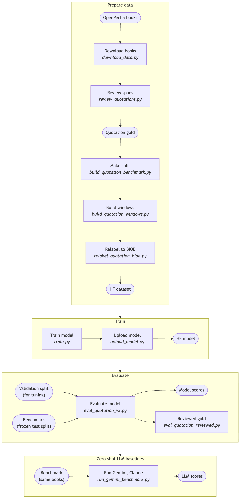

# Quotation

Finds **quotation spans** in classical Tibetan commentaries: a passage where one text quotes a scripture, a named teacher, or a stock phrase. One token classifier (labels `O`, `B`, `I`, `E`), fine-tuned from `jhu-clsp/mmBERT-base` on 8,192-token sliding windows. The folder also holds the zero-shot Gemini and Claude benchmark on the same test books. The code was copied from [WeBuddhist/Tibetan-quotation-detection](https://github.com/WeBuddhist/Tibetan-quotation-detection) (branch `master`, commit `f817c33`) and renamed to this repository's conventions; the raw Gemini replies stay there.

- **In:** the OpenPecha books named in the Tsadra list, with their `Quotation` layers.
- **Out:** a dataset and a model on Hugging Face (see below), and score tables in [results/](results/).
- **In the whole system:** `detect/` runs this model on a text (the `quotation` entry in [layer_config.py](../detect/layer_config.py)).

## Folder layout

```
quotation/
├── src/            scripts, and quotation_lib/ (the library they import)
├── configs/        training and window-building configs
├── prompts/        the Gemini prompts (current, early and plain)
├── docs/           model card, dataset card, encoder and zero-shot write-ups
├── results/        score tables and saved model outputs (QUDT, reviewed gold, zero-shot benchmark)
└── tests/          pytest suite for the library
```

## Hugging Face

| | Repo | Visibility |
|---|---|---|
| Model | [BDRC/Bo-Quotation-Detection](https://huggingface.co/BDRC/Bo-Quotation-Detection) ([card](docs/model_card.md)) | private |
| Dataset (train, validation) | [BDRC/Bo-Quotation-Dataset](https://huggingface.co/datasets/BDRC/Bo-Quotation-Dataset) ([card](docs/dataset_card.md)) | private |
| Benchmark (test, 19 books) | [BDRC/Bo-Quotation-Benchmark](https://huggingface.co/datasets/BDRC/Bo-Quotation-Benchmark) ([card](docs/benchmark_card.md)) | public |

Model read from the Hub on 2026-11-18, datasets on 2026-11-25. A 404 on a private repo means you need access from the owner. The old dataset name `karma689/tibetan-quotation-detection` redirects, and the training config still uses it at the pinned revision `w2.0`, which still holds the test files; the current main branch of the training repo has train and validation only.

## Pipeline



<sub>Chart source: [pipeline.mmd](docs/pipeline.mmd)</sub>

Squares are steps with the script that runs them; rounded boxes are files; dashed arrows are optional steps. The **benchmark** is the frozen test split (19 books): it is scored once and never used to tune. The zero-shot LLM runs use the same 19 books. Dataset uploads use the `--push` flag of the data scripts.

## Main pipeline

| Script | What it does | When to run |
|---|---|---|
| [fetch_quotation_books.py](src/fetch_quotation_books.py) | Downloads the OpenPecha books of the Tsadra list. | First, on a new machine. |
| [review_quotation_spans.py](src/review_quotation_spans.py) | Keyboard review of books and flagged spans; exports gold. | After download; before the split. |
| [build_quotation_benchmark.py](src/build_quotation_benchmark.py) | Dedupes books and makes the train, validation, test split. | After the gold export. |
| [build_quotation_windows.py](src/build_quotation_windows.py) | Tokenizes books into 8,192-token windows with BIO labels. | After the split; optional. |
| [relabel_quotation_bioe.py](src/relabel_quotation_bioe.py) | Relabels the BIO windows to BIOE. | After windowing. |
| [setup_quotation_train_env.sh](src/setup_quotation_train_env.sh) | Sets up conda, torch and Flash Attention on Vast.ai. | Once per new GPU machine. |
| [train_quotation_model.py](src/train_quotation_model.py) | Fine-tunes mmBERT-base with a boundary-weighted loss. | On a GPU machine. |
| [eval_quotation_model.py](src/eval_quotation_model.py) | Sweeps the decode, scores IoU@0.5 span F1. | After training; validation first. |
| [upload_quotation_model.py](src/upload_quotation_model.py) | Uploads the checkpoint, metrics and card to the Hub. | After evaluation. |

The training script reads [train_quotation_model.yaml](configs/train_quotation_model.yaml) (learning rate 1e-5, batch 2 with 4 accumulation, 15 epochs, bf16, class weights O 0.07, B 5.0, I 1.0, E 5.0, seed 42, best model by validation IoU@0.5 F1, early stopping 4 epochs).

## How to run

Run from the repository root; `quotation/Data/` is gitignored. Install with `pip install -r quotation/requirements.txt` (Python 3.10 or newer).

```bash
# 1. Download the corpus
python quotation/src/fetch_quotation_books.py
# 2. Review the annotations, then export the usable set
python quotation/src/review_quotation_spans.py
python quotation/src/review_quotation_spans.py --export
# 3. Make the book-level split (add --push to upload)
python quotation/src/build_quotation_benchmark.py
# 4. Build the BIO windows (step 4579 despite the step 4751 in an older name)
python quotation/src/build_quotation_windows.py --config quotation/configs/build_quotation_windows.yaml
# 5. Relabel to BIOE and push (config windowed_w8192_s4579_bioe, tag w2.0)
python quotation/src/relabel_quotation_bioe.py --push
# 6. Train on a 24 GB GPU (Vast.ai: bash quotation/src/setup_quotation_train_env.sh first). Steps 3 to 5 can be skipped: training uses the published windows.
python quotation/src/train_quotation_model.py --prepare-only && python quotation/src/train_quotation_model.py --smoke && python quotation/src/train_quotation_model.py
# 7. Choose the decode on validation, then score test with it frozen
python quotation/src/eval_quotation_model.py --config quotation/configs/train_quotation_model.yaml \
    --checkpoint quotation/outputs/final --split validation
python quotation/src/eval_quotation_model.py --config quotation/configs/train_quotation_model.yaml \
    --checkpoint quotation/outputs/final --split test --tune-on validation
# 8. Upload the model
python quotation/src/upload_quotation_model.py --config quotation/configs/train_quotation_model.yaml --repo <owner/name> --private
```

**The training script refuses a dataset revision that is not pinned.**

## Optional tools

- **Reviewed gold test set**: turns the human review YAMLs of the 19 test books into a gold test set (tag `w2.1`). `python quotation/src/build_quotation_reviewed_benchmark.py` (add `--push`, with `HF_TOKEN` set, to upload)
- **Score on reviewed gold**: scores a checkpoint on the original and the reviewed gold in one pass. `python quotation/src/eval_quotation_reviewed.py --config quotation/configs/train_quotation_model.yaml --checkpoint <folder or Hub id>`
- **DharmaBench QUDT**: scores on the external QUDT task (406 short documents). `python quotation/src/eval_quotation_dharmabench.py --config quotation/configs/train_quotation_model.yaml --checkpoint quotation/outputs/checkpoint-6562`
- **Gemini and Claude benchmark**: three-model LLM comparison on the 19 test books, needs `GEMINI_API_KEY` (and `ANTHROPIC_API_KEY` for Claude). `python quotation/src/run_quotation_zeroshot.py {build-units,preflight,freeze,run,claude-batch,locate,score} --split test --source units`. Results go to [results/zeroshot/](results/zeroshot/results.md).
- **One-book Gemini debugging**: `python quotation/src/extract_quotation_gemini.py --book P000152 --prompt quotation/prompts/quotation_anchor_prompt.md --chunked --out quotes.json`, then `python quotation/src/check_quotation_gemini.py --book P000152 --quotes quotes.json`. 
- **Tests**: `cd quotation && python -m pytest tests`

Write-ups with the numbers: [encoder-model.md](docs/encoder-model.md) and [zero-shot.md](docs/zero-shot.md).

## Results

Encoder: test set (19 books), IoU@0.5, Viterbi decode chosen on validation and frozen, per window in tokens (from the [model card](docs/model_card.md)). LLM rows: character-level IoU@0.5 on the same 19 books, stitch on (from [zero-shot.md](docs/zero-shot.md)); not the same basis, so do not compare the two blocks number for number.

| Model | F1 | P | R |
|---|---|---|---|
| Bo-Quotation-Detection (mmBERT-base, BIOE) | 0.853 | 0.831 | 0.876 |
| gemini-3.1-flash-lite, zero-shot | 0.696 | 0.595 | 0.838 |
| gemini-3.5-flash-lite, zero-shot | 0.649 | 0.530 | 0.839 |
| claude-sonnet-5 (250k units), zero-shot | 0.454 | 0.714 | 0.333 |

`gemini-3.8-flash` is also a benchmark choice (`run`); the source README says it is not scored yet.

## All files

<details><summary>Show the full file tree</summary>

```
quotation/
├── README.md
├── requirements.txt
├── pytest.ini
├── configs/
│   ├── train_quotation_model.yaml        # training config
│   ├── build_quotation_windows.yaml      # window geometry (step 4579)
│   └── build_quotation_windows_alt.yaml  # alternative window set (hub tag, masked layers)
├── prompts/
│   ├── quotation_anchor_prompt.md        # current Gemini anchor prompt
│   ├── quotation_anchor_prompt_early.md  # first anchor prompt, behind the early one-book pilots
│   └── quotation_plain_prompt.md         # plain prompt, default of extract_quotation_gemini.py
├── src/
│   ├── fetch_quotation_books.py          # download OpenPecha books of the Tsadra list
│   ├── review_quotation_spans.py         # keyboard review tool; --export writes the gold
│   ├── build_quotation_benchmark.py      # dedupe, merge, book-level split, leakage audit
│   ├── build_quotation_windows.py        # 8192-token windows, BIO labels
│   ├── relabel_quotation_bioe.py         # BIO -> BIOE windows
│   ├── build_quotation_reviewed_benchmark.py  # reviewed gold test set (tag w2.1)
│   ├── setup_quotation_train_env.sh      # conda, torch, Flash Attention on Vast.ai
│   ├── train_quotation_model.py          # fine-tune mmBERT, boundary-weighted loss
│   ├── eval_quotation_model.py           # decode sweep and IoU@0.5 scoring
│   ├── eval_quotation_reviewed.py        # score on original and reviewed gold
│   ├── eval_quotation_dharmabench.py     # external QUDT benchmark
│   ├── upload_quotation_model.py         # publish checkpoint, metrics, card
│   ├── run_quotation_zeroshot.py         # Gemini and Claude benchmark, subcommands
│   ├── extract_quotation_gemini.py       # one book through a Gemini prompt
│   ├── check_quotation_gemini.py         # locate and score Gemini quotes
│   └── quotation_lib/                    # library: windowing, BIOE, metrics, Gemini benchmark, uploads
├── docs/                                 # cards, pipeline chart, encoder-model.md, zero-shot.md
├── results/                              # QUDT metrics and predictions, reviewed-gold scores, zero-shot scores and raw LLM replies
└── tests/                                # pytest suite for quotation_lib
```

</details>
