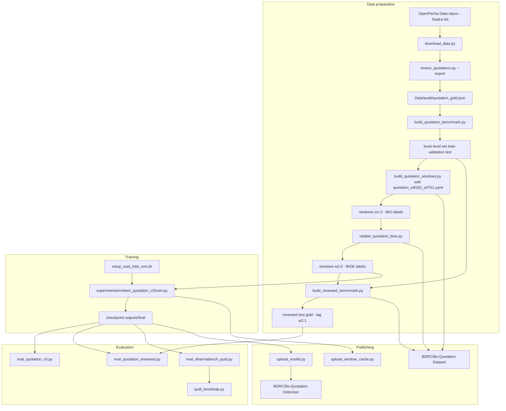
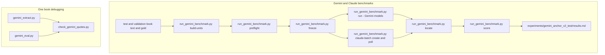

# Quotation

> **The code for this layer is not in this repository.** It lives in
> [Webuddhist-tech/Tibetan-quotation-detection](https://github.com/Webuddhist-tech/Tibetan-quotation-detection)
> (scripts in `script/`, library in `src/layer_detection/`, training in `experiments/mmbert_quotation_v3/`,
> write-ups in `docs/`). Every script path below is a path in that repository, not in this one.
> This folder holds the Hugging Face cards, the model and dataset names, and this guide to the other repository.

One token-classification model that marks quotation spans in classical Tibetan commentaries (one text quoting a scripture, a named teacher, or a stock phrase). It is one of the layers of the system; `detect/` in this repository loads `BDRC/Bo-Quotation-Detection` like the other layers.

The other repository holds two approaches side by side: a fine-tuned encoder (mmBERT-base, BIOE labels, 8192-token sliding windows) and LLM prompting (Gemini and Claude asked to pull quotations out of a page, then matched back to character offsets). Both are scored on the same 19 test books, so they can be compared.

## Hugging Face

| | Repo | Visibility |
|---|---|---|
| Dataset | [BDRC/Bo-Quotation-Dataset](https://huggingface.co/datasets/BDRC/Bo-Quotation-Dataset) | public |
| Model | [BDRC/Bo-Quotation-Detection](https://huggingface.co/BDRC/Bo-Quotation-Detection) | private |

Visibility was read from the Hub on 2026-11-17 (dataset: `private: false`; model: the API refuses an anonymous request, so it is private).

Cards: [`docs/dataset_card.md`](docs/dataset_card.md), [`docs/model_card.md`](docs/model_card.md), [`docs/huggingface.md`](docs/huggingface.md). The two cards are copies of the READMEs on the Hub.

The other repository's code and configs still use the older name `karma689/tibetan-quotation-detection` for the dataset. Per [`docs/huggingface.md`](docs/huggingface.md), the old dataset names redirect to `BDRC/Bo-Quotation-Dataset`.

Dataset configs (from the dataset card): `default` (book level), `windowed_w8192_s4579`, `windowed_w8192_s4579_bioe`, `reviewed_test`, `windowed_w8192_s4579_bioe_reviewed`.

## Flowchart

Two charts: the encoder flow, then the LLM (Gemini and Claude) flow. All scripts are in `Webuddhist-tech/Tibetan-quotation-detection`.





## Script reference

All commands are run from the root of the other repository after `pip install -r requirements.txt` and `pip install -e .` (the package is called `layer_detection`). `Data/` is gitignored there. Flags below come from each script's argparse.

### Data preparation

| Script | What it does | When to use it | How to run | Reads -> Writes |
|---|---|---|---|---|
| `script/download_data.py` | Downloads OpenPecha-Data repos from the Tsadra list | First step on a new machine, or to refresh the corpus | `python script/download_data.py` (flags `--list`, `--out`, `--dry-run`, `--force`, `--limit`) | Tsadra repo list -> `Data/repos/` |
| `script/discover_openpecha_repos.py` | Finds OpenPecha-Data repos on GitHub that were pushed recently and are missing locally | To find new books before downloading | `python script/discover_openpecha_repos.py --since-days 30 --missing -o Data/recent_opf_repo_list.txt` (other flags `--since`, `--repos-dir`, `--with-dates`) | GitHub search API -> a list of repo ids |
| `script/list_downloaded_repo_ids.py` | Lists pecha ids (and source ids) of the downloaded repos | To check what is on disk | `python script/list_downloaded_repo_ids.py` (flags `--repos-dir`, `--format`, `-o`, `--only-in-list`) | `Data/repos/*/P*.opf/meta.yml` -> ids on stdout or a file |
| `script/review_quotations.py` | Local keyboard-driven review tool: books first, then flagged spans. Decisions are saved at once | To triage books and clean the annotations before the benchmark is built | `python3 script/review_quotations.py` to review; `--export` writes the usable set; `--reset-spans` keeps book verdicts and redoes spans; also `--port`, `--order {broken,size}` | `Data/repos` -> `Data/audit/quotation_gold.json` (the export path set in the script) |
| `script/build_quotation_benchmark.py` | Thin wrapper over `layer_detection.quotation_benchmark`: dedupes books, merges chunked spans, drops under-annotated books, stratified train/val/test split by book, leakage audit, local export, optional Hub push | To build or rebuild the book-level split | `python script/build_quotation_benchmark.py [--push] [--repo ...] [--min-density 1.0] [--seed 4] [--no-sweep]` (also `--gold`, `--out`) | `Data/audit/quotation_gold.json` -> `quotation_gold_merged.json`, `quotation_split.csv`, `quotation_split.json`, `quotation_annotation_coverage.md` in `Data/audit/`, and the `train.jsonl`, `validation.jsonl`, `test.jsonl` export |
| `script/build_quotation_windows.py` | Thin wrapper over `layer_detection.quotation_windows`: tokenizes books with mmBERT-base into 8192-token windows (step 4579, overlap 3613), BIO labels, verification gates, optional upload | After the split changes or the window geometry changes. Skip it if you train on the published windows | `python script/build_quotation_windows.py --config script/quotation_w8192_s4751.yaml` (flags `--out`, `--repo`, `--config-name`, `--push`, `--verify-only`, `--ownership {first,centre}`, `--limit-books`) | Book-level set -> `Data/quotation_windows_w8192_s4579/` (config `windowed_w8192_s4579`, tag `w1.0`) |
| `script/quotation_w8192_s4751.yaml` | Config file for the step above. Despite its name it sets step 4579 and `hf_stride` 3613 (see Known issues) | Passed to `build_quotation_windows.py --config` | not run | n/a |
| `script/relabel_quotation_bioe.py` | Thin wrapper over `layer_detection.quotation_bioe`: relabels BIO windows to BIOE (B, I, E, O) and checks the result | After windowing, to make the labels the model trains on | `python script/relabel_quotation_bioe.py [--push] [--verify-only] [--hub-verify-full]` (defaults: `--src Data/quotation_windows_w8192_s4579`, `--out ..._bioe`, config `windowed_w8192_s4579_bioe`, tag `w2.0`) | `Data/quotation_windows_w8192_s4579` -> `Data/quotation_windows_w8192_s4579_bioe` |
| `script/build_reviewed_benchmark.py` | Thin wrapper over `layer_detection.reviewed_benchmark`: turns the human review YAMLs of the 19 test books into a reviewed gold test set, re-using the published test windows (only labels change) | To score a model against the human-checked gold | `python script/build_reviewed_benchmark.py` to build locally; `HF_TOKEN=... python script/build_reviewed_benchmark.py --push` to upload as `reviewed_test` and `windowed_w8192_s4579_bioe_reviewed`, tag `w2.1` (other flags `--reviews`, `--book-export`, `--src-shards`, `--require-confirmed`, `--allow-partial`, `--repo`, `--tag`) | `Data/review/quotation_test/<book>-quotation.yaml` and the test windows -> `Data/hf_export_reviewed/test.jsonl`, `Data/quotation_windows_w8192_s4579_bioe_reviewed/`, `Data/audit/quotation_review_report.md` |

### Training

| Script | What it does | When to use it | How to run | Reads -> Writes |
|---|---|---|---|---|
| `script/setup_vast_train_env.sh` | One-shot Miniconda and Python environment setup on a Vast.ai Linux box (torch, then Flash Attention; `SKIP_FLASH_ATTN=1` skips it) | Once on a new GPU machine | `bash script/setup_vast_train_env.sh` | -> conda env `train_env` |
| `experiments/mmbert_quotation_v3/train.py` | Fine-tunes mmBERT-base on Quotation with BIOE labels and boundary-weighted loss. Refuses an unpinned dataset revision | To train, or to check the recipe without a GPU | `cd experiments/mmbert_quotation_v3` then `python train.py --prepare-only`, `python train.py --smoke`, `python train.py` (flags `--config`, `--limit-windows`, `--no-test`) | `config.yaml` and the pinned windows -> `outputs/` with `outputs/final` and the test result |
| `experiments/mmbert_quotation_v3/config.yaml` | The training config: learning rate 1e-5, batch 2 with 4 accumulation, 15 epochs, bf16, class weights O 0.07, B 5.0, I 1.0, E 5.0, seed 42, best model by validation IoU@0.5 F1, early stopping 4 epochs | Passed to training and evaluation | not run | n/a |

### Evaluation

| Script | What it does | When to use it | How to run | Reads -> Writes |
|---|---|---|---|---|
| `script/eval_quotation_v3.py` | Scores a BIOE checkpoint: break-penalty and logit-bias sweep, IoU@0.5 P/R/F1 pooled and per book, MUC counts, boundary error, argmax against Viterbi | To choose the decode on validation, then score test with it frozen | `python script/eval_quotation_v3.py --config experiments/mmbert_quotation_v3/config.yaml --checkpoint experiments/mmbert_quotation_v3/outputs/final --split validation`; for test add `--split test --tune-on validation` (also `--batch-size`, `--out`, `--gold`, `--penalties`, `--biases`) | checkpoint and windows -> `eval_<split>.json` next to the checkpoint, or `--out` |
| `script/eval_quotation_reviewed.py` | Scores a checkpoint on the original gold and the human-reviewed gold in one model pass | To report numbers on the reviewed test set | `python script/eval_quotation_reviewed.py --config experiments/mmbert_quotation_v3/config.yaml --checkpoint <folder or Hub id> --save-logits outputs/reviewed_test_logits.npy` (also `--decode-from`, `--reviewed-local`, `--no-original`, `--break-penalty`, `--bias`, `--batch-size`, `--out`) | checkpoint, reviewed windows -> `outputs/eval_reviewed_test.json` |
| `script/eval_dharmabench_qudt.py` | Scores a checkpoint on the external DharmaBench QUDT task (406 short documents, no windowing), argmax and Viterbi, MUC-5 and IoU@0.5 | For the external benchmark | `python script/eval_dharmabench_qudt.py --config experiments/mmbert_quotation_v3/config.yaml --checkpoint experiments/mmbert_quotation_v3/outputs/checkpoint-6562` (also `--test-file`, `--device`, `--limit`, `--out-dir`, `--close-edge-spans`) | QUDT `test.jsonl` -> `metrics.json`, `predictions.jsonl` |
| `script/qudt_bootstrap.py` | Bootstrap confidence intervals over per-document QUDT scores | To compare two QUDT runs | `python script/qudt_bootstrap.py <run_dir> [<run_dir> ...]` (flags `--key`, `--n 2000`, `--seed`) | QUDT run folders -> intervals on stdout |

### Gemini and Claude benchmarks

| Script | What it does | When to use it | How to run | Reads -> Writes |
|---|---|---|---|---|
| `script/run_gemini_benchmark.py` | Three-model benchmark on the test books with the anchor prompt. Subcommands: `build-units`, `build-windows`, `preflight`, `freeze`, `run`, `claude-batch`, `locate`, `score` | For the scored LLM comparison | See "How to evaluate" below. `run --model <gemini id> --split test --source units`; `claude-batch --action {create,poll,list,attach} --split test`; `locate --model <id> --split test --source units`; `score --split test` | gold and book text -> `experiments/gemini_anchor_v2_test/` including `results.md` |
| `script/gemini_extract.py` | Sends one book (whole or chunked) through a Gemini prompt and writes JSON spans. Waits and retries on rate limits | Debugging and prompt work on a single book | `python script/gemini_extract.py --book P000152 --prompt docs/prompts/gemini_quote_only_anchors_v2.md --chunked --out quotes.json` (many more flags, see `--help`) | local OpenPecha book -> JSON spans |
| `script/check_gemini_quotes.py` | Locates the model's quotes in the book (exact, then fuzzy) and scores them against gold at IoU@0.5 | After `gemini_extract.py` | `python script/check_gemini_quotes.py --book P000152 --quotes quotes.json [--out hits.json]` (also `--unordered`, `--no-stitch`, `--max-len`) | quotes and gold layer -> scores, optional hits JSON |
| `script/gemini_eval.py` | Runs the v2 anchor extract and locate over a Hub split and writes metrics; skips an API call when a dump already exists | Whole-split run with the older per-book flow | `python script/gemini_eval.py --split test [--books P000069]` (also `--prompt`, `--model`, `--temperature`, `--max-len`, `--out-dir`, `--no-skip-existing`, `--no-stitch`, `--config`) | Hub split, prompt -> dumps and metrics under `--out-dir` |
| `script/gemini_phase_a.py` | Phase A of the zero-shot pipeline: measures tokens per character, gold span length percentiles, freezes the window size and step, dumps Yigchung hand-check examples | No caller found. Reads as the first setup step of the zero-shot work | `python script/gemini_phase_a.py [--skip-count-tokens]` | not verified (a `phase_a_report.json` exists in `experiments/gemini_flash_zeroshot/`) |
| `script/verify_window_plan.py` | Sizes LLM windows from the corpus and checks on all 266 books how many gold spans land whole in some window | To check a window size for the LLM flow | `python script/verify_window_plan.py [--window 3200 --overlap 1600 --revision v1.1 --tokens-per-char 1.6]` | `karma689/layer_detection` @ `v1.1` -> a table on stdout |

### Publishing

| Script | What it does | When to use it | How to run | Reads -> Writes |
|---|---|---|---|---|
| `script/upload_model.py` | Uploads a trained experiment, its metrics and a model card to the Hub. Wrapper over `layer_detection.upload_model` | After training, to publish the model | `python script/upload_model.py --config experiments/mmbert_quotation_v3/config.yaml --repo <owner/name> [--private] [--dry-run]` (also `--model-dir`, `--metrics-from {best,last}`, `--no-tokenizer`) | `outputs/final` and `trainer_state.json` -> Hub model repo |
| `script/upload_window_cache.py` | Uploads or downloads the tokenized window cache of an experiment to a private Hub dataset repo | To skip tokenizing on a new machine | `python script/upload_window_cache.py upload --config <config.yaml> --repo <owner/name> [--private]`; `download --config <config.yaml> --repo <owner/name> [--revision ...]` | `window_cache_dir` <-> Hub dataset repo |

Dataset uploads are done by the `--push` flags of `build_quotation_benchmark.py`, `build_quotation_windows.py`, `relabel_quotation_bioe.py` and `build_reviewed_benchmark.py` above.

### Experiments and one-off scripts

These are inspection and audit tools. Most are called by no other script.

| Script | What it does | When to use it | How to run | Reads -> Writes |
|---|---|---|---|---|
| `script/quotation_inspector.py` | Renders one book's quotation spans as a standalone HTML page, colour-coded by opener class and flagged when broken; `--index` ranks all books | To see what is wrong with a book | `python script/quotation_inspector.py P000115` or `--index [--min-spans 20] [--open]` (also `--repos`, `--out`) | `Data/repos` -> HTML |
| `script/make_book_viewer.py` | Renders one book's annotation layers over the raw text as one HTML file; `--gaps` marks long unannotated stretches | To let a non-programmer read a book | `python script/make_book_viewer.py P000078 --layers Quotation --gaps` (also `--repos`, `--out`, `--gap-min`) | `Data/repos` -> HTML |
| `script/extract_span.py` | Prints an inclusive character span from a local book | To look up an audit row | `python script/extract_span.py P000151 validation '[304112, 308503]'` or `--book --start --end` / `--span` (also `--repos`, `--context`, `-o`) | `Data/repos` -> text |
| `script/find_quotation_closers.py` | Finds "thus said" closers and compares them with gold Quotation spans, to find candidate missed annotations | Annotation audit | `python script/find_quotation_closers.py [--books ...] [--profile strong] [--out Data/audit/closer_fn]` (more flags, see `--help`) | `Data/repos` -> audit files |
| `script/build_quotation_tags.py` | Per-span closer and opener tag table for all 266 books | Annotation audit | `python script/build_quotation_tags.py` (no flags; has a hard-coded root `~/mnt/quotation_detection`) | -> `Data/audit/quotation_tags/` |
| `script/check_yigchung_in_quotation.py` | Checks whether Yigchung spans sit inside Quotation spans | Cross-layer audit | `python script/check_yigchung_in_quotation.py [--split all] [--out file.csv]` | `Data/repos` -> optional CSV |
| `script/diagnose_quote_tsawa.py` | Diagnoses near-zero QUOTE and TSAWA span F1 on validation windows (detection failure, fragmentation, boundary drift) | No caller found; an older seven-layer diagnostic | `python script/diagnose_quote_tsawa.py [--model ... --books 10 --per-book 1 --max-tokens 8192]` | model and validation windows -> stdout |
| `script/rescore_v13_quotation.py` | Rescores the older v1.3 seven-layer model on the new BIOE quotation splits | No caller found | `python script/rescore_v13_quotation.py [--split test --tune-on validation]` | v1.3 model, BIOE splits -> a results file |
| `script/build_windowed_dataset.py` with `script/windowed_w8192_s4916.yaml` | Builds the w8192/s4916 windowed set of the older seven-layer dataset `karma689/layer_detection` @ `v1.1` | Not for the quotation model. Seven-layer work, kept from the old repository | `python script/build_windowed_dataset.py --no-push` (also `--verify-only`, `--push-only`) | `karma689/layer_detection` -> windowed config |
| `script/analysis/qd_*.py` (9 files: `qd_compare`, `qd_final_sweep`, `qd_meta`, `qd_mine`, `qd_newsent`, `qd_perbook`, `qd_series`, `qd_top3`, `qd_validate`) | Exploratory analysis of quotation openers, closers and per-book statistics | Only `qd_series.py` is named in a doc (`docs/handoff-quotation-split-cursor.md`); no caller found for the rest. Several read relative paths such as `qd/...` | `python script/analysis/<name>.py` (no argparse) | `Data/repos`, `Data/audit/split.csv` -> tables |
| `experiments/gemini_flash_zeroshot/`, `experiments/gemini_anchor_v2_test/` | Run outputs and configs of the zero-shot work | Reference | not run | n/a |

## Step by step: from raw data to a published model

1. Set up: `python3 -m venv venv && source venv/bin/activate && pip install -r requirements.txt && pip install -e .`. On Vast.ai use `bash script/setup_vast_train_env.sh`.
2. Get the corpus: `python script/download_data.py`.
3. Review and export the annotations: `python3 script/review_quotations.py`, then `python3 script/review_quotations.py --export`.
4. Build the book-level split: `python script/build_quotation_benchmark.py` (add `--push` to upload).
5. Build the BIO windows: `python script/build_quotation_windows.py --config script/quotation_w8192_s4751.yaml`.
6. Relabel to BIOE: `python script/relabel_quotation_bioe.py --push`.
7. Optional, reviewed gold: `python script/build_reviewed_benchmark.py`, then with `HF_TOKEN=...` and `--push`.
8. Train. You can skip steps 4 to 6 and train on the published windows (config `windowed_w8192_s4579_bioe`, revision `w2.0`; `train.py` refuses an unpinned revision):
   ```bash
   cd experiments/mmbert_quotation_v3
   python train.py --prepare-only
   python train.py --smoke
   python train.py
   ```
   A 24 GB card is enough.
9. Publish the model: `python script/upload_model.py --config experiments/mmbert_quotation_v3/config.yaml --repo <owner/name> --private`.

### How to evaluate

Encoder. Choose the decode on validation, then freeze it before looking at test:

```bash
python script/eval_quotation_v3.py --config experiments/mmbert_quotation_v3/config.yaml \
    --checkpoint experiments/mmbert_quotation_v3/outputs/final --split validation
python script/eval_quotation_v3.py --config experiments/mmbert_quotation_v3/config.yaml \
    --checkpoint experiments/mmbert_quotation_v3/outputs/final --split test --tune-on validation
python script/eval_quotation_reviewed.py --config experiments/mmbert_quotation_v3/config.yaml \
    --checkpoint experiments/mmbert_quotation_v3/outputs/final
python script/eval_dharmabench_qudt.py --config experiments/mmbert_quotation_v3/config.yaml \
    --checkpoint experiments/mmbert_quotation_v3/outputs/checkpoint-6562
```

LLM benchmark. Needs `GEMINI_API_KEY` and, for Claude, `ANTHROPIC_API_KEY`. Copy the live rate limits into `experiments/gemini_anchor_v2_test/limits.yaml` first:

```bash
python script/run_gemini_benchmark.py build-units
python script/run_gemini_benchmark.py preflight --source units
python script/run_gemini_benchmark.py freeze
python script/run_gemini_benchmark.py run --model gemini-3.1-flash-lite --split test --source units
python script/run_gemini_benchmark.py run --model gemini-3.5-flash-lite --split test --source units
python script/run_gemini_benchmark.py claude-batch --action create --split test
python script/run_gemini_benchmark.py claude-batch --action poll --split test
python script/run_gemini_benchmark.py locate --model gemini-3.1-flash-lite --split test --source units
python script/run_gemini_benchmark.py score --split test
```

`--source` is `units` (about 26 requests) or `windows` (16k characters, 333 requests). `gemini-3.8-flash` is also a `run` choice; the source README says it is not scored yet.

## Results

Encoder, test set (19 books), IoU 0.5, Viterbi decode chosen on validation and frozen (from the model card). Per window, in tokens:

| F1 | Precision | Recall |
|---|---|---|
| 0.853 | 0.831 | 0.876 |

LLM prompting, character-level IoU 0.5, same 19 test books, stitch on (from `docs/zero-shot.md` in the other repository). Not the same basis as the encoder row above, so do not compare the two tables number for number.

| Model | Precision | Recall | F1 |
|---|---:|---:|---:|
| gemini-3.1-flash-lite | 0.595 | 0.838 | 0.696 |
| gemini-3.5-flash-lite | 0.530 | 0.839 | 0.649 |
| claude-sonnet-5 (250k units) | 0.714 | 0.333 | 0.454 |

## Folder layout

This folder:

```
quotation/
  README.md              this guide
  docs/dataset_card.md   copy of the dataset README on the Hub
  docs/model_card.md     copy of the model README on the Hub
  docs/huggingface.md    repo names, visibility, rename note
```

The other repository (`Webuddhist-tech/Tibetan-quotation-detection`):

```
script/                  CLI wrappers and one-off diagnostics (tables above)
script/analysis/         qd_*.py exploratory analysis of quotation markers
src/layer_detection/     library: windowing, BIOE labels, metrics, Gemini benchmark, uploads
experiments/mmbert_quotation_v3/        config.yaml, train.py, MODEL_CARD.md, QUDT outputs
experiments/gemini_anchor_v2_test/      three-model benchmark inputs and results.md
experiments/gemini_flash_zeroshot/      early zero-shot runs
tests/                   pytest suite for the library
docs/                    encoder-model.md, zero-shot.md, handoffs, prompts
outputs/                 saved reviewed-test evaluation files
Data/                    corpus and caches, not in git
```

## Known issues

- `script/quotation_w8192_s4751.yaml` is named for step 4751 but sets `step: 4579` and `hf_stride: 3613`, as its own comments explain (the longest span needs 3613 tokens). The published config is `windowed_w8192_s4579`.
- The code and configs of the other repository still point to `karma689/tibetan-quotation-detection`; the published dataset is now `BDRC/Bo-Quotation-Dataset` (old names redirect, per `docs/huggingface.md`).
- `script/build_quotation_tags.py` has a hard-coded root (`~/mnt/quotation_detection`), and the `script/analysis/qd_*.py` files read relative paths such as `qd/...`, so they run only in the author's layout.
- `script/build_windowed_dataset.py` and `script/rescore_v13_quotation.py` belong to the older seven-layer work; no script or doc in the other repository calls `rescore_v13_quotation.py`, `diagnose_quote_tsawa.py`, `gemini_phase_a.py` or `list_downloaded_repo_ids.py`.
- The model repo `BDRC/Bo-Quotation-Detection` is private; a 404 on it means you need access from its owner.
