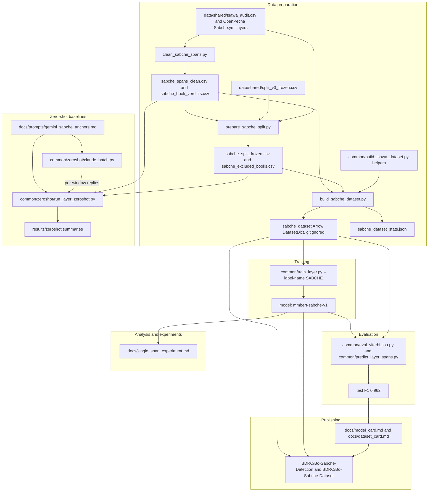

# Sabche (outline headings)

One binary token classifier for **sabche** (ས་བཅད་) spans: the outline heading a commentary author writes before the section he is about to explain, for example `གཉིས་པ་༼ངེས་ཚིག་༽ནི` or a numbered line such as `(1) ...`. A span is the heading only and stops before its closing shad. This folder holds the three scripts that turn the raw OpenPecha Sabche annotations into a cleaned span table, a frozen document split and the BIO dataset that `common/train_layer.py` trains on, the frozen data tables, the model and dataset cards, the zero-shot LLM baselines, and one post-processing experiment. Everything else (windowing, training, scoring, zero-shot runners) lives in [`../common/`](../common/); the production decoder is [`../detect/`](../detect/).

`src/` reads book text paths from `data/shared/tsawa_audit.csv` and windowing from `common/build_tsawa_dataset.py`. Training is `common/train_layer.py --label-name SABCHE`.

## Hugging Face

| | Repo | Visibility | Card |
|---|---|---|---|
| Model | [`BDRC/Bo-Sabche-Detection`](https://huggingface.co/BDRC/Bo-Sabche-Detection) | private (read from the Hub API on 2026-11-18) | [`docs/model_card.md`](docs/model_card.md) |
| Dataset | [`BDRC/Bo-Sabche-Dataset`](https://huggingface.co/datasets/BDRC/Bo-Sabche-Dataset) | private (read from the Hub API on 2026-11-18) | [`docs/dataset_card.md`](docs/dataset_card.md) |

Notes on publishing and 404s: [`docs/huggingface.md`](docs/huggingface.md). The cards are equal to the Hub READMEs. The zero-shot evaluation also has its own repository: [`tenzinyonten/sabche-zeroshot-eval`](https://github.com/tenzinyonten/sabche-zeroshot-eval) (Gemini and Claude against mmBERT).

## Flowchart



## Script reference

All commands run from the repository root. The three `src/` scripts must run in this order; each only reads files, it does not clean again.

### Data preparation (`src/`)

| Script | What it does | When to use it | How to run | Reads -> Writes |
|---|---|---|---|---|
| [`src/clean_sabche_spans.py`](src/clean_sabche_spans.py) | Builds the cleaned span sidecar (does not rewrite any `Sabche.yml`). Per book: (1) re-aligns drifted offsets with a Viterbi pass over ordinal-heading anchors (`SWITCH_COST` 3.0, accepted only if the heading-like rate rises by at least `MIN_GAIN` 0.20 and ends at least `MIN_HEADING` 0.60); (2) snaps off-by-one edges within `MAX_WALK` 3 characters (the end stops before the boundary char, because Sabche spans exclude the trailing shad); (3) gives a book verdict, excluding books whose heading-like rate stays below `EXCLUDE_BELOW` 0.30. Adjacent spans are not merged. | First step, whenever the Sabche annotations or the audit table change. | `python sabche/src/clean_sabche_spans.py` (no flags; paths are constants in the file) | `data/shared/tsawa_audit.csv` and each book's OPF Sabche layer -> `data/processed/sabche_spans_clean.csv`, `data/processed/sabche_book_verdicts.csv` |
| [`src/prepare_sabche_split.py`](src/prepare_sabche_split.py) | Frozen document split, 83/8.5/8.5 by window count (8192 / 5120). Keeps every book that has a cleaned layer minus verdict=exclude and the `UNDER_ANNOTATED` books (outline annotated, body headings not). Books already in `split_v3_frozen.csv` keep their split. Books are linked into must-link groups (split_v3 `group_id` plus books sharing Sabche headings: `LINK_SHARE` 0.10 over at least `MIN_SHARED` 2 distinct spans, or `MIN_SHARED_ABS` 10); a group whose fixed members disagree goes to test, then val, then train. Remaining groups are placed greedily, largest first, into the split with the largest relative deficit. Seed 123. | After cleaning, to (re)freeze the split. The committed split is frozen (v2, generated 2026-09-22); do not re-run it for a model that is already published. | `python sabche/src/prepare_sabche_split.py [--val-frac 0.085] [--test-frac 0.085]` | `data/shared/tsawa_audit.csv`, `sabche_spans_clean.csv`, `sabche_book_verdicts.csv`, `data/shared/split_v3_frozen.csv`, the book texts -> `data/processed/sabche_split_frozen.csv`, `data/processed/sabche_excluded_books.csv`, `scratch/sabche/splits/sabche_split_report.json` (scratch is gitignored) |
| [`src/build_sabche_dataset.py`](src/build_sabche_dataset.py) | Builds the Sabche BIO `DatasetDict` (labels `O` 0, `B-SABCHE` 1, `I-SABCHE` 2) with the tsawa builder's `label_tokens`, `sliding_windows` and `pack_window`. Nothing is re-cleaned here. No training. | After the split is frozen, to produce the training data. | `python sabche/src/build_sabche_dataset.py [--audit-csv P] [--sidecar P] [--split-file P] [--tokenizer jhu-clsp/mmBERT-base] [--max-length 8192] [--stride 5120] [--out-dir P] [--stats-json P] [--limit N]` (`--limit N` is for debugging: first N documents only) | `data/shared/tsawa_audit.csv`, `sabche_spans_clean.csv` (dropped spans skipped), `sabche_split_frozen.csv` -> `data/processed/sabche_dataset/` (gitignored), `data/processed/sabche_dataset_stats.json` |

### Training and evaluation (scripts in `common/`)

These are not in this folder; they are listed because this layer uses them. The exact training command is on the model card.

| Script | What it does | When to use it | How to run | Reads -> Writes |
|---|---|---|---|---|
| [`../common/train_layer.py`](../common/train_layer.py) | Trains the token classifier for one layer. | After the dataset is built. | `python common/train_layer.py --label-name SABCHE --scheme bio --epochs 8 --output-dir runs/sabche` (command from the model card) | `data/processed/sabche_dataset` -> checkpoints in `runs/sabche` |
| [`../common/eval_viterbi_iou.py`](../common/eval_viterbi_iou.py) | Viterbi decoding and IoU 0.5 span F1; `--sweep` searches the break penalty. | To score a model. The test number on the card uses break penalty 4.0. | `python common/eval_viterbi_iou.py --model <path-or-hub-id> --dataset <path> --split test --break-penalty 4.0` (add `--sweep` on validation) | model and dataset -> JSON at `--out` |
| [`../common/predict_layer_spans.py`](../common/predict_layer_spans.py) | Dumps predicted spans per book. | To inspect predictions or run post-processing experiments. | `python common/predict_layer_spans.py --label-name SABCHE --model <path> --dataset <path> --splits test --break-penalty 4.0 --out <dir>` | model and dataset -> span files in `--out` |

### Zero-shot baselines (scripts in `common/zeroshot/`)

| Script | What it does | When to use it | How to run | Reads -> Writes |
|---|---|---|---|---|
| [`../common/zeroshot/run_layer_zeroshot.py`](../common/zeroshot/run_layer_zeroshot.py) | Zero-shot span detection with an LLM: 16,000-character windows, 2,000 overlap, the prompt returns anchor text that is located back in the book; scores against the cleaned spans with IoU 0.5, micro over the split. Default model `gemini-3.1-flash-lite`, `--provider gemini` or `anthropic`. `--locate-only` skips the API and only scores saved replies. | To produce the Gemini rows, and (with `--locate-only`) to score the Claude replies. | `python common/zeroshot/run_layer_zeroshot.py --layer sabche --books <ids> --out <dir>` (add `--locate-only` to score only) | `sabche_spans_clean.csv`, `sabche_split_frozen.csv`, `docs/prompts/gemini_sabche_anchors.md` -> per-window replies and a summary JSON in `--out` |
| [`../common/zeroshot/claude_batch.py`](../common/zeroshot/claude_batch.py) | Runs Claude Sonnet 5 on the test windows through the Message Batches API, reusing the same windows, prompt and per-window cache format. Sends nothing unless `create --yes`. | To get the Claude baseline. | `python common/zeroshot/claude_batch.py --layer sabche plan --groups 3`, then `... create --group g1 --books <ids> [--yes]`, `... poll --group g1`, `... fetch --group g1` | prompt, split -> `scratch/sabche/claude/test` and `scratch/sabche/claude/batches.json` (gitignored) |

### Experiments and one-off scripts

| Script | What it does | When to use it | How to run | Reads -> Writes |
|---|---|---|---|---|
| `scratch/sabche_single_span/run.py` (named in [`docs/single_span_experiment.md`](docs/single_span_experiment.md); not in this repository) | Tests deleting or extending single-character and single-syllable predicted spans on the saved test predictions. | Done once; the conclusion is to ship no such rule. | not in the repo, so no command can be given | saved test spans of `mmbert-sabche-v1`, `sabche_gold.csv`, `data/raw_opf` -> `scratch/sabche_single_span/results.json` |

## Step by step: from raw data to a published model

1. Clean the spans: `python sabche/src/clean_sabche_spans.py`. Check `data/processed/sabche_book_verdicts.csv` (verdict keep or exclude).
2. Freeze the split: `python sabche/src/prepare_sabche_split.py`. The committed `sabche_split_frozen.csv` is the published v2 split: 261 train, 33 validation and 29 test books.
3. Build the dataset: `python sabche/src/build_sabche_dataset.py`. Compare `data/processed/sabche_dataset_stats.json` with the dataset card (8,886 / 911 / 963 windows).
4. Train: `python common/train_layer.py --label-name SABCHE --scheme bio --epochs 8 --output-dir runs/sabche`.
5. Publish by hand: upload the model and dataset with the cards from `docs/` (see [`docs/huggingface.md`](docs/huggingface.md)). No script in this folder does the upload; none was found in the repo for Sabche.

**How to evaluate.** Decode with Viterbi (break penalty 4.0), score IoU 0.5 span F1 per book with `common/eval_viterbi_iou.py` and `common/predict_layer_spans.py` (see the table above). For the zero-shot baselines run `run_layer_zeroshot.py --layer sabche` (Gemini) or `claude_batch.py` followed by `run_layer_zeroshot.py --layer sabche --locate-only` (Claude). Reproduction detail beyond the commands in the docs is in [`results/README.md`](results/README.md).

## Results

Fine-tuned model (test split, 29 books, 4,079 gold spans; from [`docs/model_card.md`](docs/model_card.md)):

| test split | F1 | precision | recall |
|---|---|---|---|
| all 29 books | 0.962 | 0.954 | 0.970 |
| old batch (11 books) | 0.958 | 0.940 | 0.977 |
| new batch (18 books) | 0.964 | 0.964 | 0.965 |

The model predicts 4,144 spans for 4,079 gold spans. These are raw Viterbi decodes, before the inference post-processing rules.

Zero-shot LLM baselines (IoU 0.5, micro over the split; from [`results/README.md`](results/README.md)):

| Model | Split | F1 | Precision | Recall | Gold found |
|---|---|---|---|---|---|
| Claude Sonnet 5 (Message Batches API) | test, 29 books | 0.681 | 0.613 | 0.766 | 3,124 / 4,079 |
| Gemini (script default `gemini-3.1-flash-lite`; the log does not record the model) | test, 29 books | 0.668 | 0.600 | 0.754 | 3,075 / 4,079 |
| Gemini, incomplete run | validation, 22 of 33 books (not comparable) | 0.549 | 0.466 | 0.669 | 1,769 / 2,645 |

Claude has not been run on validation. Each zero-shot score is a single run, so the two test numbers are roughly equal. Per-book scores are in `results/README.md`; the raw summaries are `results/zeroshot/claude_sonnet5_test_summary.json`, `gemini_test_summary.json` and `gemini_val_partial_summary.json`. The raw per-window replies are under `scratch/` (gitignored) and are not tracked.

**How the zero-shot results were produced.** No training and no examples. Each model receives the prompt in [`docs/prompts/gemini_sabche_anchors.md`](docs/prompts/gemini_sabche_anchors.md) (v1, built 2026-09-24 from statistics of the train and validation books only) on 16,000-character windows cut at a shad with 2,000 characters of overlap, and returns `head`, `tail` and optional `frame` anchors, which the locator maps back to character offsets in the book. Claude was run with `claude_batch.py` in three batches (179 + 180 + 179 windows, about $5 per 180 windows at batch pricing); both were scored with `run_layer_zeroshot.py --layer sabche --locate-only` against the cleaned spans and the frozen split.

Post-processing experiment (test only, from [`docs/single_span_experiment.md`](docs/single_span_experiment.md)): baseline F1 0.9619; deleting single-syllable predictions 0.9640; extending to the syllable 0.9619; extending to the next shad 0.9633. The conclusion there is to add no Sabche-specific single-character or single-syllable rule, and the result was not checked on validation.

## Folder layout

```
sabche/
├── README.md                          this file
├── src/
│   ├── clean_sabche_spans.py          re-align drifted offsets, snap edges, book verdicts
│   ├── prepare_sabche_split.py        frozen 83/8.5/8.5 document split
│   └── build_sabche_dataset.py        BIO DatasetDict for mmBERT
├── data/processed/
│   ├── sabche_spans_clean.csv         cleaned span table (per-span action, dropped, reason)
│   ├── sabche_book_verdicts.csv       per-book heading rate and keep/exclude verdict
│   ├── sabche_excluded_books.csv      books left out of the dataset, with reason
│   ├── sabche_split_frozen.csv        frozen train/val/test split
│   ├── sabche_dataset_stats.json      window, document, span and label counts
│   └── sabche_dataset/                Arrow dataset (gitignored)
├── docs/
│   ├── model_card.md                  Hub README of the model
│   ├── dataset_card.md                Hub README of the dataset
│   ├── huggingface.md                 repo links and visibility notes
│   ├── single_span_experiment.md      short-span delete/extend experiment
│   └── prompts/gemini_sabche_anchors.md   zero-shot prompt
└── results/
    ├── README.md                      zero-shot baselines and per-book scores
    └── zeroshot/                      Gemini and Claude score summaries (JSON)
```

There is no `tests/` folder.

## Known issues

- `docs/huggingface.md` says both repos are private, and the Hub API confirms it; anonymous access returns an error until access is granted.
- `src/prepare_sabche_split.py` also writes `scratch/sabche/splits/sabche_split_report.json`, which is gitignored, so that report is not in the repo.
- The `scratch/sabche_single_span/run.py` script cited by the experiment doc is not in the repository, so that experiment cannot be re-run from here.
- Model card limits: the production shad rule was tuned on the test split and not re-checked on validation; some training books are partly annotated (titled-heading recall 0.2 to 0.5 in 21 kept books); 227 spans in re-aligned old-batch books were dropped; real document-level leakage between train and test is about 6.8%.
- The Gemini model used for the zero-shot test run is not recorded in the log; the Gemini validation run is incomplete (22 of 33 books).
