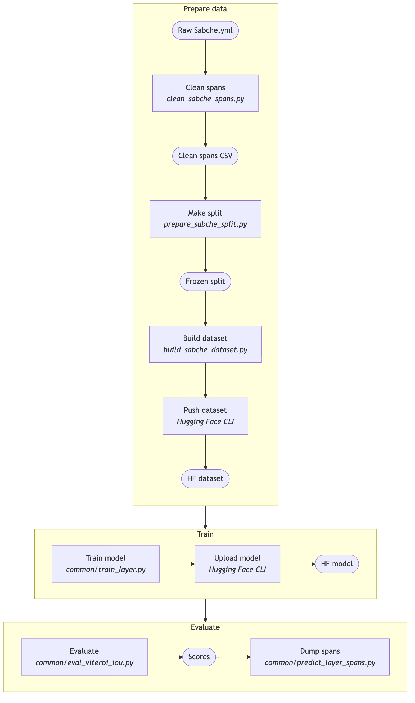

# Sabche (ས་བཅད་)

Finds **sabche outline headings** in Tibetan commentaries: the heading a commentary author writes before the section he is about to explain, for example `གཉིས་པ་༼ངེས་ཚིག་༽ནི` or a numbered line such as `(1) ...`. A span is the heading only and stops before its closing shad. One binary token classifier (labels `O`, `B-SABCHE`, `I-SABCHE`), fine-tuned from `jhu-clsp/mmBERT-base`.

- **In:** the `Sabche.yml` layers of the OpenPecha books, plus the book list `data/shared/tsawa_audit.csv` and the frozen split `data/shared/split_v3_frozen.csv`.
- **Out:** a dataset and a model on Hugging Face (see below).
- **In the whole system:** `detect/` runs this model on a text (the `sabche` entry in [layer_config.py](../detect/layer_config.py)). The three data scripts live here in `src/`; windowing, training and scoring use the shared scripts in [common/](../common/).

## Folder layout

```
sabche/
├── src/             scripts: clean, split, build
├── data/processed/  cleaned spans, book verdicts, frozen split, stats
├── docs/            model card, dataset card, zero-shot prompt, short-span experiment
└── results/         zero-shot baselines (README and score summaries)
```

## Hugging Face

| | Repo | Visibility |
|---|---|---|
| Model | [BDRC/Bo-Sabche-Detection](https://huggingface.co/BDRC/Bo-Sabche-Detection) ([card](docs/model_card.md)) | private |
| Dataset | [BDRC/Bo-Sabche-Dataset](https://huggingface.co/datasets/BDRC/Bo-Sabche-Dataset) ([card](docs/dataset_card.md)) | private |

Both are private (read from the Hub, 2026-11-18); a 404 means you need access from the owner. The cards are equal to the Hub READMEs (compared 2026-11-18).

## Pipeline



<sub>Chart source: [pipeline.mmd](docs/pipeline.mmd)</sub>

Squares are steps with the script that runs them; rounded boxes are files; dashed arrows are optional steps. The cards are in [docs/](docs/).

## Main pipeline

| Script | What it does | When to run |
|---|---|---|
| [clean_sabche_spans.py](src/clean_sabche_spans.py) | Re-aligns drifted offsets, snaps edges, excludes unrecoverable books. | First; rerun on new annotations. |
| [prepare_sabche_split.py](src/prepare_sabche_split.py) | Makes the frozen 83/8.5/8.5 document split. | After cleaning; split is frozen. |
| [build_sabche_dataset.py](src/build_sabche_dataset.py) | Tokenizes books into BIO windows for mmBERT. | After the split. |
| [train_layer.py](../common/train_layer.py) | Fine-tunes mmBERT for the Sabche layer. | On a GPU machine. |
| [eval_viterbi_iou.py](../common/eval_viterbi_iou.py) | Scores a model: Viterbi decoding, IoU 0.5 span F1. | After training; validation first. |

`train_layer.py` and `eval_viterbi_iou.py` are shared scripts in [common/](../common/). Flags, thresholds, and the files each script reads and writes are in its docstring and `--help`.

## How to run

All commands run from the repository root.

```bash
# 1. Clean the spans; check data/processed/sabche_book_verdicts.csv (keep or exclude)
python sabche/src/clean_sabche_spans.py
# 2. Split. The committed split is the published v2 (261/33/29 books): do not re-run it
python sabche/src/prepare_sabche_split.py
# 3. Build the BIO dataset (8,192-token windows, stride 5,120); expect 8,886 / 911 / 963 windows
python sabche/src/build_sabche_dataset.py
# 4. Upload the dataset and docs/dataset_card.md (as README.md) to BDRC/Bo-Sabche-Dataset with the Hugging Face CLI
# 5. Train on a GPU machine (command from the model card)
python common/train_layer.py --label-name SABCHE --scheme bio --epochs 8 --output-dir runs/sabche
# 6. Upload the model and docs/model_card.md (as README.md) to BDRC/Bo-Sabche-Detection with the Hugging Face CLI
# 7. Evaluate on test with break penalty 4.0 (use --sweep on validation to pick it)
python common/eval_viterbi_iou.py --model BDRC/Bo-Sabche-Detection --dataset sabche/data/processed/sabche_dataset \
    --split test --break-penalty 4.0
```

**Step 2 fails when run as it is (see Known issues); the committed split is already final.**

## Optional tools

- **Dump spans**: predicted spans per book, for inspection or post-processing experiments. `python common/predict_layer_spans.py --label-name SABCHE --model <path> --dataset <path> --splits test --break-penalty 4.0 --out <dir>`

## Results

Test set (29 books, 4,079 gold spans). Numbers are copied from the [model card](docs/model_card.md) and [results/README.md](results/README.md).

| Model | F1 | P | R |
|---|---|---|---|
| Bo-Sabche-Detection (all 29 books) | 0.962 | 0.954 | 0.970 |
| Bo-Sabche-Detection (old batch, 11 books) | 0.958 | 0.940 | 0.977 |
| Bo-Sabche-Detection (new batch, 18 books) | 0.964 | 0.964 | 0.965 |
| Claude Sonnet 5, zero-shot (all 29 books) | 0.681 | 0.613 | 0.766 |
| Gemini, zero-shot (all 29 books) | 0.668 | 0.600 | 0.754 |

Fine-tuned scores are raw Viterbi decodes (4,144 predicted spans), before the inference post-processing rules. The Gemini model name is not recorded in the log (script default `gemini-3.1-flash-lite`); each zero-shot score is one run.

## Zero-shot baselines

Zero-shot baselines (Claude, Gemini) were run with the shared scripts in [common/zeroshot/](../common/zeroshot/).
Results are in [results/](results/).

## Short-span experiment

Test only: deleting single-syllable predictions gives F1 0.9640 against 0.9619 baseline, so no Sabche-specific short-span rule was added. Details in [docs/single_span_experiment.md](docs/single_span_experiment.md); not checked on validation.

## Known issues

<details><summary>Show 6 known issues</summary>

- `src/prepare_sabche_split.py` reads `args.version` when it writes the split header, but the parser has no `--version` option, so a full run ends with an `AttributeError` after the computation. The committed split was made by an earlier version of the script and its header names the old path `src/prepare_sabche_split.py`.
- `src/prepare_sabche_split.py` also writes `scratch/sabche/splits/sabche_split_report.json`, which is gitignored, so that report is not in the repo.
- The `scratch/sabche_single_span/run.py` script cited by the experiment doc is not in the repository, so that experiment cannot be re-run from here.
- No script uploads the model or the dataset to the Hub; none was found in the repo for Sabche.
- Model card limits: the production shad rule was tuned on the test split and not re-checked on validation; some training books are partly annotated (titled-heading recall 0.2 to 0.5 in 21 kept books); 227 spans in re-aligned old-batch books were dropped; real document-level leakage between train and test is about 6.8%.
- The Gemini model used for the zero-shot test run is not recorded in the log; the Gemini validation run is incomplete (22 of 33 books, F1 0.549, not comparable); Claude has not been run on validation.

</details>

## All files

<details><summary>Show the full file tree</summary>

```
sabche/
├── README.md
├── src/
│   ├── clean_sabche_spans.py          # re-align drifted offsets, snap edges, book verdicts
│   ├── prepare_sabche_split.py        # frozen 83/8.5/8.5 document split
│   └── build_sabche_dataset.py        # BIO DatasetDict for mmBERT
├── data/processed/
│   ├── sabche_spans_clean.csv         # cleaned span table (per-span action, dropped, reason)
│   ├── sabche_book_verdicts.csv       # per-book heading rate and keep/exclude verdict
│   ├── sabche_excluded_books.csv      # books left out of the dataset, with reason
│   ├── sabche_split_frozen.csv        # frozen train/val/test split (test is frozen)
│   ├── sabche_dataset_stats.json      # window, document, span and label counts
│   └── sabche_dataset/                # built Arrow dataset (gitignored, made by step 3)
├── docs/
│   ├── model_card.md                  # also the Hugging Face README of the model
│   ├── dataset_card.md                # also the Hugging Face README of the dataset
│   ├── single_span_experiment.md      # short-span delete/extend experiment
│   └── prompts/gemini_sabche_anchors.md   # zero-shot prompt (v1)
└── results/
    ├── README.md                      # zero-shot baselines and per-book scores
    └── zeroshot/                      # Gemini and Claude score summaries (JSON)
```

There is no `tests/` folder. Scripts here import shared code from `common/` (`build_tsawa_dataset.py`, `check_boundary_snapping.py`) and read book paths from `data/shared/tsawa_audit.csv`. The zero-shot scripts in `common/zeroshot/` read the cleaned spans, the frozen split and `docs/prompts/gemini_sabche_anchors.md`.

</details>
