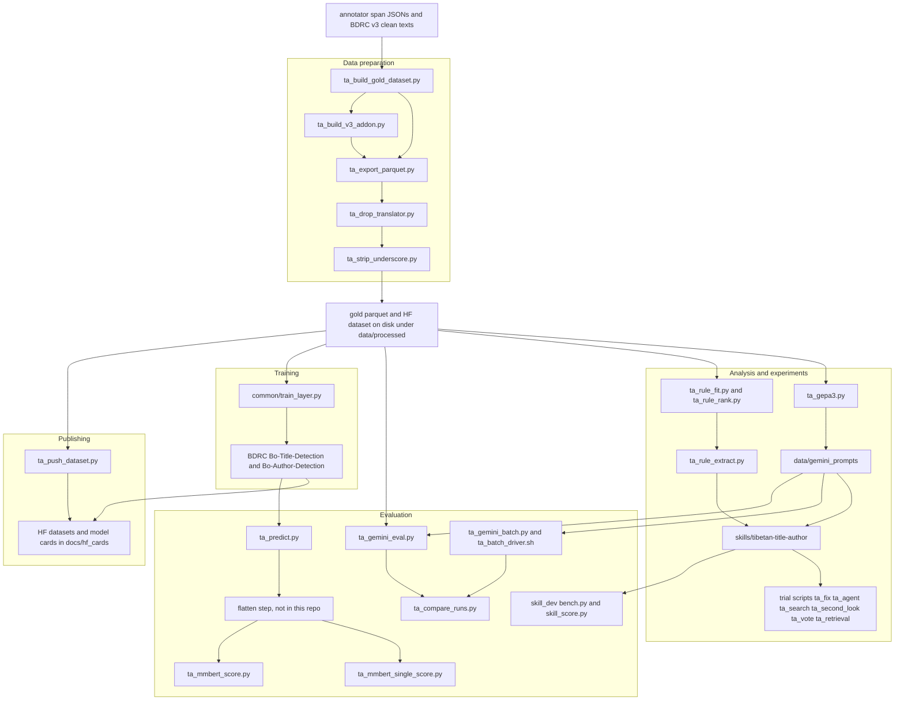
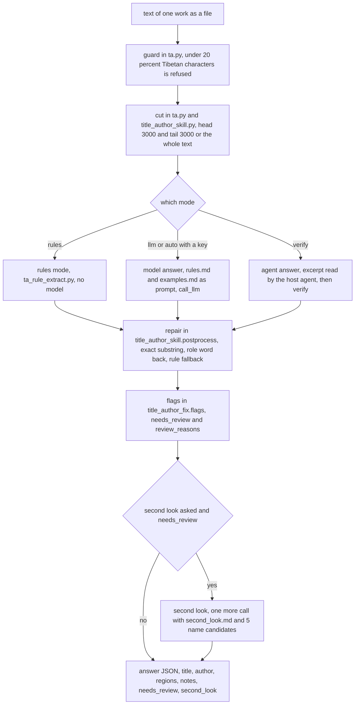

# Title and author

Find the title and the author of a Tibetan work from the first and last 3,000 characters of its text (a text of 6,000 characters or fewer is used whole). Two systems do it: a fine-tuned mmBERT-base token classifier (one model for the title, one for the author), and an LLM-based skill with a rule-based layer around it. Unlike the other layers (Tsawa, Sabche, Chapter, Quotation, Yigchung) this one is not a sliding window over a whole book: it works on one work at a time. It is wired into [`detect/`](../detect/title_author.py): `tibetan-detect --title-author-system model|skill|both` (also `--title-system` and `--author-system` per field) chooses between the model and the skill, see [Skill](#skill).

This folder holds everything for the layer: the dataset builders, the mmBERT prediction and scoring scripts, the rule extractor, the Gemini batch and GEPA prompt-optimisation scripts, trial scripts, the skill itself, and the docs and Hugging Face cards.

The gold datasets, parquet exports, Gemini batches and runs, and model predictions are on disk under `data/` and gitignored. They are several gigabytes.

## Contents

1. [Models and data on Hugging Face](#models-and-data-on-hugging-face)
2. [Flowchart](#flowchart)
3. [Script reference](#script-reference)
4. [Skill](#skill) (when it is used, every `ta.py` mode, the second look, `needs_review`, server and tool handler, GEPA, the skill flowchart)
5. [Step by step: from raw data to a published model](#step-by-step-from-raw-data-to-a-published-model)
6. [Results](#results)
7. [Folder layout](#folder-layout)
8. [Known issues](#known-issues)

## Models and data on Hugging Face

Visibility was read from the Hub on 2026-11-17 (the four BDRC repos and the run 2 model are private; the two Yontenn datasets are public).

| | Hugging Face repo | Visibility | Card |
|---|---|---|---|
| Final model, title | `BDRC/Bo-Title-Detection` (weights in `best/`) | private | [`docs/hf_cards/Bo-Title-Detection.md`](docs/hf_cards/Bo-Title-Detection.md) |
| Final model, author | `BDRC/Bo-Author-Detection` (weights in `best/`) | private | [`docs/hf_cards/Bo-Author-Detection.md`](docs/hf_cards/Bo-Author-Detection.md) |
| Dataset for the title model | `BDRC/Bo-Title-Dataset` | private | [`docs/hf_cards/Bo-Title-Dataset.md`](docs/hf_cards/Bo-Title-Dataset.md) |
| Dataset for the author model | `BDRC/Bo-Author-Dataset` | private | [`docs/hf_cards/Bo-Author-Dataset.md`](docs/hf_cards/Bo-Author-Dataset.md) |
| Joint data, 5 labels (O, B/I-TITLE, B/I-AUTHOR); both datasets above are relabelled copies of it | [Yontenn/title-author-training](https://huggingface.co/datasets/Yontenn/title-author-training) | public | [`docs/dataset_card.md`](docs/dataset_card.md) |
| Text and span tables (an older version, with auto-labelled works) | [Yontenn/formatting-title-author](https://huggingface.co/datasets/Yontenn/formatting-title-author) | public | none in this repo |
| Joint model, run 2 (an experiment, trained on data before the translator and `_` cleaning) | `Yontenn/mmbert-title-author-run2` (weights in `best/`) | private | [`docs/model_cards/mmbert-title-author-run2.md`](docs/model_cards/mmbert-title-author-run2.md) |

`Bo-Title-Detection` was trained on `Bo-Title-Dataset`, and `Bo-Author-Detection` on `Bo-Author-Dataset`. The model repos have no tokenizer files; use `jhu-clsp/mmBERT-base`. The four BDRC repos were moved from `Yontenn/mmbert-title-only`, `mmbert-author-only`, `title-only-training` and `author-only-training` on 2026-11-17 (the old names redirect); see [`docs/huggingface.md`](docs/huggingface.md).

Training is `common/train_layer.py`. The joint model is `--label-name TITLE_AUTHOR --scheme multi`. A single-entity model is `--label-name TITLE --scheme bio --dataset BDRC/Bo-Title-Dataset` (or `AUTHOR` with `BDRC/Bo-Author-Dataset`), with `--weight-scheme sqrt_inv --evals-per-epoch 2 --epochs 8 --skip-test`. The title-only run used all 8 epochs; the author-only run stopped early at epoch 5.5, with its best checkpoint at step 10,020. Full hyperparameter tables are in the two model cards.

Decoding is Viterbi, then one span per work: title = first span, author = last span. The joint model uses break penalty 12; the single-entity models use 6 (chosen on validation). Scoring: `src/ta_mmbert_score.py` (joint) and `src/ta_mmbert_single_score.py` (single-entity).

## Flowchart

How the scripts connect, from the raw annotator spans to a published model, plus the Gemini, GEPA and skill side. Script file names are in the nodes; the skill's own pipeline is a second chart in the [Skill](#skill) section.



Reading it: the builders turn annotator spans into the dataset; `common/train_layer.py` trains on it; `ta_predict.py` saves logits that the two scoring scripts decode with the same scorer as the Gemini answers; the rule extractor, GEPA prompts and the skill sit beside the model as the second system, and `skill_dev/` benchmarks the skill. The exact link between the builders and the Hub datasets (which flags produced the final `notrans_nous` data) is not recorded in the scripts; see [Known issues](#known-issues).

## Script reference

All paths are from the repository root. Scripts that score data take `TA_PQ` (the parquet folder, default `title_author/data/processed/parquet_export_strat_both_notrans_nous`). The test split is refused unless `ALLOW_TEST=1` is set (final comparison only, never for tuning). Keys come only from the environment (`GEMINI_API_KEY`, `ANTHROPIC_API_KEY`), never from a file.

### Data preparation

| Script | What it does | When to use it | How to run | Reads -> Writes |
|---|---|---|---|---|
| `src/ta_build_gold_dataset.py` | Builds the tokenized 5-label BIO DatasetDict from the annotator span JSONs: keeps head `[0,K)` and tail `[L-K,L)` of each work (whole text if L <= 2K), labels tokens with the token-start rule from `common/build_tsawa_dataset.py`, splits by group of collection ids. | First step of a dataset build. | `python title_author/src/ta_build_gold_dataset.py [--all] [--single] [--clean] [--crop chars\|paras] [--k 3000] [--max-length 8192] [--stride 5120] [--seed 42] [--split-csv CSV] [--tag TAG] [--tokenizer DIR] [--out-dir DIR] [--limit N]` | annotator span JSONs (via `ta_load_spans`, see Known issues) -> `data/processed/gold_dataset[_all][_TAG]/` and `gold_*_*.csv` |
| `src/ta_build_v3_addon.py` | Adds works from the BDRC v3 release with automatically found spans (title = first exact hit, author = last hit, one copy per duplicate cluster, not a near-duplicate of any gold work). Train only; validation and test are copied unchanged. | After the gold dataset, to add the `v3_auto` works. | `python title_author/src/ta_build_v3_addon.py CLEAN_DIR [--base gold_dataset_all] [--single] [--all-groups] [--k 3000] [--max-length 8192] [--stride 5120] [--tokenizer DIR] [--out-dir DIR]` | v3 clean texts, `gold_dataset_all` -> `gold_dataset_all_v3` and `gold_dataset_all_v3_works.csv` |
| `src/ta_export_parquet.py` | Exports raw text (not tokens) as Parquet for review and sharing: only works with both a title and an author span; gold works keep their split, `v3_auto` works are train only; first and last about 3,000 characters with spans as character offsets. | To make the parquet folder that the scorers and Gemini scripts read. | `python title_author/src/ta_export_parquet.py V3_CLEAN_DIR [OUT_DIR] [--base gold_dataset_all] [--v3-works gold_dataset_all_v3_works.csv] [--out-dir DIR]` | `data/processed/<base>`, `bdrc_metadata.csv`, v3 dir -> `data/processed/parquet_export/` (or OUT_DIR) with `train/validation/test.parquet` and `works_index.csv` |
| `src/ta_drop_translator.py` | Drops works whose gold author contains a translator word (`ལོ་ཙཱ`, `ལོ་ཙྪ`, `ལོཙཱ`, `ལོཙྪ`, `ལོ་ཙ་བ`); writes new copies and a list of what was dropped. | After export, before stripping `_`. | `python title_author/src/ta_drop_translator.py` (no arguments; the paths are fixed in the script) | `gold_dataset_all_strat_single_v3_both`, `parquet_export_strat_both` -> `..._notrans` copies and `data/processed/translator_dropped.csv` |
| `src/ta_strip_underscore.py` | Removes the `_` syllable-separator artifact from the text and shifts the spans; only works with a `_` are re-tokenized, and a self-check compares untouched works with the old rows. | After the translator drop. | `python title_author/src/ta_strip_underscore.py` (no arguments) | `..._notrans` copies -> `parquet_export_strat_both_notrans_nous` and `gold_dataset_all_strat_single_v3_both_notrans_nous` |

### Training

Training itself is not in this folder: it is `common/train_layer.py` (commands in [Models and data](#models-and-data-on-hugging-face) and [Step by step](#step-by-step-from-raw-data-to-a-published-model)). The one script here that is used right after training is the prediction script in the next table.

### Evaluation: mmBERT

| Script | What it does | When to use it | How to run | Reads -> Writes |
|---|---|---|---|---|
| `src/ta_predict.py` | Runs a trained model on validation and test and saves the raw logits (fp16) per work. | On the GPU box after training, then copy the files to the Mac to tune Viterbi. | `python3 title_author/src/ta_predict.py MODEL_DIR OUT_DIR [DATASET]` (default dataset `Yontenn/title-author-training`) | model, dataset -> `OUT_DIR/{validation,test}_logits.npz` |
| `src/ta_mmbert_score.py` | Scores the joint model (5 labels) with the same scorer as the Gemini answers: Viterbi with break penalty 12, title = first span, author = last span, token span decoded to text and located in head or tail. Runs a gold-label decode first as a sanity check (should score about 1.0). | To get the joint-model row of the results table. | `python3 title_author/src/ta_mmbert_score.py SPLIT [N_PREFIX_WORKS]` (`ALLOW_TEST=1` for test) | `data/mmbert_preds/{SPLIT}_flat.npz` -> `data/mmbert_preds/{SPLIT}_answers.json` |
| `src/ta_mmbert_single_score.py` | Same for a single-entity model (3 labels): decodes at several break penalties, one span per work (first span for the title, last for the author, or the most confident), scores IoU >= 0.5 in the same block. | To tune the penalty on validation, then write the final test answers. | `python3 title_author/src/ta_mmbert_single_score.py FIELD SPLIT PENALTIES`, e.g. `... author validation 3,6,12,20`; final: `ALLOW_TEST=1 python3 title_author/src/ta_mmbert_single_score.py author test 12 write 12 first_last` | `data/mmbert_preds/{FIELD}_only/{SPLIT}_flat.npz` -> `.../{SPLIT}_answers.json` with `write` |
| `src/ta_compare_runs.py` | Compares two saved Gemini runs on the works both answered, with a paired bootstrap 95% range of the mean difference (A minus B). No network, no cost. Its `load` and `score` are reused by other scripts. | To say whether one prompt or system beats another. | `python title_author/src/ta_compare_runs.py SPLIT "RUN_A_GLOB" "RUN_B_GLOB" [ROWS=a:b]` (`TA_PQ`, `ALLOW_TEST=1` for test) | `data/gemini_runs/*/partial_raw.json` -> printed table |

### Evaluation: Gemini

| Script | What it does | When to use it | How to run | Reads -> Writes |
|---|---|---|---|---|
| `src/ta_gemini_eval.py` | Runs Gemini with a prompt file on annotator works (regular calls, key rotation on 429, resume), scores title and author at IoU >= 0.5, writes failures for review. `make-v0` builds `v0.md` from a Cursor briefing file. Marked "UNTESTED first version" in its own docstring. | Small runs on train or validation; also the scorer other scripts import. | `python title_author/src/ta_gemini_eval.py make-v0 CURSOR_MD`; `... dry PROMPT.md`; `... run PROMPT.md SPLIT N [SEED]`. Env: `GEMINI_API_KEY` (or `GEMINI_API_KEYS`), `GEMINI_MODEL` (default `gemini-3.8-flash`), `THINK_LEVEL`, `ROWS=a:b`, `IDS_FILE`, `RESUME` | parquet -> `data/gemini_runs/<prompt>_<split>_<N>/` with `results.json`, `failures.md` |
| `src/ta_gemini_batch.py` | Gemini Batch API runner: half price, asynchronous. `submit` uploads a JSONL, `status` polls, `collect` downloads and scores and prints the token bill, `combine` merges chunks into one scored run. | Whole-split runs (the full test set). | `python title_author/src/ta_gemini_batch.py submit PROMPT.md SPLIT MODEL [N] [SEED]`; `... status TAG`; `... collect TAG`; `... combine NAME TAG1 TAG2 ...`. Env: `GEMINI_API_KEY`, `THINK_LEVEL`, `ROWS=a:b`, `TA_PQ`, `ALLOW_TEST` | prompt, parquet -> `data/gemini_batches/<TAG>.json(l)`, `data/gemini_runs/<TAG>/` |
| `src/ta_batch_driver.sh` | Runs a split through the Batch API in chunks, one at a time (submit, wait, collect, score), because the project allows only a limited number of tokens in active batch jobs (a whole 2,384-work test set got HTTP 429; 600 works fit). | Whole-split run when one big batch is rejected. | `GEMINI_API_KEY=... TA_PQ=... ALLOW_TEST=1 THINK_LEVEL=low [NSAMP=1400] title_author/src/ta_batch_driver.sh PROMPT.md SPLIT MODEL TOTAL [CHUNK=600]`, then merge with `combine` | as `ta_gemini_batch.py` |

### Rule script

| Script | What it does | When to use it | How to run | Reads -> Writes |
|---|---|---|---|---|
| `src/ta_rule_extract.py` | The rule-based title and author extractor (plain Python, no model): finds title and author lines by their formulas (ཞེས་བྱ་བ, བཞུགས་སོ, agentive plus མཛད/སྦྱར/བྲིས/བཀོད), ranks candidates with fitted weights, and holds `repair_span()` and the role-word list. An identical copy sits in `skills/tibetan-title-author/scripts/` (the skill imports that copy). | As the free baseline, the author fallback of the skill, and the candidate list of the second look. | `python title_author/src/ta_rule_extract.py score SPLIT [--n N] [--seed S]`; `python title_author/src/ta_rule_extract.py show WORK_ID`. Does not open test unless `ALLOW_TEST=1` | parquet -> printed scores; `data/rule_runs/` holds saved runs |
| `src/ta_rule_fit.py` | Fits the candidate weights on TRAIN only (logistic regression). | When the rule script's features change. | `python title_author/src/ta_rule_fit.py author\|title\|both [N]` (default N 6000) | train parquet -> `src/ta_rule_weights.json` (author), `src/ta_rule_title_weights.json` (title) |
| `src/ta_rule_rank.py` | Fits author weights on TRAIN with a per-work softmax (picks one candidate per work). | Alternative author fit. Which of the two fits produced the shipped author weights is not stated. | `python title_author/src/ta_rule_rank.py` (no arguments; paths are hardcoded, see Known issues) | train and validation -> `ta_rule_weights.json` |
| `src/ta_rule_weights.json`, `src/ta_rule_title_weights.json` | Data files: the fitted weights read by `ta_rule_extract.py`. Copies are in the skill's `scripts/`. | Not run. | | |

### Gemini prompts: GEPA

| Script | What it does | When to use it | How to run | Reads -> Writes |
|---|---|---|---|---|
| `src/ta_gepa3.py` | GEPA (DSPy 3, `dspy.GEPA`) prompt optimisation. Uses train for reflection and validation for selection; typed feedback (what kind of mistake, with the gold context), a locked block so the 12 examples cannot be deleted, a hybrid step that applies the rule layer before scoring. Run with `~/dspy-env/bin/python`. | To rewrite the rules part of the prompt, or to score a prompt with the same settings. Test is refused unless `ALLOW_TEST=1`. | `ta_gepa3.py run START_PROMPT.md N_TRAIN N_VAL BUDGET`; `ta_gepa3.py eval PROMPT.md SPLIT N`; `ta_gepa3.py demo RUN_FOLDER N`. Env: `BATCH`, `CROP`, `STRATIFY`, `MINIBATCH`, `RULE_FEEDBACK`, `LOCK_FILE`, `HYBRID`, `EFFICIENCY`, `TOKEN_W`, `EXCLUDE_N`, `GEMINI_MODEL`, `REFLECT_GEMINI`, `TASK_EFFORT`, `THREADS`, `TA_PQ`, `OUT_NAME`, `SKIP_EVALS` (what each does: [Skill](#gepa-prompt-optimisation)) | parquet, start prompt -> `data/gemini_prompts/$OUT_NAME` (and `$OUT_NAME.candidates.json` with `EFFICIENCY=1`) |
| `src/ta_check_keys.py` | Checks which Gemini keys still have free quota (one 8-token call per key and model; prints only the last 4 characters). 429 means the daily quota is used up. | Before a free-tier run. | `python3 title_author/src/ta_check_keys.py [MODEL ...]` (default `gemini-3.5-flash-lite gemini-3.5-flash`); keys one per line in `~/.gemini_keys.txt` | key file -> printed status |

### Analysis and experiments: the skill benchmark

| Script | What it does | When to use it | How to run | Reads -> Writes |
|---|---|---|---|---|
| `skill_dev/bench.py` | Benchmarks the skill on a split with the same scorer as every other result; prints title, author, mean, seconds per work, tokens, and how well `needs_review` separates right from wrong. | To measure the skill or a changed rule layer. Free in `rules` mode. | `python3 skill_dev/bench.py validation [N=300] [rules]`; paid: `GEMINI_API_KEY=... python3 skill_dev/bench.py validation 100 gemini-3.8-flash` (answers cached in `~/.cache/ta_skill`) | parquet -> printed numbers |
| `skill_dev/skill_score.py` | One number for a candidate prompt: mean(title, author correct) minus `TOKEN_W` x prompt tokens/1000 minus `CALL_W` x tool calls per work (defaults 0.004 and 0.01, a choice, not a measurement). Free, reads saved answers. Importable by GEPA. | To compare prompts with a token penalty. | `python3 skill_dev/skill_score.py PROMPT.md "RUN_GLOB" [validation]` | saved runs -> printed score |
| `skill_dev/precut_coverage.py` | Free, no model: if the text sent is cut shorter, does it still contain the gold title and author? Coverage is an upper limit on accuracy. Validation only. | To decide a cut size before paying for a run. | `python3 skill_dev/precut_coverage.py [validation]` | parquet -> printed coverage |

### Experiments and one-off scripts

All trials below use validation only (never test), cache every reply per work (a rerun resumes), and read the key from `GEMINI_API_KEY`. They test ways to improve the author on the works that `needs_review` flags. The result of each is in [`docs/gemini_results.md`](docs/gemini_results.md) and [`docs/overview.md`](docs/overview.md); none is called by `ta.py`.

| Script | What it does | When to use it | How to run | Reads -> Writes |
|---|---|---|---|---|
| `src/ta_fix_trial.py` | Trial of the fix pass (`title_author_fix.fix`): the LLM picks one of the rule script's top 5 name candidates. | Only to repeat that trial. Result: author on flagged works 0.563 -> 0.584 (24 fixed, 11 broken), overall author +0.7 points. | `GEMINI_API_KEY=... TA_PQ=... python3 title_author/src/ta_fix_trial.py [N=300] [MODEL=gemini-3.5-flash-lite] [BASE_RUN=gepa_v2_validation_heldout]` | saved answers -> cache in `data/gemini_runs/` |
| `src/ta_agent_trial.py` | Trial C: the model calls tools (`list_candidates`, `find_in_text`, `bdrc_author`) to check the author. The next three trials state that they use the same works, order and baseline as this one. | Only to repeat the trial. Result in the docs: about 2 more correct of 30. | `GEMINI_API_KEY=... python3 title_author/src/ta_agent_trial.py [N=30] [MODEL=gemini-3.5-flash-lite]` | -> `data/gemini_runs/agent_trial_<model>/results.json` |
| `src/ta_search_trial.py` | Gemini with Google Search grounding checks the author. PAID (grounding needs billing); stops at `MAX_WORKS` or after 3 errors in a row. | Only to repeat the trial; state the cost first. No result for it is recorded in the docs. | `GEMINI_API_KEY=... python3 title_author/src/ta_search_trial.py [N=40] [MODEL=gemini-3.5-flash]` (`DRY=1` prints the plan, `FORCE_SEARCH=1`, `MAX_WORKS`) | -> `data/gemini_runs/search_trial_<model>/results.json` |
| `src/ta_second_look_trial.py` | Trial of the skill's no-tools second look (`title_author_skill.second_look`), one call per work. | To measure the second look as shipped. The no-tools version is not measured in the docs. | `GEMINI_API_KEY=... python3 title_author/src/ta_second_look_trial.py [N=139] [MODEL=gemini-3.5-flash-lite]` | -> `data/gemini_runs/second_look_trial_<model>/` |
| `src/ta_vote_trial.py` | Trials F and G: F = voting (baseline plus 4 samples at temperature 0.8); G = a second model answers and the baseline model judges disagreements. | Only to repeat the trials. Result: no gain. | `GEMINI_API_KEY=... python3 title_author/src/ta_vote_trial.py [N=30] [MODEL] [MODEL2]` | -> `data/gemini_runs/` |
| `src/ta_retrieval_trial.py` | Trial I: shows the model the K most similar labelled train windows (character n-gram TF-IDF, same-book neighbours excluded) as examples for the author check. | Only to repeat the trial. Result: no gain. | `GEMINI_API_KEY=... python3 title_author/src/ta_retrieval_trial.py [N=30] [MODEL] [K=3]` | -> `data/gemini_runs/retrieval_trial_<model>/results.json` |

`ta_search_trial.py`, `ta_vote_trial.py`, `ta_retrieval_trial.py`, `ta_second_look_trial.py` and `ta_export_parquet.py`, `ta_push_dataset.py`, `skill_dev/precut_coverage.py` have no caller in any script or doc in the repository (grep checked); they are standalone tools run by hand.

### Publishing

| Script | What it does | When to use it | How to run | Reads -> Writes |
|---|---|---|---|---|
| `src/ta_push_dataset.py` | Pushes the tokenized DatasetDict and its card to the Hub, private unless `--public`. `--repo-id` has no default on purpose: pushing over `Yontenn/title-author-training` would replace the data the models were trained on. | To publish a dataset. | `python title_author/src/ta_push_dataset.py --repo-id REPO [--local-dir data/processed/gold_dataset_all] [--card docs/dataset_card.md] [--public]` | local dataset, card -> the Hub repo |

The cards in `docs/hf_cards/` are written by hand and uploaded with the repos; nothing in this folder generates them.

## Skill

`skills/tibetan-title-author/` is an Anthropic-style skill (`SKILL.md`, `scripts/`, `references/`) that finds the title and the author of a Tibetan work as exact substrings of its text, and flags when the author needs a human check. It reads only the first and last 3,000 characters (a text of 6,000 characters or fewer is used whole). Rules come from `references/rules.md` (GEPA-rewritten) plus twelve worked examples in `references/examples.md`; plain scripts cut the input, repair the answer and flag doubt. Accuracy was measured with Gemini only; the Claude adapter is untested.

### When to use the skill, the model, or the rule script

| Use | When | Cost and needs | Measured on the test set (2,384 works, share with IoU >= 0.5) |
|---|---|---|---|
| The mmBERT models (`BDRC/Bo-Title-Detection`, `BDRC/Bo-Author-Detection`) | Many works, no paid calls, a local run. Best for the title. | Free per work; needs the weights from the private Hub repos (access from the owner) and `transformers`. In `detect/` this is the default (`--title-author-system model`). | title 0.842, author 0.734 |
| The skill (LLM plus rule layer) | One work or a few, or when the author matters most: it is better on the author. Also for an agent that can read the cut text itself. | One paid LLM call per work (Gemini or Claude key); the agent mode needs no key. | title 0.786, author 0.756 |
| The rule script alone (`ta.py rules`) | A free, instant first guess, or when there is no key and no model. A hint, not an answer. | Free. | title 0.688, author 0.375 (`data/rule_runs/rule_test_all/results.json`) |
| Title from the title-only model, author from the skill | Best measured mix. In `detect/`: `--title-system model --author-system skill`. | Paid call for the author only. | title 0.842, author 0.756, mean 0.799 |

The skill is refused for non-Tibetan input (under 20% Tibetan characters). Where it is not obvious, trigger and skip rules are in the `description` of `SKILL.md`: use it when the user gives Tibetan text and asks for the title, author, composer or colophon; skip translation, summaries, transliteration, word meanings, catalog (BDRC) lookups and non-Tibetan text.

### Skill pipeline flowchart



Steps, in order (from `references/pipeline.md` and the code):

1. **Guard** (`ta.py`): under 20% Tibetan characters gives an error instead of an answer.
2. **Cut** (`ta.py` `split_work`, `title_author_skill.normalize_input`): a text of 6,000 characters or fewer is the whole `[HEAD]`; longer is the first 3,000 as `[HEAD]` plus the last 3,000 as `[TAIL]`. `--chars N` changes the block size (2,000 is untested).
3. **Draft**: a model reads `rules.md` + `examples.md` (the system prompt) and the text, and returns title, title region, author and author region as JSON. In rules mode there is no model: the rule script gives the draft.
4. **Repair** (`postprocess`, no model): title and author must be exact substrings of the text (a differing space or newline is found again with `repair_span`); a role word touching the author's name is put back (for example `དགེ་སློང`); with no usable author the rule script's author is used.
5. **Flags** (`title_author_fix.flags`, no model): see `needs_review` below.
6. **Second look** (only with `--second-look` and only when `needs_review`): see below.
7. **Answer**: `title`, `title_region`, `author`, `author_region`, `notes`, `needs_review`, `review_reasons` (and `second_look` when it ran).

### `ta.py` modes

Command: `python3 title_author/skills/tibetan-title-author/scripts/ta.py ...` (below, `ta.py`). A folder in place of a file runs every `.txt` in it and prints one JSON line per book. Notes about the cut go to stderr.

| Mode | Command | What it does | Cost |
|---|---|---|---|
| auto (default; the word `auto` may be left out) | `ta.py BOOK.txt` or `ta.py FOLDER/` | Picks the model your key allows: `GEMINI_API_KEY` gives `gemini-3.8-flash`, else `ANTHROPIC_API_KEY` gives `claude-sonnet-5-5` (not benchmarked); with no key it falls back to the rule-based guess and says so on stderr. `--model MODEL` names the model. | Paid when a key is set |
| llm | `ta.py llm BOOK.txt MODEL` (for example `gemini-3.8-flash` or `claude-sonnet-5-5`) | Cut, model, repair, flags; the model name decides the adapter (`gemini-*` to Gemini, `claude-*` to the `anthropic` SDK, anything else raises an error, use your own `call_llm`). Add `--second-look` for the second look. | Paid |
| rules | `ta.py rules BOOK.txt` | No model: the rule script ranks name candidates. Marked `needs_review: true` with reason "no LLM used". | Free |
| excerpt | `ta.py excerpt BOOK.txt` | Prints only the `[HEAD]` and `[TAIL]` the model would read, so an agent reads that instead of the whole book. | Free |
| verify | `ta.py verify BOOK.txt --title "..." --author "..."` (or `--json '{...}'`) | For a draft that already exists (an agent's own answer): repairs spacing, restores the role word, falls back to the rule script if the author cannot be found, sets `needs_review`. Never compares with labels. No second look in this mode. | Free |
| selftest | `ta.py selftest` | Offline check. | Free |

Agent route without a key: `ta.py excerpt book.txt`, read `references/rules.md`, decide the title and author copied exactly from the excerpt, run `ta.py verify`, and if `needs_review` is true do the second look by hand with `references/second_look.md` (keep the first author unless there is a clear reason), then run `verify` again or tell the user the author is uncertain.

### `needs_review`

`needs_review` is set by `title_author_fix.flags()` (free, rule-based) when any of these holds:

- the author was repaired, came from the rule fallback, or is missing (reason "author repaired, from the fallback, or missing");
- a requester cue (བསྐུལ, ངོར, ཞུས, གསོལ་བ, བཀའ་བསྒོ) follows the author within 70 characters ("requester cue after the author");
- two or more signature verbs (མཛད་པ, སྦྱར་པ, བྲིས་པ, བཀོད་པ) sit in the region ("two or more signature verbs in the region").

About a third of the works are flagged (32% on validation). Flagged works were right 56-60% of the time for the author, the others 78-79% (validation). The flag covers the author only. Take the second look, or tell the user the author is uncertain.

### The second look

`--second-look` (modes `auto` and `llm`) makes one more model call, only for works with `needs_review`. The call (`title_author_skill.second_look`) gets the prompt `references/second_look.md` (re-read the colophon; the author is the composer of this work, not the translator, a stanza writer, compiler, copyist, proofreader or requester; keep the first answer unless there is a clear reason), the first answer, the rule script's top 5 name candidates with context (the name inside `[[ ]]`), and the excerpt. The new author replaces the old one only if it is an exact substring of the text (searched in the tail first) and different; the role-word step is applied again. The result is in `second_look`: `changed`, `kept` or `no reply`. `needs_review` and `review_reasons` stay as the first pass set them. Measured with tools (text search, name candidates, BDRC) on 139 flagged validation works with `gemini-3.5-flash-lite`: author 0.597 to 0.669, 11 fixed, 1 broken. The shipped version has no tools and is not measured (trial script: `src/ta_second_look_trial.py`). Other ideas tried on the flagged works gave at most about one point (tool calling, retrieval, voting, two models plus a judge, the candidate picker `fix`, BDRC catalog: matches the label about 25%). `title_author_fix.fix()` is an experimental candidate picker; `ta.py` does not use it.

### Local server and tool handler

| File | What it is | How to use it |
|---|---|---|
| `scripts/server.py` | Tiny HTTP server, standard library only, bound to 127.0.0.1. Answers are cached on disk (`~/.cache/ta_skill`), failed calls are retried, the key is read only from the environment. | `GEMINI_API_KEY=... python3 .../server.py [PORT=8765] [MODEL=gemini-3.8-flash]` (paid per request) or `python3 .../server.py 8765 rules` (free). `POST /extract` with `{"text_head": "...", "text_tail": "...", "whole_work": false}` returns title, regions, author, notes, `needs_review`, `review_reasons` (HTTP 400 with `{"error": ...}` on bad input); `GET /tool` the tool definition; `GET /stats` calls, cache hits, seconds, tokens; `GET /health`. No second look and no 20% Tibetan guard here. |
| `scripts/tool_handler.py` + `references/tool_schema.json` | The skill as a tool for an LLM host that supports function calling. The tool is `extract_title_author` (`text_head` required; `text_tail`, `whole_work` optional). | `claude_tool()`, `openai_tool()`, `gemini_tool()` give the definition; when the model calls it, `handle_tool_call(name, arguments, call_llm=your_function)` returns the result as a JSON string (seven keys, no `second_look`). With `call_llm=None` the rule-based answer is returned. `python3 .../tool_handler.py selftest` checks it offline. |
| `scripts/efficiency.py` | `cached`, `retrying`, `metered`, `extract_many` wrappers around any `call_llm(system, user) -> str`; thread-safe token counts. | `extract_many(works, llm, workers=4)`; use few workers on a live key; for thousands of works use the Batch API (`src/ta_gemini_batch.py`). |
| `scripts/run_tests.py` | Runs every offline selftest (`title_author_skill`, `title_author_fix`, `tool_handler`, `efficiency`, `server`, `ta`): no key, no network, no cost. | `python3 title_author/skills/tibetan-title-author/scripts/run_tests.py` |

### Skill files

| File | Role |
|---|---|
| `SKILL.md` | The skill description, quick start, agent route, rules (never read the whole book, never reword, author is the composer of this work, keep the role word) |
| `scripts/ta.py` | The command: guard, cut, modes |
| `scripts/title_author_skill.py` | `extract()`, `postprocess()`, `second_look()`, `normalize_input()`, `parse_answer()`, adapters `gemini_call`, `anthropic_call`, `llm_for`; refuses a prompt without its Title and Author sections or the examples (`TA_PROMPT` overrides the prompt file; `TA_ALLOW_INCOMPLETE_PROMPT` disables the check) |
| `scripts/ta_rule_extract.py`, `ta_rule_weights.json`, `ta_rule_title_weights.json` | The rule script and its weights (same as the copies in `src/`) |
| `scripts/title_author_fix.py` | `flags()` (the `needs_review` reasons), `candidates()` (name candidates for the second look), `fix()` (experimental) |
| `scripts/efficiency.py`, `server.py`, `tool_handler.py`, `run_tests.py` | See the table above |
| `references/rules.md`, `examples.md` | The prompt: rules, then 12 worked examples |
| `references/second_look.md` | The prompt for the second look |
| `references/pipeline.md` | How the pieces fit |
| `references/tool_schema.json` | The tool definition |

### GEPA prompt optimisation

GEPA (DSPy `dspy.GEPA`) rewrites the prompt by reading the model's mistakes. `src/ta_gepa3.py` adds the rule-based method in three places: typed feedback (`RULE_FEEDBACK=1`: the mistake text says what kind of error it was and shows the gold context), a locked block (`LOCK_FILE`: the 12 examples are appended to the input field description so the rewriter cannot delete them; earlier runs deleted them, which cost about 6.7 author points on the large model), and a hybrid step (`HYBRID=1`: role word and rule fallback before scoring). Other settings: `BATCH` works per call and `CROP` first and last characters kept, `STRATIFY=1` samples in proportion to source, `MINIBATCH` mistakes read per rewrite (default 3), `EXCLUDE_N` leaves out works used for selection, `EFFICIENCY=1` picks the final prompt among complete candidates by validation score minus `TOKEN_W` x prompt tokens/1000 (a candidate missing a heading of the starting prompt, or ending inside a code span, can never win), `TASK_EFFORT=low` turns hidden thinking down, `THREADS` (3 was needed on the long prompt, 8 hit the per-minute token limit, per the handoff doc), `OUT_NAME` names the output in `data/gemini_prompts/`.

Prompts in `data/gemini_prompts/`: `gepa_final_full.md` (the final prompt: GEPA-rewritten rules plus the 12 locked examples), `gepa_final.md` (only GEPA's rewritten rules), `final.md` (the hand-made baseline), `examples_locked.md` (the 12 examples, passed as `LOCK_FILE`), `plain_baseline.md`, and `archive/` (older prompts). The skill itself reads `references/rules.md` + `references/examples.md`, not these files, unless `TA_PROMPT` points elsewhere. Final run (2026-11-11, `docs/overview.md`): `gemini-3.8-flash`, low thinking, 300 validation works, 600 train works, budget 300 metric calls, examples locked, rule feedback and rule layer on; 5 rewrites proposed, 3 accepted, validation 0.713 to 0.758; on 300 unseen test works it tied the hand-made `final.md` (0.813 mean both). GEPA did not beat the hand-made prompt. A token-penalty run picked a cut-off prompt; that result is withdrawn (see `docs/gemini_results.md`).

## Step by step: from raw data to a published model

The commands below follow the scripts' own usage. The exact flags and intermediate folder names that produced the data now on the Hub are not recorded in this folder (see [Known issues](#known-issues)).

1. **Build the gold dataset** from the annotator span JSONs:
   `python title_author/src/ta_build_gold_dataset.py --all --single --clean --tag strat`
2. **Add the v3 auto-labelled works** (train only):
   `python title_author/src/ta_build_v3_addon.py CLEAN_DIR --base gold_dataset_all --single`
3. **Export parquet** (raw text and spans):
   `python title_author/src/ta_export_parquet.py CLEAN_DIR`
4. **Drop translator works**: `python title_author/src/ta_drop_translator.py`
5. **Remove the `_` artifact**: `python title_author/src/ta_strip_underscore.py`
6. **Push the dataset** (private unless `--public`; the single-entity datasets are relabelled copies of the joint one):
   `python title_author/src/ta_push_dataset.py --repo-id REPO`
7. **Train** on the GPU box with `common/train_layer.py` (commands under [Models and data](#models-and-data-on-hugging-face)); weights go to `best/` of the model repo.
8. **Predict**: `python3 title_author/src/ta_predict.py MODEL_DIR OUT_DIR DATASET`, then flatten the logits into `data/mmbert_preds/` (the flatten step is not in this repo).
9. **Tune the penalty on validation**: `python3 title_author/src/ta_mmbert_single_score.py author validation 3,6,12,20` (and `title`).
10. **Score test once**: `ALLOW_TEST=1 python3 title_author/src/ta_mmbert_single_score.py author test 6 write 6 first_last`.
11. **Publish** the weights to `BDRC/Bo-Title-Detection` and `BDRC/Bo-Author-Detection` (in `best/`) with the cards from `docs/hf_cards/`. Nothing in this folder does the upload for models.

### How to evaluate

- mmBERT: steps 8 to 10 above (`ta_mmbert_score.py` for the joint model).
- Gemini prompt: `python title_author/src/ta_gemini_eval.py run PROMPT.md validation 300`, or the Batch API (`ta_gemini_batch.py submit`, `status`, `collect`, `combine`). State the cost before any paid call.
- Skill: `python3 skill_dev/bench.py validation 300 rules` (free), or with a model name (paid).
- Two runs against each other: `ta_compare_runs.py` (paired bootstrap).
- Rule script: `python title_author/src/ta_rule_extract.py score validation`.
- Skill offline tests: `python3 title_author/skills/tibetan-title-author/scripts/run_tests.py`.

## Results

Cleaned test set, 2,384 works, share of works with IoU ≥ 0.5 against the gold span in the same block. Decoder settings were chosen on validation; test was scored once.

| | Title | Author | Mean |
|---|---|---|---|
| mmBERT joint, run 2 (penalty 12) | 0.833 | 0.711 | 0.772 |
| mmBERT title-only + author-only (penalty 6) | 0.842 | 0.734 | 0.788 |
| Skill (gemini-3.8-flash, GEPA prompt, rule layer) | 0.786 | 0.756 | 0.771 |
| Title-only model for the title + skill for the author | 0.842 | 0.756 | 0.799 |
| Rule script alone (`data/rule_runs/rule_test_all`) | 0.688 | 0.375 | 0.531 |

Paired 95% ranges: two single models minus joint, mean +0.017 (+0.007 to +0.026); author-only minus joint, author +0.023 (+0.009 to +0.038); title-only minus joint, title +0.010 (−0.002 to +0.021); mix minus the skill, mean +0.028 (+0.020 to +0.036); mix minus the two single models, mean +0.011 (+0.002 to +0.019).
Either one right: joint model or skill, title 0.881, author 0.837; title-only or skill, title 0.892; author-only or skill, author 0.838.

`docs/run2_results.md` reports run 2 on an earlier 2,389-work test set: title F1 0.828, author F1 0.744. About 11% of the gold authors differ from the author a reader would name (stanza writer, compiler, copyist, requester), so every number has a ceiling.

Per-model test F1 from the cards (one span per work, penalty 6): `Bo-Title-Detection` 0.845 (precision 0.848, recall 0.842); `Bo-Author-Detection` 0.738 (precision 0.742, recall 0.734). Gemini details (prompts, costs, same-works comparisons) are in [`docs/gemini_results.md`](docs/gemini_results.md).

## Folder layout

```
title_author/
├── README.md                     this file
├── src/                          builders, the rule extractor, Gemini batch and GEPA scripts, mmBERT scoring, trials
│   ├── ta_build_gold_dataset.py  tokenized 5-label dataset from the annotator spans
│   ├── ta_build_v3_addon.py      adds the v3 auto-labelled works (train only)
│   ├── ta_export_parquet.py      raw-text parquet export
│   ├── ta_drop_translator.py     drops works with a translator author
│   ├── ta_strip_underscore.py    removes the _ artifact
│   ├── ta_push_dataset.py        pushes a dataset and card to the Hub
│   ├── ta_predict.py             saves model logits (GPU box)
│   ├── ta_mmbert_score.py        scores the joint model
│   ├── ta_mmbert_single_score.py scores a single-entity model
│   ├── ta_gemini_eval.py         regular Gemini run and scorer
│   ├── ta_gemini_batch.py        Batch API runner
│   ├── ta_batch_driver.sh        chunked batch driver
│   ├── ta_compare_runs.py        paired comparison of two runs
│   ├── ta_rule_extract.py        the rule extractor
│   ├── ta_rule_fit.py, ta_rule_rank.py   fit the rule weights on train
│   ├── ta_rule_weights.json, ta_rule_title_weights.json   fitted weights
│   ├── ta_gepa3.py               GEPA prompt optimisation
│   ├── ta_check_keys.py          Gemini key quota check
│   └── ta_fix_trial.py, ta_agent_trial.py, ta_search_trial.py, ta_second_look_trial.py, ta_vote_trial.py, ta_retrieval_trial.py   author-check trials
├── skills/tibetan-title-author/  the skill
│   ├── SKILL.md                  skill description and rules
│   ├── scripts/                  ta.py (the command), title_author_skill.py, title_author_fix.py, ta_rule_extract.py and weights, efficiency.py, server.py, tool_handler.py, run_tests.py
│   └── references/               rules.md, examples.md, second_look.md, pipeline.md, tool_schema.json
├── skill_dev/                    bench.py, skill_score.py, precut_coverage.py
├── docs/                         overview.md, gemini_results.md, run2_results.md, dataset_card.md, huggingface.md, handoff_for_cursor.md (an old handoff, some paths in it are stale)
│   ├── hf_cards/                 cards of the four BDRC repos
│   └── model_cards/              card of the run 2 model
├── data/gemini_prompts/          prompts: gepa_final_full.md, gepa_final.md, final.md, examples_locked.md, plain_baseline.md; archive/ holds older ones
├── data/processed/               bdrc_metadata.csv, translator_dropped.csv (the gold datasets and parquet exports are gitignored)
└── data/rule_runs/               saved runs of the rule script (train 2000, validation, test)
```

Gitignored and on disk only: `data/processed/gold_dataset*/`, `data/processed/parquet_export*`, `data/gemini_batches/`, `data/gemini_runs/`, `data/mmbert_preds/`, `data/exports/`.

## Known issues

All checked in the code of this repository.

- `ta_build_gold_dataset.py` and `ta_export_parquet.py` import `ta_load_spans` (and `--split-csv` is described as coming from `ta_restratify.py`); neither file is in `src/`, so those two scripts cannot run from a fresh clone. `ta_build_v3_addon.py` mentions `fill_spans_auto.py`, also absent.
- `ta_drop_translator.py` and `ta_strip_underscore.py` have the folder names `gold_dataset_all_strat_single_v3_both[_notrans]` and `parquet_export_strat_both[_notrans]` fixed in the code; the flags that produced those folders are not recorded here, so steps 1 to 3 of the step-by-step list are the documented usage, not a verified reproduction.
- `ta_mmbert_score.py` and `ta_mmbert_single_score.py` read `*_flat.npz` files made by a "converter" from the `ta_predict.py` logits; the converter is not in this repo.
- `ta_rule_rank.py` has the path `/Users/tenzinyonten/layer_detection/title_author/src` hardcoded for both import and output, and `ta_rule_extract.py` and the saved `rule_runs/*/results.json` carry the same machine path.
- `src/ta_rule_extract.py` and its weights are duplicated in `skills/tibetan-title-author/scripts/` (identical now); change both or the skill and the research copy drift apart.
- The model cards give the training command with the old dataset names (`Yontenn/title-only-training`, `Yontenn/author-only-training`); the datasets now live at `BDRC/Bo-Title-Dataset` and `BDRC/Bo-Author-Dataset`. The cards also say review-flag cutoffs for the model are in this README; there are none here (the `needs_review` flags of the skill are described above).
- `docs/overview.md` and `docs/handoff_for_cursor.md` still call the skill folder `skill/`, and the handoff lists absolute paths under `/Users/tenzinyonten/layer_detection`.
- `ta_push_dataset.py`'s docstring shows no arguments, but `--repo-id` is required.
- `ta_gemini_eval.py` calls itself an untested first version; the Batch API script reuses its scorer.
- `ta.py` auto mode with `ANTHROPIC_API_KEY` uses `claude-sonnet-5-5`, which was not benchmarked; the skill's numbers are Gemini only. The no-tools second look is not measured.
- The rule-based figures differ between files: `ta.py` and `SKILL.md` say author about 36% (title about 0.64), the saved test run says title 0.688 and author 0.375 (used above).
