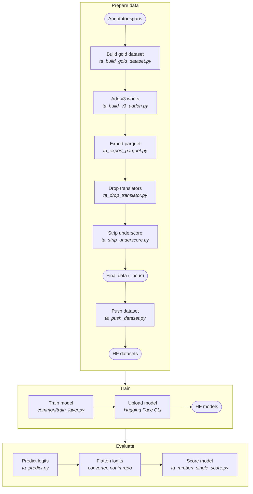
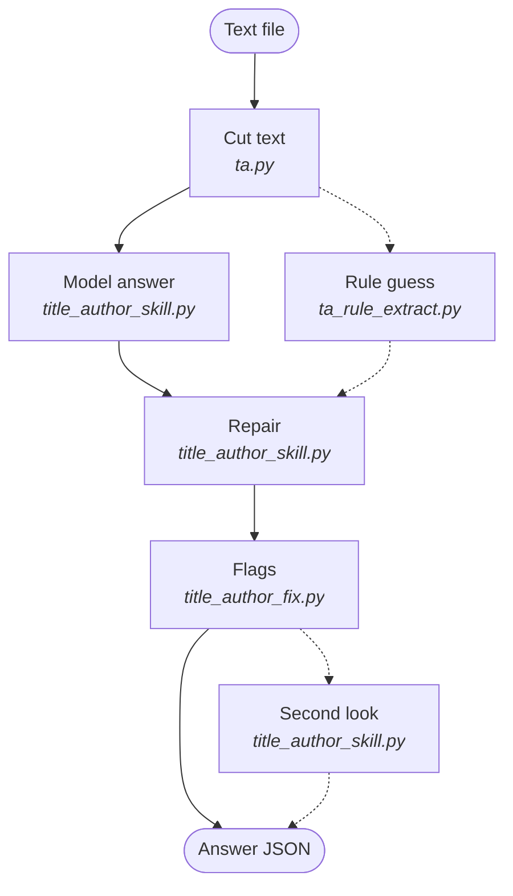

# Title and author

Finds the **title and the author** of a Tibetan work from the first and last 3,000 characters of its text (a text of 6,000 characters or fewer is used whole). Two systems do it: fine-tuned mmBERT-base token classifiers (one model for the title, one for the author) and an LLM-based skill with a rule-based layer around it. Unlike the other layers, this one works on one work at a time, not on a sliding window over a whole book.

- **In:** annotator span JSONs and the BDRC v3 clean texts (the gold data are gitignored under `data/`, several gigabytes).
- **Out:** two datasets and two models on Hugging Face (below), and the skill in [skills/tibetan-title-author/](skills/tibetan-title-author/SKILL.md).
- **In the whole system:** `tibetan-detect --title-author-system model|skill|both` in [detect/title_author.py](../detect/title_author.py) chooses between the models and the skill (`--title-system` and `--author-system` per field). Training and the training command use [common/train_layer.py](../common/train_layer.py).

## Folder layout

```
title_author/
├── src/        dataset builders, mmBERT prediction and scoring, Gemini and GEPA scripts, trials
├── skills/     the skill: ta.py, rule script, prompts, tests (see SKILL.md)
├── skill_dev/  benchmark and scoring scripts for the skill
├── docs/       overview, Gemini results, run 2 results, dataset card, Hugging Face cards
└── data/       prompts, saved rule-script runs, small tables (the big data is gitignored)
```

## Hugging Face

| Repo | Visibility |
|---|---|
| [BDRC/Bo-Title-Detection](https://huggingface.co/BDRC/Bo-Title-Detection) ([card](docs/hf_cards/Bo-Title-Detection.md)) | private |
| [BDRC/Bo-Author-Detection](https://huggingface.co/BDRC/Bo-Author-Detection) ([card](docs/hf_cards/Bo-Author-Detection.md)) | private |
| [BDRC/Bo-Title-Dataset](https://huggingface.co/datasets/BDRC/Bo-Title-Dataset) ([card](docs/hf_cards/Bo-Title-Dataset.md)) | private |
| [BDRC/Bo-Author-Dataset](https://huggingface.co/datasets/BDRC/Bo-Author-Dataset) ([card](docs/hf_cards/Bo-Author-Dataset.md)) | private |

All four are private (read from the Hub, 2026-11-18); a 404 means you need access from the owner. They were moved from `Yontenn/mmbert-title-only`, `mmbert-author-only`, `title-only-training` and `author-only-training` on 2026-11-17 (old names redirect). Each title or author model was trained on the dataset of the same name; the weights are in `best/` and the tokenizer files (copied from `jhu-clsp/mmBERT-base`) are at the repo root. Both datasets are relabelled copies of the public joint data [Yontenn/title-author-training](https://huggingface.co/datasets/Yontenn/title-author-training) ([card](docs/dataset_card.md)); the joint run 2 model is the private `Yontenn/mmbert-title-author-run2` ([card](docs/model_cards/mmbert-title-author-run2.md)).

## Pipeline



Squares are steps with the script that runs them; rounded boxes are files. The skill has its own chart under [Skill](#skill).

## Main pipeline

| Script | What it does | When to run |
|---|---|---|
| [ta_build_gold_dataset.py](src/ta_build_gold_dataset.py) | Builds the tokenized 5-label BIO dataset from annotator spans. | First; needs `ta_load_spans` (missing). |
| [ta_build_v3_addon.py](src/ta_build_v3_addon.py) | Adds auto-labelled BDRC v3 works to train only. | After the gold dataset. |
| [ta_export_parquet.py](src/ta_export_parquet.py) | Exports raw text and character-offset spans as Parquet. | After the v3 add-on. |
| [ta_drop_translator.py](src/ta_drop_translator.py) | Drops works whose gold author is a translator. | After export. |
| [ta_strip_underscore.py](src/ta_strip_underscore.py) | Removes the `_` artifact and shifts the spans. | After the translator drop. |
| [ta_push_dataset.py](src/ta_push_dataset.py) | Pushes a dataset and its card to the Hub. | After the final data is built. |
| [train_layer.py](../common/train_layer.py) | Fine-tunes mmBERT for TITLE or AUTHOR. | On a GPU machine. |
| [ta_predict.py](src/ta_predict.py) | Saves raw model logits for validation and test. | On the GPU box, after training. |
| [ta_mmbert_single_score.py](src/ta_mmbert_single_score.py) | Viterbi decoding and IoU scoring of one single-entity model. | After flattening the logits. |

## How to run

All commands run from the repository root. **The test split is refused unless `ALLOW_TEST=1` is set: use it once, for the final score.**

```bash
# 1-5. Build the data (steps 1 and 3 need ta_load_spans, which is not in this repo)
python title_author/src/ta_build_gold_dataset.py --all --single --clean --tag strat
python title_author/src/ta_build_v3_addon.py CLEAN_DIR --base gold_dataset_all --single
python title_author/src/ta_export_parquet.py CLEAN_DIR
python title_author/src/ta_drop_translator.py
python title_author/src/ta_strip_underscore.py
# 6. Push a dataset (private; --repo-id has no default on purpose)
python title_author/src/ta_push_dataset.py --repo-id BDRC/Bo-Title-Dataset --card title_author/docs/hf_cards/Bo-Title-Dataset.md
# 7. Train on a GPU machine (title; for the author use AUTHOR and BDRC/Bo-Author-Dataset)
python common/train_layer.py --label-name TITLE --scheme bio --dataset BDRC/Bo-Title-Dataset \
    --weight-scheme sqrt_inv --evals-per-epoch 2 --epochs 8 --skip-test
# 8. Upload best/ and the card (docs/hf_cards/*.md as README.md) with the Hugging Face CLI
# 9. Predict, then flatten the logits into data/mmbert_preds/ (the flatten step is not in this repo)
python3 title_author/src/ta_predict.py MODEL_DIR OUT_DIR BDRC/Bo-Title-Dataset
# 10. Tune the break penalty on validation, then score test once
python3 title_author/src/ta_mmbert_single_score.py title validation 3,6,12,20
ALLOW_TEST=1 python3 title_author/src/ta_mmbert_single_score.py title test 6 write 6 first_last
```

Decoding is Viterbi, then one span per work: the title is the first span, the author the last. The single-entity models use break penalty 6 (chosen on validation), the joint model 12. The title run used all 8 epochs; the author run stopped early at epoch 5.5 (best step 10,020). Full hyperparameters are in the two model cards.

## Optional tools

- **Score the joint model** (run 2, 5 labels, penalty 12): `ALLOW_TEST=1 python3 title_author/src/ta_mmbert_score.py test`
- **Compare two Gemini runs** (paired bootstrap, free): `python title_author/src/ta_compare_runs.py validation "RUN_A_GLOB" "RUN_B_GLOB"`
- **Gemini on a prompt** (paid, state the cost first): `python title_author/src/ta_gemini_eval.py run PROMPT.md validation 300`; whole splits: `python title_author/src/ta_gemini_batch.py submit PROMPT.md SPLIT MODEL`
- **Rule script score** (free): `python title_author/src/ta_rule_extract.py score validation`
- **Benchmark the skill** (free in rules mode): `python3 title_author/skill_dev/bench.py validation 300 rules`
- **Skill tests** (offline, no key): `python3 title_author/skills/tibetan-title-author/scripts/run_tests.py`

## Skill

[skills/tibetan-title-author/](skills/tibetan-title-author/SKILL.md) finds the title and author as exact substrings of the text and flags when the author needs a check. Accuracy was measured with Gemini only. Everything else (agent route, server, tool handler, prompts) is in [SKILL.md](skills/tibetan-title-author/SKILL.md).



Run `ta.py` as `python3 title_author/skills/tibetan-title-author/scripts/ta.py ...`; a folder in place of a file runs every `.txt` in it.

- **auto** (default): `ta.py BOOK.txt` uses `GEMINI_API_KEY` (`gemini-3.8-flash`), else `ANTHROPIC_API_KEY` (`claude-sonnet-5-5`, not benchmarked), else the rule guess.
- **llm**: `ta.py llm BOOK.txt MODEL` cuts, asks the named model, repairs and flags; paid; add `--second-look`.
- **rules**: `ta.py rules BOOK.txt` is the free rule-based guess, always `needs_review: true`.
- **excerpt**: `ta.py excerpt BOOK.txt` prints only the head and tail the model would read.
- **verify**: `ta.py verify BOOK.txt --title "..." --author "..."` repairs and flags a draft that already exists.
- **Second look**: with `--second-look`, one more model call on flagged works re-reads the colophon with five rule-script name candidates; the new author counts only if it is an exact, different substring.
- **needs_review** (author only, about a third of works): the author was repaired or missing, a requester cue follows it, or two or more signature verbs sit in the region.

## Results

Cleaned test set, 2,384 works; share of works with IoU >= 0.5 against the gold span in the same block. Settings were chosen on validation; test was scored once.

| Model | Title | Author | Mean |
|---|---|---|---|
| mmBERT joint, run 2 (penalty 12) | 0.833 | 0.711 | 0.772 |
| mmBERT title-only and author-only models (penalty 6) | 0.842 | 0.734 | 0.788 |
| Skill (gemini-3.8-flash, GEPA prompt, rule layer) | 0.786 | 0.756 | 0.771 |
| Title-only model for the title, skill for the author | 0.842 | 0.756 | 0.799 |
| Rule script alone (`data/rule_runs/rule_test_all`) | 0.688 | 0.375 | 0.531 |

Per-model test F1 from the cards (one span per work): Bo-Title-Detection 0.845 (P 0.848, R 0.842); Bo-Author-Detection 0.738 (P 0.742, R 0.734). The mix is the best measured: in `detect/`, `--title-system model --author-system skill`. About 11% of gold authors differ from the author a reader would name (stanza writer, compiler, copyist, requester), so every number has a ceiling. Gemini details and paired ranges: [docs/gemini_results.md](docs/gemini_results.md); run 2 on an earlier 2,389-work test set: [docs/run2_results.md](docs/run2_results.md).

Paired 95% ranges: two single models minus joint, mean +0.017 (+0.007 to +0.026); author-only minus joint, author +0.023 (+0.009 to +0.038); title-only minus joint, title +0.010 (−0.002 to +0.021); mix minus the skill, mean +0.028 (+0.020 to +0.036); mix minus the two single models, mean +0.011 (+0.002 to +0.019).

Either one right: joint model or skill, title 0.881, author 0.837; title-only or skill, title 0.892; author-only or skill, author 0.838.

## Known issues

<details><summary>Show 8 known issues</summary>

- `ta_build_gold_dataset.py` and `ta_export_parquet.py` import `ta_load_spans` (and `--split-csv` comes from `ta_restratify.py`); neither is in `src/`, so those two scripts cannot run from a fresh clone. `ta_build_v3_addon.py` also imports `ta_load_spans` and its docstring mentions the absent `fill_spans_auto.py`.
- `ta_drop_translator.py` and `ta_strip_underscore.py` have the folder names `gold_dataset_all_strat_single_v3_both[_notrans]` and `parquet_export_strat_both[_notrans]` fixed in the code; the flags that produced them are not recorded, so steps 1 to 3 are the documented usage, not a verified reproduction.
- `ta_mmbert_score.py` and `ta_mmbert_single_score.py` read `*_flat.npz` files made by a converter from the `ta_predict.py` logits; the converter is not in this repo.
- `ta_rule_rank.py` has the path `/Users/tenzinyonten/layer_detection/title_author/src` hardcoded for import and output; the saved `data/rule_runs/*/results.json` carry the same machine path. Which of `ta_rule_fit.py` and `ta_rule_rank.py` made the shipped author weights is not stated.
- `src/ta_rule_extract.py` and its two weight files are duplicated in `skills/tibetan-title-author/scripts/` (identical now); change both or they drift apart.
- The model cards on the Hub and in `docs/hf_cards/` still say "Review-flag cutoffs are in `title_author/README.md`"; there are none here (the `needs_review` flags belong to the skill).
- `ta_gemini_eval.py` calls itself an untested first version; the Batch API script reuses its scorer.
- The skill's numbers are Gemini only; `ta.py` auto mode with `ANTHROPIC_API_KEY` uses the unbenchmarked `claude-sonnet-5-5`, and the no-tools second look is not measured. Rule-script figures differ between files: `ta.py` and `SKILL.md` say author about 36% (title about 0.64), the saved test run says title 0.688 and author 0.375 (used above).

</details>

## All files

<details><summary>Show the full file tree</summary>

```
title_author/
├── README.md
├── src/
│   ├── ta_build_gold_dataset.py       # tokenized 5-label BIO dataset from annotator spans
│   ├── ta_build_v3_addon.py           # adds v3 auto-labelled works (train only)
│   ├── ta_export_parquet.py           # raw-text Parquet export (no caller found)
│   ├── ta_drop_translator.py          # drops works with a translator author
│   ├── ta_strip_underscore.py         # removes the _ artifact
│   ├── ta_push_dataset.py             # pushes a dataset and card to the Hub (no caller found)
│   ├── ta_predict.py                  # saves model logits (GPU box)
│   ├── ta_mmbert_score.py             # scores the joint model (called by detect/)
│   ├── ta_mmbert_single_score.py      # scores a single-entity model
│   ├── ta_compare_runs.py             # paired bootstrap of two Gemini runs
│   ├── ta_gemini_eval.py              # regular Gemini run and the shared scorer
│   ├── ta_gemini_batch.py             # Gemini Batch API runner (half price)
│   ├── ta_batch_driver.sh             # runs a split through the Batch API in chunks
│   ├── ta_check_keys.py               # checks which Gemini keys have free quota
│   ├── ta_rule_extract.py             # the rule-based extractor (copy of the skill's)
│   ├── ta_rule_fit.py                 # fits the rule weights on train (logistic regression)
│   ├── ta_rule_rank.py                # alternative author-weight fit, per-work softmax; hardcoded path
│   ├── ta_rule_weights.json           # fitted author weights
│   ├── ta_rule_title_weights.json     # fitted title weights
│   ├── ta_gepa3.py                    # GEPA prompt optimisation (DSPy 3)
│   ├── ta_fix_trial.py                # trial: LLM picks one of 5 name candidates
│   ├── ta_agent_trial.py              # trial: model calls tools to check the author
│   └── ta_second_look_trial.py        # trial: the skill's no-tools second look (no caller found)
├── skills/tibetan-title-author/
│   ├── SKILL.md                       # skill description, agent route, rules
│   ├── scripts/
│   │   ├── ta.py                      # the command: guard, cut, modes
│   │   ├── title_author_skill.py      # extract, repair (postprocess), second look, model adapters
│   │   ├── title_author_fix.py        # needs_review flags, name candidates, experimental fix()
│   │   ├── ta_rule_extract.py         # rule script used by the skill (copy of src/)
│   │   ├── efficiency.py              # cache, retry, meter, parallel wrappers around call_llm
│   │   ├── server.py                  # local HTTP server (127.0.0.1)
│   │   ├── tool_handler.py            # the skill as a tool for an LLM host
│   │   ├── run_tests.py               # runs every offline selftest
│   │   └── ta_rule_weights.json, ta_rule_title_weights.json   # weights of the rule script
│   └── references/                    # rules.md, examples.md (the prompt), second_look.md, pipeline.md, tool_schema.json
├── skill_dev/
│   ├── bench.py                       # benchmarks the skill on a split
│   ├── skill_score.py                 # accuracy minus a token penalty, for GEPA
│   └── precut_coverage.py             # does a shorter cut still hold the gold? (no caller found)
├── docs/                              # gemini_results, run2_results, dataset_card
│   ├── hf_cards/                      # cards of the four BDRC repos
│   └── model_cards/                   # card of the run 2 model
└── data/
    ├── gemini_prompts/                # gepa_final_full.md (final), gepa_final.md, final.md, examples_locked.md, plain_baseline.md, archive/
    ├── processed/                     # bdrc_metadata.csv, translator_dropped.csv (gold datasets and parquet exports are gitignored)
    └── rule_runs/                     # saved rule-script runs (train 2000, validation, test)
```

GEPA (DSPy `dspy.GEPA`, `src/ta_gepa3.py`, settings in its docstring) rewrites the prompt by reading the model's mistakes. The final run (2026-11-11, `gemini-3.8-flash`, 300 validation works, 600 train works, 300 metric calls, examples locked, rule feedback and rule layer on) raised validation 0.713 to 0.758 but tied the hand-made `final.md` on 300 unseen test works (0.813 mean both); GEPA did not beat the hand-made prompt. The skill reads `references/rules.md` and `examples.md`, not `data/gemini_prompts/`, unless `TA_PROMPT` points elsewhere. Gitignored and on disk only: `data/processed/gold_dataset*/`, `data/processed/parquet_export*`, `data/gemini_batches/`, `data/gemini_runs/`, `data/mmbert_preds/`, `data/exports/`.

</details>
