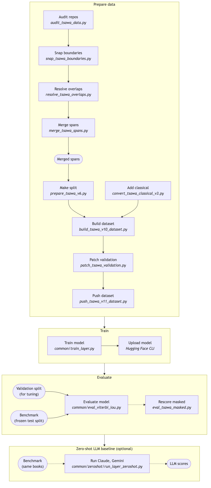

# Tsawa (རྩ་བ, root text)

Finds the **root text** a commentary quotes: a commentary lifts a verse or a passage out of the root text, quotes it, and then explains it; that quoted piece is the Tsawa. One binary token classifier (labels `O`, `B-TSAWA`, `I-TSAWA`), fine-tuned from `jhu-clsp/mmBERT-base`. Quotations from other works look almost the same, and telling them apart is the hard part.

- **In:** the `Tsawa.yml` layers of the OpenPecha `.opf` repos (in `data/raw_opf/`, gitignored), the shared book list `data/shared/tsawa_audit.csv` and the frozen split `data/shared/split_v3_frozen.csv`, and 25 classical commentaries (outside the repo, in `~/tsawa_commentary_data/`).
- **Out:** a dataset and a model on Hugging Face (see below).
- **In the whole system:** `detect/` runs this model on a text (the `tsawa` entry in [layer_config.py](../detect/layer_config.py)). The data scripts live here in `src/`; training and scoring use the shared scripts in [common/](../common/).

## Folder layout

```
tsawa/
├── src/             scripts: audit, clean, split, build, push (sub-folders: analysis, checks, eval)
├── audit/           offset drift and quotation-filter studies, 124 re-annotation flags
├── tests/           four standalone claim checks (not pytest)
├── data/processed/  span tables, split files, classical commentaries, reports
└── docs/            model card, dataset card, zero-shot prompt
```

## Hugging Face

| | Repo | Visibility |
|---|---|---|
| Model | [BDRC/Bo-Tsawa-Detection](https://huggingface.co/BDRC/Bo-Tsawa-Detection) ([card](docs/model_card.md)) | private |
| Dataset (train, validation) | [BDRC/Bo-Tsawa-Dataset](https://huggingface.co/datasets/BDRC/Bo-Tsawa-Dataset) ([card](docs/dataset_card.md)) | private |
| Benchmark (test) | [BDRC/Bo-Tsawa-Benchmark](https://huggingface.co/datasets/BDRC/Bo-Tsawa-Benchmark) ([card](docs/benchmark_card.md)) | public |

Visibility read from the Hub on 2026-11-25 (model and training data private, benchmark public); a 404 on a private repo means you need access from the owner. The dataset and benchmark cards match the Hub READMEs apart from script names, which are current here. The `push_*` scripts still default to the old `Yontenn/formatting-tsawa-v10` and `-v11` names (the dataset in the training command of the model card); pass `--repo-id` to publish elsewhere. Do not write to `BDRC/*` without the owner's go-ahead.

## Pipeline



<sub>Chart source: [pipeline.mmd](docs/pipeline.mmd)</sub>

Squares are steps with the script that runs them; rounded boxes are files; dashed arrows are optional steps. The **benchmark** is the frozen test split: it is scored once and never used to tune. The zero-shot LLM box is optional: the prompt is in `docs/prompts/` and the shared script runs it with `--layer tsawa`, but no Tsawa LLM results are saved in this repo. "Add classical" stands for three scripts (convert, split, collapse; see Main pipeline). The cards are in [docs/](docs/).

## Main pipeline

| Script | What it does | When to run |
|---|---|---|
| [audit_tsawa_data.py](src/audit_tsawa_data.py) | Audits the Tsawa layer of every cloned `.opf` repo. | First, after fetching the repos. |
| [snap_tsawa_boundaries.py](src/snap_tsawa_boundaries.py) | Moves dirty span edges to the nearest syllable boundary. | After the audit. |
| [resolve_tsawa_overlaps.py](src/resolve_tsawa_overlaps.py) | Fixes overlapping span pairs with three review rules. | After snapping. |
| [merge_tsawa_spans.py](src/merge_tsawa_spans.py) | Merges consecutive spans separated only by shad or space. | After resolving overlaps. |
| [snap_tsawa_quotation_boundaries.py](src/snap_tsawa_quotation_boundaries.py) | Snaps Quotation and Citation spans for ignore lists. | Before the split. |
| [prepare_tsawa_split.py](src/prepare_tsawa_split.py) | Builds the frozen book split and the ignore-span list. | Only to rebuild the split. |
| [convert_tsawa_classical.py](src/convert_tsawa_classical.py) | Converts the 25 classical commentaries to span tables. | Once, before the dataset. |
| [prepare_tsawa_classical_split.py](src/prepare_tsawa_classical_split.py) | Holds out whole commentaries per root text. | After the conversion. |
| [clean_tsawa_classical_blank_lines.py](src/clean_tsawa_classical_blank_lines.py) | Collapses blank-line runs and remaps spans. | After the classical split. |
| [build_tsawa_dataset.py](src/build_tsawa_dataset.py) | Tokenizes everything into 8,192-token BIO windows. | After spans and split exist. |
| [patch_tsawa_validation.py](src/patch_tsawa_validation.py) | Fixes labels of 6 validation books; writes v11. | After building v10. |
| [push_tsawa_dataset.py](src/push_tsawa_dataset.py) | Uploads the v11 dataset and a short card. | After patching. |
| [train_layer.py](../common/train_layer.py) | Fine-tunes mmBERT for the Tsawa layer. | On a GPU machine. |
| [eval_viterbi_iou.py](../common/eval_viterbi_iou.py) | Scores a model: Viterbi decoding, span F1 at IoU 0.5. | After training; validation first. |

`train_layer.py` and `eval_viterbi_iou.py` are shared scripts in [common/](../common/). The steps up to the frozen split already produced the span tables committed in `data/processed/`, so for the current model you can start at the build step.

## How to run

All commands run from the repository root. **Never decode with argmax (test F1 0.49); use Viterbi. Select models on validation only.**

```bash
# 1. Fetch the .opf repos (also data/ids/newdata.txt)
python common/fetch_opf_repos.py --ids-file data/ids/olddata.txt
# 2. Audit, then clean the spans
python tsawa/src/audit_tsawa_data.py --raw-dir data/raw_opf --manifest data/raw_opf/_manifest.csv --out-csv data/shared/tsawa_audit.csv
python tsawa/src/snap_tsawa_boundaries.py --audit-csv data/shared/tsawa_audit.csv --raw-opf-dir data/raw_opf --out tsawa/data/processed/tsawa_spans_snapped.csv
python tsawa/src/resolve_tsawa_overlaps.py --sidecar tsawa/data/processed/tsawa_spans_snapped.csv --raw-opf-dir data/raw_opf
python tsawa/src/merge_tsawa_spans.py
python tsawa/src/snap_tsawa_quotation_boundaries.py
# 3. Frozen split and ignore list (rebuild only if needed)
python tsawa/src/prepare_tsawa_split.py
# 4. Classical commentaries
python tsawa/src/convert_tsawa_classical.py && python tsawa/src/prepare_tsawa_classical_split.py && python tsawa/src/clean_tsawa_classical_blank_lines.py
# 5. Build the dataset and patch the validation labels (see Known issues: both need extra files)
python tsawa/src/build_tsawa_dataset.py && python tsawa/src/patch_tsawa_validation.py
# 6. Push the dataset (private unless --public)
python tsawa/src/push_tsawa_dataset.py --repo-id <repo>
# 7. Train on a GPU machine (command from the model card)
python common/train_layer.py --label-name TSAWA --dataset Yontenn/formatting-tsawa-v10 --scheme bio --weight-scheme inv --break-penalty 5.0 --epochs 15 --patience 3 --evals-per-epoch 4 --lr 1e-5 --batch-size 8 --seed 42
# 8. Upload the model and docs/model_card.md (as README.md) with the Hugging Face CLI
# 9. Score the benchmark once (28 books)
python common/eval_viterbi_iou.py --model BDRC/Bo-Tsawa-Detection --dataset BDRC/Bo-Tsawa-Benchmark --split test --break-penalty 4.0 --dump-spans test_spans.jsonl
```

## Optional tools

- **Review overlaps**: lists overlapping span pairs for review; stops if the count is not 18. `python tsawa/src/review_tsawa_overlaps.py --sidecar tsawa/data/processed/tsawa_spans_snapped.csv --raw-opf-dir data/raw_opf --out tsawa/data/processed/overlap_review.csv`
- **Review snapping**: prints before/after text of moved spans. `python tsawa/src/review_tsawa_snap_diffs.py --sidecar tsawa/data/processed/tsawa_spans_snapped.csv --raw-opf-dir data/raw_opf --n 15`
- **Spot-check labels**: scores sampled spans on metre and closing punctuation. `python tsawa/src/check_tsawa_spots.py --audit-csv data/shared/tsawa_audit.csv --raw-opf-dir data/raw_opf`
- **Rescore masked**: re-scores a `--dump-spans` file with doubtful gold (quotations) masked. `python tsawa/src/eval/eval_tsawa_masked.py --dump test_spans.jsonl`
- **Check double labels**: counts tsawa spans that are also quotations. `python tsawa/src/eval/check_tsawa_double_labels.py`
- **Find label errors**: ranks gold spans a trained model finds unlikely. `python tsawa/src/checks/check_tsawa_label_errors.py --model <model> --dataset <dataset> --spans tsawa/data/processed/tsawa_spans_resolved.csv --raw-opf data/raw_opf`
- **Analyze errors**: fragmentation, short spans, exact-match F1. `python tsawa/src/analysis/analyze_tsawa_errors.py --model <model> --dataset <dataset>`
- **Quotation-filter study**: would dropping predicted spans that overlap quotations help? `python tsawa/audit/check_tsawa_quotation_filter.py` (needs saved predictions under `scratch/`)
- **Book catalog**: train, validation and test book list as xlsx. `python tsawa/src/build_tsawa_catalog.py` (see Known issues)

## Results

Test split, 22 benchmark books. Numbers are copied from the [model card](docs/model_card.md): span F1 at IoU 0.5 in token space, greedy one-to-one matching, Viterbi with break penalty 4.0.

| Split | F1 | P | R |
|---|---|---|---|
| Test, 22 benchmark books (3,180 gold spans, per window) | 0.842 | 0.811 | 0.876 |
| Test, with the quotation filter | 0.890 | 0.916 | 0.865 |
| Validation (v11 labels) | 0.789 | 0.726 | 0.863 |
| classical_test (6 commentaries) | 0.959 | 0.941 | 0.978 |

The 22 test books hold 1,976 distinct spans; overlapping windows count a span in each window, which gives the 3,180, so these scores are per window, not per whole book and not comparable with whole-book scores.

The quotation filter drops a predicted Tsawa span when at least 50% of it lies inside spans predicted by `BDRC/Bo-Quotation-Detection`; it was tested only on this test set. `classical_test` shares root verses with training commentaries (about 99% of its verses also occur in a train commentary), so it measures recall of seen root text, not generalisation. Stricter overlap is weaker: F1 0.814 at IoU 0.9, 0.637 at exact match.

## Known issues

<details><summary>Show 6 known issues</summary>

All checked in the code on 2026-11-18.

- `build_tsawa_dataset.py` and `patch_tsawa_validation.py` read `tsawa/data/processed/tsawa_audit.csv`, which is not in the repo: the audit moved to `data/shared/tsawa_audit.csv`. Copy the file there before running them.
- Several scripts read files under `scratch/` that are not in the repo: `prepare_tsawa_split.py` (the old Tsawa dataset `tsawa_dataset_v5_merged`; its helper `stratified_split.py` is now in the repo), `build_tsawa_dataset.py` (the patched 22-book test set `scratch/tsawa/analysis/formatting-tsawa-v6_test_patched_full22_final`), `convert_tsawa_classical.py` (`scratch/tsawa/analysis/end_boundary_check.py`), `eval_tsawa_masked.py` and the three `audit/` studies (saved predictions). The classical source docs are in `~/tsawa_commentary_data/`, also outside the repo.
- `tsawa_spans_merged_reannotated_normalized.csv` is committed and read by the builders, but no script in the repo produces it.
- `build_tsawa_catalog.py` has a hard-coded `ROOT = Path("/Users/tenzinyonten/layer_detection")`.
- The analysis and eval scripts default to old models and datasets (`Yontenn/mmbert-tsawa-io-v2`, `formatting-tsawa-v1`, `ds_v5`, `runs/v5_merged/best`); pass `--model` and `--dataset` for the current ones.
- Five interlinear books annotated a word at a time (`IDAD44BA2`, `I1637B774`, `I9FF2B59B`, `I9CB71958`, `IB522F095`; see `data/processed/tsawa_set_aside.csv`) were set aside from training; the layer is not defined for that commentary form. The four scripts in `tests/` are standalone scripts with argparse, not pytest tests.

</details>

## All files

<details><summary>Show the full file tree</summary>

```
tsawa/
├── README.md
├── src/
│   ├── audit_tsawa_data.py              # audit every .opf repo's Tsawa layer
│   ├── snap_tsawa_boundaries.py         # snap dirty span edges to syllable boundaries
│   ├── review_tsawa_snap_diffs.py             # sample of before/after snapping text
│   ├── review_tsawa_overlaps.py               # list overlapping span pairs (expects 18)
│   ├── resolve_tsawa_overlaps.py              # apply three overlap rules
│   ├── merge_tsawa_spans.py             # merge spans separated only by shad or space
│   ├── snap_tsawa_quotation_boundaries.py     # same snapping for Quotation and Citation
│   ├── check_tsawa_spots.py              # score sampled spans on metre and closers
│   ├── prepare_tsawa_split.py                    # frozen split split_v3 and ignore spans
│   ├── stratified_split.py                       # helper: greedy window-balanced split (generator of split_v2); imported by prepare_tsawa_split.py
│   ├── convert_tsawa_classical.py          # classical commentaries to span tables
│   ├── prepare_tsawa_classical_split.py          # whole-commentary holdout per root text
│   ├── clean_tsawa_classical_blank_lines.py  # collapse blank lines, remap spans
│   ├── build_tsawa_dataset.py             # build the v10 dataset
│   ├── patch_tsawa_validation.py              # fix 6 validation books, write v11
│   ├── push_tsawa_dataset.py              # push v11 to the Hub
│   ├── build_tsawa_catalog.py           # book catalog xlsx
│   ├── analysis/
│   │   ├── analyze_tsawa_errors.py            # fragmentation, short spans, exact-match F1
│   │   ├── analyze_tsawa_missed_spans.py         # missed short spans: CONTAINED, OVERLAP, SPLIT, MISSED
│   │   ├── compare_tsawa_citation.py    # Tsawa vs Citation surface form
│   │   ├── analyze_tsawa_incipits.py            # incipit pointers, headings ending in ནི།
│   │   ├── analyze_tsawa_segmentation.py         # HTML of old vs new batch segmentation
│   │   └── analyze_tsawa_new_gaps.py             # HTML of gaps between new-batch spans
│   ├── checks/
│   │   ├── audit_tsawa_labels.py           # four data checks before a build
│   │   └── check_tsawa_label_errors.py         # rank gold spans by model P(TSAWA)
│   └── eval/
│       ├── eval_tsawa_masked.py            # re-score with doubtful gold masked
│       ├── eval_tsawa_merged.py               # does merging adjacent spans close the recall gap
│       ├── check_tsawa_false_positives.py     # false positives: on citation, near tsawa, commentary
│       ├── analyze_tsawa_old_false_positives.py               # old-batch false positives (imports check_false_positives)
│       └── check_tsawa_double_labels.py       # tsawa spans also labelled quotation
├── audit/
│   ├── check_tsawa_drift.py         # offset-drift scan of train and val books
│   ├── check_tsawa_offset_correction.py  # shift offsets in 5 test books, re-score v6 predictions
│   ├── check_tsawa_quotation_filter.py   # quotation-filter study
│   ├── check_tsawa_dropped_quotes.py  # real spans the filter would drop
│   ├── build_tsawa_quote_dropped_review.py    # review pack (csv, html) of those drops
│   ├── *.csv, *.md, *.html              # outputs of the five scripts above
│   └── needs_reannotation/              # 124 YAML flags (eval/test, eval/validation, train), no caller
├── tests/
│   ├── test_interlinear.py              # do a book's spans reconstruct continuous root text
│   ├── test_repetition_signal.py        # does repeated text mark tsawa
│   ├── test_retrieval_premise.py        # can tsawa be matched in other books instead of tagged
│   └── test_tsawa_claims.py             # four structural claims on the annotations
├── data/processed/
│   ├── tsawa_spans_*.csv                # snapped, resolved, merged and re-annotated spans
│   ├── quotation_spans_snapped.csv      # snapped Quotation and Citation spans
│   ├── split_v2_frozen.csv/.md, split_v3_frozen_excl_set_aside.csv  # split files
│   ├── v6_ignore_spans.csv, named_source_pairs.csv, dropped_spans.csv  # ignore and review lists
│   ├── tsawa_set_aside.csv              # 5 interlinear books set aside
│   ├── classical_v3/, classical_v3_collapsed/  # classical commentaries and their splits
│   └── tsawa_book_catalog.*, tsawa_reannotation_37.*, other reports  # catalogs and reports
└── docs/
    ├── model_card.md                    # also the Hugging Face README of the model
    ├── dataset_card.md                  # also the Hugging Face README of the dataset
    └── prompts/gemini_tsawa_anchors.md  # zero-shot prompt
```

Scripts run from the repo root. Built Arrow datasets (`data/processed/tsawa_dataset_v10`, `v11`) are gitignored.

</details>
