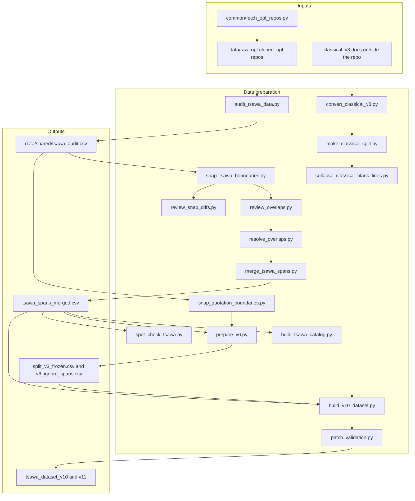
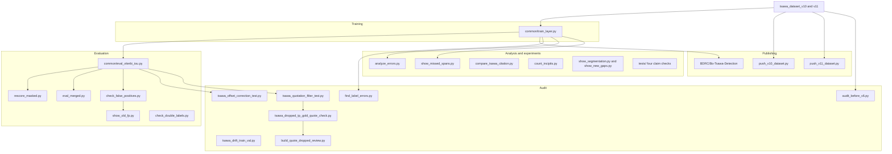

# Tsawa (རྩ་བ, root text)

One binary token classifier for the root-text layer, fine-tuned from `jhu-clsp/mmBERT-base`. A commentary lifts a verse or a passage out of the root text, quotes it, and then explains it; that quoted piece is the Tsawa. This folder holds everything that is specific to this layer: the scripts that clean the OpenPecha annotations and build the training dataset, the evaluation and error-analysis scripts, the audits of the labels, and the span tables the dataset is built from. Training and the main evaluation script are shared with the other layers and live in [`../common/`](../common/); inference code for all layers lives in [`../detect/`](../detect/).

Shared inputs this layer does not own: `data/shared/tsawa_audit.csv` and `data/shared/split_v3_frozen.csv`.
The shared audit that also covers sabche and chapter stays in `common/annotation_audit/`.
Training uses `common/train_layer.py`. The book-level audit and the frozen split used to live in `data/processed/` and moved to `data/shared/` because chapter and sabche read them too.

## Hugging Face

| | Repo | Visibility (read from the Hub, 2026-11-17) | Cards |
|---|---|---|---|
| Model | [BDRC/Bo-Tsawa-Detection](https://huggingface.co/BDRC/Bo-Tsawa-Detection) | public | [`docs/model_card.md`](docs/model_card.md) |
| Dataset | [BDRC/Bo-Tsawa-Dataset](https://huggingface.co/datasets/BDRC/Bo-Tsawa-Dataset) | private (needs access from BDRC) | [`docs/dataset_card.md`](docs/dataset_card.md) |

The working dataset and model repos used while developing were under the `Yontenn` account (for example `Yontenn/formatting-tsawa-v10`, the dataset in the training command of the model card). The `push_*` scripts still default to those names; pass `--repo-id` to publish elsewhere.

## Flowchart

The pipeline is drawn in two charts. Chart 1 covers data preparation, chart 2 covers training, evaluation, publishing, the audit and the analysis scripts. Nodes marked `common/` are shared scripts outside this folder.

### Chart 1: from OpenPecha repos to a built dataset



### Chart 2: training, evaluation, publishing, audit and analysis



## Script reference

All commands run from the repo root (`ROOT` is found as `parents[2]` of the script, and the defaults are relative paths such as `data/raw_opf` and `tsawa/data/processed/...`). Raw `.opf` repos are expected in `data/raw_opf/` (gitignored). Scripts that read `scratch/...` need files that are not in the repo (see Known issues). The Reads / Writes column names files under `tsawa/data/processed/` as `P/`.

### Data preparation

| Script | What it does | When to use it | How to run | Reads -> Writes |
|---|---|---|---|---|
| `src/audit_tsawa_data.py` | Audits the Tsawa layer of every cloned `.opf` repo (counts, data-quality flags). Trains nothing. | First step, after fetching repos. | `python tsawa/src/audit_tsawa_data.py --raw-dir data/raw_opf --manifest data/raw_opf/_manifest.csv --out-csv data/shared/tsawa_audit.csv [--limit N]` | `data/raw_opf/*.opf/.../Tsawa.yml`, manifest -> `data/shared/tsawa_audit.csv` |
| `src/snap_tsawa_boundaries.py` | Moves dirty span starts left and dirty ends right to the nearest syllable boundary (shad or tsheg), capped walk. Never rewrites YAML. | After the audit, before merging. | `python tsawa/src/snap_tsawa_boundaries.py --audit-csv data/shared/tsawa_audit.csv --raw-opf-dir data/raw_opf --out tsawa/data/processed/tsawa_spans_snapped.csv [--max-walk 12]` | audit csv, `.opf` -> `P/tsawa_spans_snapped.csv` |
| `src/review_snap_diffs.py` | Prints a random sample of before/after text for spans the snapper moved. Read-only. | To eyeball the snapping. | `python tsawa/src/review_snap_diffs.py --sidecar tsawa/data/processed/tsawa_spans_snapped.csv --raw-opf-dir data/raw_opf --n 15 --seed 42 [--large-add N]` | snapped csv, `.opf` -> stdout |
| `src/review_overlaps.py` | Lists post-snap overlapping span pairs for manual review. Stops if the count differs from the expected 18. | Before resolving overlaps. | `python tsawa/src/review_overlaps.py --sidecar tsawa/data/processed/tsawa_spans_snapped.csv --raw-opf-dir data/raw_opf --out tsawa/data/processed/overlap_review.csv [--expect 18]` | snapped csv, `.opf` -> `P/overlap_review.csv` |
| `src/resolve_overlaps.py` | Applies three review rules (trim trailing citation particles, strip bracketed folio tags and digit prefixes, cut at last shad if the overlap is at most 10 characters). Aborts if overlaps remain. | After the overlap review. | `python tsawa/src/resolve_overlaps.py --sidecar tsawa/data/processed/tsawa_spans_snapped.csv --raw-opf-dir data/raw_opf --out tsawa/data/processed/tsawa_spans_resolved.csv --log tsawa/data/processed/overlap_resolve_log.csv [--expect N] [--allow-remaining]` | snapped csv, `.opf` -> `P/tsawa_spans_resolved.csv`, `P/overlap_resolve_log.csv` |
| `src/merge_tsawa_spans.py` | Merges consecutive spans whose gap is only shad, tsheg, spaces or newlines (chains allowed). | After resolving overlaps. | `python tsawa/src/merge_tsawa_spans.py [--resolved ...] [--audit-csv data/shared/tsawa_audit.csv] [--out tsawa/data/processed/tsawa_spans_merged.csv] [--tokenizer jhu-clsp/mmBERT-base]` | `P/tsawa_spans_resolved.csv`, audit csv -> `P/tsawa_spans_merged.csv` |
| `src/snap_quotation_boundaries.py` | Same snapping for the Quotation / Citation layer (old batch `Quotation.yml`, new batch `Citation.yml`, merged); quote-quote overlaps trimmed. Tsawa precedence is applied later at label time. | To get quotation spans used for ignore lists and the labelling step. | `python tsawa/src/snap_quotation_boundaries.py [--audit-csv data/shared/tsawa_audit.csv] [--raw-opf-dir data/raw_opf] [--out tsawa/data/processed/quotation_spans_snapped.csv] [--max-walk 12]` | audit csv, `.opf` -> `P/quotation_spans_snapped.csv` |
| `src/spot_check_tsawa.py` | Samples tsawa spans and scores them on metre (7/9/11/13 syllables), terminal punctuation and the trailing quote marker. Verdict uses the first two; the third is a bonus flag. | To sanity-check labels by sampling. | `python tsawa/src/spot_check_tsawa.py --audit-csv data/shared/tsawa_audit.csv --raw-opf-dir data/raw_opf [--n 20] [--seed 42] [--out tsawa/data/processed/spot_check_results.csv]` | audit csv, `.opf` -> stdout, optional csv |
| `src/prepare_v6.py` | Builds the frozen split `split_v3` (seed 123, targets 76/12/12 by windows, pechas with fewer than 10 merged spans dropped, must-link groups for reprints) and the ignore-span list. Does not touch existing sidecars, datasets or YAML. | When the split or ignore list must be rebuilt. | `python tsawa/src/prepare_v6.py` (no flags) | `P/tsawa_spans_merged.csv`, audit, `P/split_v2_frozen.csv`, `P/quotation_spans_snapped.csv` -> `data/shared/split_v3_frozen.csv`, `P/v6_ignore_spans.csv`, two reports under `scratch/` |
| `src/convert_classical_v3.py` | Converts the 25 classical commentaries (6 root texts, from `~/tsawa_commentary_data/interleaved_v3`) into the pipeline format: normalises span ends to shad-inside, boundary check, audit rows. | Once, to add the classical commentaries. | `python tsawa/src/convert_classical_v3.py` (no flags) | external folder -> `P/classical_v3/` (spans, ignore spans, audit, `convert_report.json`) |
| `src/make_classical_split.py` | Whole-commentary holdout per root text: rank 2 by span count -> classical test, rank 3 -> classical validation, rest train. Deterministic. | After the conversion. | `python tsawa/src/make_classical_split.py [--test-only]` (`--test-only` puts rank 3 in train and writes `classical_split_test_only.csv`) | `P/classical_v3/` -> `P/classical_v3/classical_split.csv` |
| `src/collapse_classical_blank_lines.py` | Collapses blank-line runs in the classical docs to one newline and remaps every span, checking each one. | Before `build_v10_dataset.py`. | `python tsawa/src/collapse_classical_blank_lines.py` (no flags) | `~/tsawa_commentary_data/interleaved_v3/docs`, `P/classical_v3/` -> `~/tsawa_commentary_data/interleaved_v3_collapsed/`, `P/classical_v3_collapsed/` |
| `src/build_v10_dataset.py` | Builds the combined dataset v10: existing books, 26 re-annotated books, classical-train commentaries (collapsed copies), frozen `.opf` validation and test, plus separate `classical_validation` and `classical_test`. 8,192-token windows, stride 5,120, mmBERT tokenizer. No training. | To build the training dataset. | `python tsawa/src/build_v10_dataset.py [--out-dir tsawa/data/processed/tsawa_dataset_v10] [--max-length 8192] [--stride 5120]` | split, merged and re-annotated span csvs, classical folders, a patched test set under `scratch/` -> `P/tsawa_dataset_v10/` (gitignored) |
| `src/patch_validation.py` | Replaces the labels of the 6 re-annotated validation books (I19A08A51, I895C519A, P000028, P000161, P000175, P000215) and writes v11 and a v11 without the classical docs. v10 is never modified. | After building v10. | `python tsawa/src/patch_validation.py` (no flags) | `P/tsawa_dataset_v10/` and span csvs -> `P/tsawa_dataset_v11/`, `P/tsawa_dataset_v11_noclassical/`, `P/tsawa_dataset_v11_patch_report.json` |
| `src/build_tsawa_catalog.py` | Builds the train / validation / test book catalog as xlsx. | To refresh the book list. | `python tsawa/src/build_tsawa_catalog.py` (no flags; `ROOT` is hard-coded, see Known issues) | split, audit, merged spans -> `P/tsawa_book_catalog.xlsx` |

### Training

No Tsawa-specific training script exists in this folder. Training is `common/train_layer.py`; the command used for the published model is in step 6 below.

| Script | What it does | When to use it | How to run | Reads -> Writes |
|---|---|---|---|---|
| `../common/train_layer.py` | Token classifier training for one layer (`--label-name`), BIO or IO scheme, class weights, early stopping, best checkpoint chosen on validation IoU 0.5 F1. | To train the model. | see step 6 | built dataset -> checkpoint |

### Evaluation

| Script | What it does | When to use it | How to run | Reads -> Writes |
|---|---|---|---|---|
| `../common/eval_viterbi_iou.py` | The main scorer: Viterbi decoding with a break penalty, span F1 at IoU 0.5, greedy one-to-one matching. `--dump-spans` writes per-window spans for other scripts. Not in this folder, listed because every score here comes from it. | Every time a model is scored. | `python common/eval_viterbi_iou.py --model BDRC/Bo-Tsawa-Detection --dataset <dataset path or id> --split test --break-penalty 4.0 [--sweep] [--dump-spans out.jsonl]` | model, dataset -> json, optional jsonl |
| `src/eval/rescore_masked.py` | Re-scores a `--dump-spans` file with suspect gold spans (those listed in `named_source_pairs.csv`, probably quotations) masked as don't-care on both sides. | To see how much the score depends on doubtful gold. | `python tsawa/src/eval/rescore_masked.py --dump <spans.jsonl> [--pairs tsawa/data/processed/named_source_pairs.csv] [--tokenizer jhu-clsp/mmBERT-base] [--out FILE]` | jsonl, `P/named_source_pairs.csv` -> stdout or `--out` |
| `src/eval/eval_merged.py` | Tests whether merging adjacent spans separated only by shad or whitespace (gold and predictions alike) closes the new-batch recall gap. IoU 0.5 by batch, original vs merged. | Diagnostic; needs `eval_particle_rule.py` from `common/` in the import path. | `python tsawa/src/eval/eval_merged.py --model <model> --dataset <ds> [--split validation] [--break-penalty 4.0] [--batch-size 4]` | model, dataset -> stdout |
| `src/eval/check_false_positives.py` | Sorts every wrong prediction into ON CITATION, NEAR TSAWA or COMMENTARY, using the v4 dataset for citation labels (windows must match v5). | To see where false positives land. | `python tsawa/src/eval/check_false_positives.py --model runs/v5_merged/best --v5 ds_v5 --v4 ds_v4 [--split validation] [--break-penalty 4.0] [--batch-size 4]` | model, two datasets -> stdout |
| `src/eval/show_old_fp.py` | Prints old-batch wrong predictions that land on text labelled neither tsawa nor citation. | After `check_false_positives.py`; imports it and `eval_particle_rule.py` from `common/`. | `python tsawa/src/eval/show_old_fp.py --model runs/v5_merged/best --v5 ds_v5 --v4 ds_v4 [--n 20] [--ctx 25]` | model, datasets -> stdout |
| `src/eval/check_double_labels.py` | Counts tsawa spans also covered by a Citation/Quotation span, and spans introduced by a named source (`... ལས།`). Nothing is modified. | To estimate quotations mislabelled as tsawa. | `python tsawa/src/eval/check_double_labels.py [--spans tsawa/data/processed/tsawa_spans_resolved.csv] [--raw-opf data/raw_opf] [--examples 8]` | resolved spans, `.opf` -> stdout |

### Publishing

| Script | What it does | When to use it | How to run | Reads -> Writes |
|---|---|---|---|---|
| `src/push_v10_dataset.py` | Pushes `tsawa_dataset_v10` to the Hub, private by default; checks split sizes against `build_report.json`, appends a short card, uploads `build_report.json` and `classical_split.csv`, reloads to verify. | To publish the v10 dataset. | `python tsawa/src/push_v10_dataset.py [--repo-id Yontenn/formatting-tsawa-v10] [--public]` | local v10 -> Hub |
| `src/push_v11_dataset.py` | Same for `tsawa_dataset_v11` (validation patched). | To publish the v11 dataset. | `python tsawa/src/push_v11_dataset.py [--repo-id Yontenn/formatting-tsawa-v11] [--public]` | local v11 -> Hub |

The model repo is not published by a script in this folder. Do not write to `BDRC/*` repos without the owner's go-ahead.

### Audit

Studies of how good the labels and the saved predictions are. They are read-only on data. The five scripts in `audit/` write their reports next to themselves; run them from the repo root.

| Script | What it does | When to use it | How to run | Reads -> Writes |
|---|---|---|---|---|
| `src/checks/audit_before_v6.py` | Four data checks: under-labelled books, prose tsawa, overlap with other layers (title, author, chapter, sabche), and leakage of val/test text into train. CPU only. | Before building a dataset version. | `python tsawa/src/checks/audit_before_v6.py > scratch/tsawa/analysis/audit_v6.txt` | spans, `.opf`, split -> stdout |
| `src/checks/find_label_errors.py` | Runs a trained model over train and ranks gold spans by mean P(TSAWA); confidently negative spans are label-error candidates. | To find annotations the model cannot believe. | `python tsawa/src/checks/find_label_errors.py --model Yontenn/mmbert-tsawa-io-v2 --dataset Yontenn/formatting-tsawa-v2 --spans tsawa/data/processed/tsawa_spans_resolved.csv --raw-opf data/raw_opf [--split train] [--top 100] [--limit N] [--device cpu] [--out scratch/tsawa/analysis/label_errors]` | model, dataset, spans -> `ranked_spans.csv` and a text file in `--out` |
| `audit/tsawa_drift_train_val.py` | Offset-drift scan of the train and val books: share of spans starting at a line start and ending before a shad or newline. Clean books score 97-100% on start; flags below 60%. | To find books whose offsets do not fit the text. | `python tsawa/audit/tsawa_drift_train_val.py` | spans, `.opf` -> `audit/tsawa_drift_train_val.csv` (flagged rows in `..._flagged.csv`) |
| `audit/tsawa_offset_correction_test.py` | Exploratory: shifts offsets in the five suspect test books (P000027, P000083, P000144, P000242, P000269) and re-scores saved v6 test predictions. Result in `audit/tsawa_offset_correction_test.md`. | To measure how much offset drift costs on the test set. | `python tsawa/audit/tsawa_offset_correction_test.py` | `scratch/tsawa/analysis/v6_nofeat_test_spans_bp4.jsonl`, `.opf` -> `audit/tsawa_offset_correction_test.md`, `audit/tsawa_offset_corrected_spans.csv`, `audit/tsawa_offset_shift_test.csv` |
| `audit/tsawa_quotation_filter_test.py` | Would dropping predicted tsawa spans that overlap a Quotation or Citation span help? Read-only post-processing study using gold quotations as an upper bound. | To judge the quotation filter described in the model card. | `python tsawa/audit/tsawa_quotation_filter_test.py` | saved predictions, patched test set under `scratch/` -> `audit/tsawa_quotation_filter_test.md`, `audit/tsawa_quotation_filter_by_book.csv` |
| `audit/tsawa_dropped_tp_gold_quote_check.py` | For real tsawa predictions the predicted-quotation filter would drop (coverage 0.5 or more), checks whether a gold quotation sits at that spot. | After the filter study. | `python tsawa/audit/tsawa_dropped_tp_gold_quote_check.py` | `scratch/postprocess_round2/score_pred_quotes.py` and saved predictions -> `audit/tsawa_dropped_tp_gold_quote_check.md`, `.csv` |
| `audit/build_quote_dropped_review.py` | Builds a review pack (csv and html) for the spans the filter would delete although they matched gold (90 window rows, 68 distinct spans, 10 test books). | For human review of the filter's losses. | `python tsawa/audit/build_quote_dropped_review.py` | `audit/tsawa_dropped_tp_gold_quote_check.csv` -> `audit/tsawa_quote_dropped_review.csv`, `.html` |

`audit/needs_reannotation/` holds 124 YAML flags (one per book, `eval/test`, `eval/validation`, `train`) marking books that need full re-annotation. They are tracking files, not model inputs, and no script reads them (grep found no caller).

### Analysis and experiments

Measurements that motivated the data decisions. They change nothing. Many default to early models and datasets (`Yontenn/...-v1`, `-v2`), so pass `--model` and `--dataset` for the current ones.

| Script | What it does | When to use it | How to run | Reads -> Writes |
|---|---|---|---|---|
| `src/analysis/analyze_errors.py` | Diagnoses how the model fails: fragmentation (one gold span into several), short spans, exact-match F1 against the custom tolerance metric. CPU. | After training, to understand errors. | `python tsawa/src/analysis/analyze_errors.py --model <model> --dataset <ds> [--split test] [--batch-size 2] [--device cpu] [--limit N] [--out scratch/tsawa/analysis/error_analysis]` | model, dataset -> `--out` |
| `src/analysis/show_missed_spans.py` | Classifies every missed short gold span as CONTAINED, OVERLAP, SPLIT or MISSED. | To tell segmentation errors from detection errors. | `python tsawa/src/analysis/show_missed_spans.py --model <model> --dataset <ds> [--split validation] [--max-len 10] [--examples 15] [--device cpu] [--out scratch/tsawa/analysis/missed_spans.csv]` | model, dataset -> csv |
| `src/analysis/compare_tsawa_citation.py` | Compares Tsawa and Citation spans on surface form (closers, metre, length) to see if a text-only model could tell them apart. | To study the main error class (quotations predicted as tsawa). | `python tsawa/src/analysis/compare_tsawa_citation.py [--spans ...tsawa_spans_resolved.csv] [--raw-opf data/raw_opf] [--books 60] [--examples 4]` | spans, `.opf` -> stdout |
| `src/analysis/count_incipits.py` | Counts incipit pointers (opening words plus a length such as "five lines"), headings ending in ནི། and spans cutting a word. | To size labelling inconsistencies. | `python tsawa/src/analysis/count_incipits.py [--spans ...] [--raw-opf data/raw_opf] [--max-len 60] [--examples 12] [--dump scratch/tsawa/analysis/incipit_analysis.csv]` | spans, `.opf` -> csv |
| `src/analysis/show_segmentation.py` | HTML page of old-batch and new-batch passages with alternating span colours. | To see how the two annotation batches segment. | `python tsawa/src/analysis/show_segmentation.py [--examples 3] [--seed 5] [--out scratch/tsawa/analysis/tsawa_segmentation.html]` | spans, `.opf` -> html |
| `src/analysis/show_new_gaps.py` | HTML page of the gap text between consecutive new-batch spans, coloured green, yellow or red by gap type. | To decide if a looser merge rule would help. | `python tsawa/src/analysis/show_new_gaps.py [--spans ...tsawa_spans_merged.csv] [--n 40] [--out scratch/tsawa/analysis/new_gaps.html]` | merged spans -> html |
| `tests/test_interlinear.py` | Checks whether a book's spans in order reconstruct continuous root text (metre and gap signals); qualitative. Not a pytest file (no `test_` functions): a standalone script. | To check the interlinear commentary claim. | `python tsawa/tests/test_interlinear.py --pecha IF3ACC3E1 [--compare] [--chars 400]` | spans, `.opf` -> stdout |
| `tests/test_repetition_signal.py` | Measures whether text that recurs across books marks tsawa (precision and recall of a repeated-text mask against gold). | To test a retrieval or repetition signal. | `python tsawa/tests/test_repetition_signal.py [--books 80] [--test-books 15] [--shingle 60] [--stride 15] [--seed 11] [--out scratch/tsawa/analysis/repetition_signal.csv]` | spans, `.opf` -> csv |
| `tests/test_retrieval_premise.py` | Looks for sampled tsawa spans as verbatim substrings of other books (can tsawa be matched instead of tagged). | To test the retrieval premise. | `python tsawa/tests/test_retrieval_premise.py [--sample 300] [--min-len 60] [--partial] [--seed 7] [--out scratch/tsawa/analysis/retrieval_premise.csv]` | spans, `.opf` -> csv |
| `tests/test_tsawa_claims.py` | Checks four structural claims on the annotations: sequentiality, quote particles outside the span, metre, word-by-word commentary. | To verify claims about commentary structure. | `python tsawa/tests/test_tsawa_claims.py [--books 40] [--examples 5] [--seed 3]` | spans, `.opf` -> stdout |

### Experiments and one-off scripts

| Script | What it does | When to use it | How to run | Reads -> Writes |
|---|---|---|---|---|
| `src/build_v7_dataset.py` | Dataset v7: existing + re-annotated + classical-train, frozen val and test; no classical eval split. | No caller found; superseded by `build_v10_dataset.py`. | `python tsawa/src/build_v7_dataset.py [--out-dir ...tsawa_dataset_v7] [--max-length 8192] [--stride 5120]` | as v10 -> `P/tsawa_dataset_v7/` |
| `src/build_v8_dataset.py` | Dataset v8: like v7 plus separate `classical_validation` and `classical_test`. | No caller found; superseded by v10. | `python tsawa/src/build_v8_dataset.py [--out-dir ...tsawa_dataset_v8] [--max-length 8192] [--stride 5120]` | as v10 -> `P/tsawa_dataset_v8/` |
| `src/build_v9_dataset.py` | Dataset v9: one `classical_test` only (one held-out commentary per text, no classical validation, uses `make_classical_split.py --test-only`). | No caller found; superseded by v10. | `python tsawa/src/build_v9_dataset.py [--out-dir ...tsawa_dataset_v9] [--max-length 8192] [--stride 5120]` | as v10 -> `P/tsawa_dataset_v9/` |
| `src/push_v8_dataset.py` | Pushes v8 to the Hub (private by default). | No caller found. | `python tsawa/src/push_v8_dataset.py [--repo-id Yontenn/formatting-tsawa-v8] [--public]` | local v8 -> Hub |
| `src/push_tsawa_dataset.py` | Pushes the first local `tsawa_dataset/` (from `common/build_tsawa_dataset.py`) without re-tokenizing. Only `docs/pipeline_and_data.md` mentions it. | Old flow; use the v10 or v11 push instead. | `python tsawa/src/push_tsawa_dataset.py [--local-dir DIR] [--repo-id ID] [--private]` | local dataset -> Hub |
| `src/check_features.py` | Checks whether the `f4` / `f5` features (source marker before, closer ahead) fire on span-end tokens in the v6 dataset, which still has a `features` column. | Feature experiment; the published model has no features. | `python tsawa/src/check_features.py [--dataset ds_v6] [--split train]` | built dataset -> stdout |
| `src/count_trailing_particles.py` | Counts how often tsawa spans end with a citation particle (ཅེས་, ཞེས་ ...) to see if a trim rule is worth it. | No caller found. | `python tsawa/src/count_trailing_particles.py` (no flags) | spans -> stdout |

## Step by step: from raw data to a published model

Run from the repo root. Steps 1-4 produced the span tables already committed in `tsawa/data/processed/`, so for the current model you can start at step 5.

1. Fetch the `.opf` repos: `python common/fetch_opf_repos.py --ids-file data/ids/olddata.txt` (and `newdata.txt`). Flags: `--dry-run`, `--batch`, `--org`, `--no-gh`.
2. Audit them: `python tsawa/src/audit_tsawa_data.py --raw-dir data/raw_opf --manifest data/raw_opf/_manifest.csv --out-csv data/shared/tsawa_audit.csv`
3. Clean the spans, in this order:
   ```bash
   python tsawa/src/snap_tsawa_boundaries.py --audit-csv data/shared/tsawa_audit.csv --raw-opf-dir data/raw_opf --out tsawa/data/processed/tsawa_spans_snapped.csv
   python tsawa/src/review_overlaps.py --sidecar tsawa/data/processed/tsawa_spans_snapped.csv --raw-opf-dir data/raw_opf --out tsawa/data/processed/overlap_review.csv
   python tsawa/src/resolve_overlaps.py --sidecar tsawa/data/processed/tsawa_spans_snapped.csv --raw-opf-dir data/raw_opf
   python tsawa/src/merge_tsawa_spans.py
   python tsawa/src/snap_quotation_boundaries.py
   ```
4. Build the split and ignore list: `python tsawa/src/prepare_v6.py`. For the classical commentaries: `python tsawa/src/convert_classical_v3.py`, then `python tsawa/src/make_classical_split.py`, then `python tsawa/src/collapse_classical_blank_lines.py`.
5. Build the dataset and patch the validation labels: `python tsawa/src/build_v10_dataset.py` then `python tsawa/src/patch_validation.py` (see Known issues: both need `tsawa_audit.csv` and `scratch/` files).
6. Train (the command from the model card):
   ```bash
   python common/train_layer.py --label-name TSAWA --dataset Yontenn/formatting-tsawa-v10 --scheme bio --weight-scheme inv --break-penalty 5.0 --epochs 15 --patience 3 --evals-per-epoch 4 --lr 1e-5 --batch-size 8 --seed 42
   ```
7. Publish the dataset: `python tsawa/src/push_v11_dataset.py --repo-id <repo>` (private unless `--public`). The model upload is done by hand; no script for it is in this folder.

**How to evaluate.** Score on the 22-book `test` split with Viterbi decoding, break penalty 4.0, IoU 0.5: `python common/eval_viterbi_iou.py --model <model> --dataset <dataset> --split test --break-penalty 4.0 --dump-spans test_spans.jsonl`. Select models on `validation` only. Do not use argmax decoding (test F1 0.49). `classical_test` is not a generalisation measure (see Results). Then use `rescore_masked.py` on the dump, and the scripts in `audit/` for the quotation filter study.

## Results

From the [model card](https://huggingface.co/BDRC/Bo-Tsawa-Detection) (span F1 at IoU 0.5, token space, greedy one-to-one matching, Viterbi with break penalty 4.0).

| Split | F1 | Precision | Recall |
|---|---|---|---|
| test, 22 benchmark books (3,180 gold spans) | 0.842 | 0.811 | 0.876 |
| test, with the quotation filter | 0.890 | 0.916 | 0.865 |
| validation (v11 labels) | 0.789 | 0.726 | 0.863 |
| classical_test (6 commentaries) | 0.959 | 0.941 | 0.978 |

The quotation filter drops a predicted Tsawa span when at least 50% of it lies inside spans predicted by `BDRC/Bo-Quotation-Detection`; it is tested only on this test set. `classical_test` shares root verses with training commentaries (about 99% of its verses also occur in a train commentary), so it measures recall of seen root text. Stricter overlap is weaker: F1 0.814 at IoU 0.9, 0.637 at exact match.

## Folder layout

```
tsawa/
├── README.md                 this file
├── src/                      builders, boundary snapping, push scripts
│   ├── analysis/             error and segmentation analysis (6 scripts)
│   ├── checks/               pre-build data checks and label-error finder (2 scripts)
│   └── eval/                 diagnostics around the common scorer (5 scripts)
├── audit/                    offset drift, offset correction, quotation-filter study, review pack, re-annotation flags
│   └── needs_reannotation/   124 YAML flags per book (eval/test, eval/validation, train)
├── data/processed/           span tables, split files, reports (built Arrow datasets are gitignored)
│   ├── classical_v3/         converted classical commentaries and their split files
│   └── classical_v3_collapsed/   same with blank lines collapsed
├── docs/                     model_card.md, dataset_card.md, huggingface.md, prompts/gemini_tsawa_anchors.md
└── tests/                    four standalone claim checks (not pytest)
```

Shared inputs this layer does not own: `data/shared/tsawa_audit.csv`, `data/shared/split_v3_frozen.csv`.

## Known issues

All checked in the code or on the Hub on 2026-11-17.

- `build_v7` to `build_v10_dataset.py` and `patch_validation.py` read `tsawa/data/processed/tsawa_audit.csv`. That file is not in the repo: the audit moved to `data/shared/tsawa_audit.csv`. Point the scripts there or copy the file before running them.
- Several scripts read files under `scratch/` that are not in the repo: `prepare_v6.py` (`scratch/tsawa/scripts/build_stratified_split`), `build_v7` to `build_v10` (the patched 22-book test set `scratch/tsawa/analysis/formatting-tsawa-v6_test_patched_full22_final`), `convert_classical_v3.py` (`scratch/tsawa/analysis/end_boundary_check.py`), `rescore_masked.py`, the three `audit/` studies (saved predictions in `scratch/tsawa/analysis/`, `scratch/postprocess_round2/`), and the analysis scripts' default outputs. The classical source docs are in `~/tsawa_commentary_data/`, also outside the repo.
- `tsawa_spans_merged_reannotated_normalized.csv` is read by the builders and `convert_classical_v3.py` mentions the same convention, but no script in the repo produces that file.
- `build_tsawa_catalog.py` has a hard-coded `ROOT = Path("/Users/tenzinyonten/layer_detection")`.
- The root README lists the dataset as `BDRC/Tibetan-Tsawa-Detection`; the Hub API answers that name with a redirect (HTTP 307), so it was probably renamed, but this was not followed up.
- The analysis and eval scripts default to old models and datasets (`Yontenn/mmbert-tsawa-io-v2`, `formatting-tsawa-v1`, `ds_v5`, `runs/v5_merged/best`); they need explicit `--model` and `--dataset` for the current ones.
- `tests/` holds standalone scripts with argparse, not pytest tests (no `test_` functions).
- Argmax decoding gives test F1 0.49; always decode with Viterbi (`common/eval_viterbi_iou.py`).
- Five interlinear books annotated a word at a time (`IDAD44BA2`, `I1637B774`, `I9FF2B59B`, `I9CB71958`, `IB522F095`; see `data/processed/tsawa_set_aside.csv`) were set aside from training; the layer is not defined for that commentary form.
