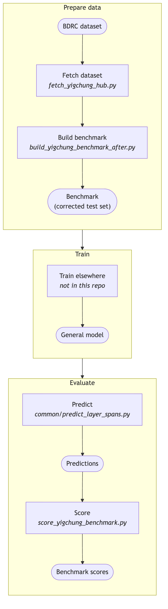
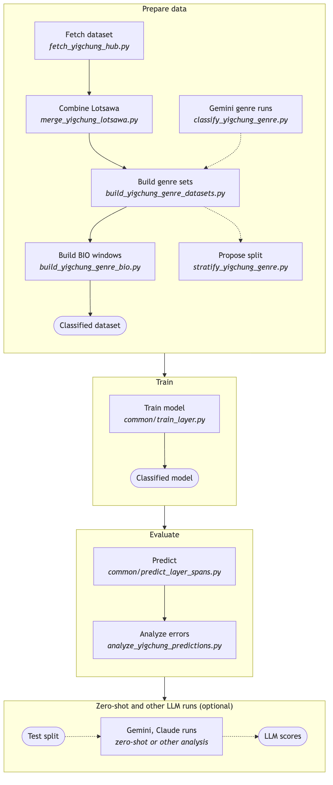

# Yigchung (ཡིག་ཆུང་)

Finds **Yigchung**, the small-print interlinear note written under or beside the main line of a pecha. One token classifier (labels `O`, `B-YIGCHUNG`, `I-YIGCHUNG`), fine-tuned from `jhu-clsp/mmBERT-base`. The folder holds **two separate systems**:

- **General system** (in production): `BDRC/Bo-Yigchung-Detection` (v2, from `karma689/mmbert-yigchung-v2`), trained on all genres **elsewhere**. Only its benchmark lives here: the corrected 77-book test set and the scoring script.
- **Classified (genre) system** (private, experimental): `BDRC/Bo-Yigchung-Classified-Detection`, for four genres only (liturgy, prayer, sadhana, songs). The data build, the genre labelling and the error analysis live here; training uses `common/train_layer.py`. It is **not a replacement** for the general model (see Results).

- **In:** the public dataset [BDRC/Bo-Yigchung-Dataset](https://huggingface.co/datasets/BDRC/Bo-Yigchung-Dataset) (762 books, 601 / 84 / 77), read at pinned revision `778c059b`; hand tables in `data/processed/`; annotator files in `data/local/` (not public).
- **Out:** the classified dataset and model on Hugging Face, and the benchmark scores in `results/`.
- **In the whole system:** `detect/` runs the general model ([layer_config.py](../detect/layer_config.py)).

## Folder layout

```
yigchung/
├── src/             scripts: fetch, combine, label, build, score, analyze
├── prompts/         genre-classification prompts for classify_yigchung_genre.py
├── data/processed/  tracked tables: catalog, span fixes, split proposal, stats
├── docs/            the four Hugging Face cards
└── results/         benchmark scores, genre run results, general-model per-book scores
```

## Hugging Face

Visibility read from the Hub with the local login on 2026-11-18; a 404 without a login means the repo is private.

| System | Repo | Visibility |
|---|---|---|
| General model | [BDRC/Bo-Yigchung-Detection](https://huggingface.co/BDRC/Bo-Yigchung-Detection) ([card](docs/model_card.md)) | public |
| General dataset | [BDRC/Bo-Yigchung-Dataset](https://huggingface.co/datasets/BDRC/Bo-Yigchung-Dataset) ([card](docs/dataset_card.md)) | public |
| Classified model | BDRC/Bo-Yigchung-Classified-Detection ([card](docs/classified_model_card.md)) | private |
| Classified dataset | BDRC/Bo-Yigchung-Classified-Dataset ([card](docs/classified_dataset_card.md)) | private |

The general model replaced the earlier one on 2026-11-17 (kept under tag `v1`). Old names (`BDRC/yigchung_detection_v2`, `Yontenn/mmbert-yigchung-genre-v3`) redirect.

## Pipeline

General system (benchmark only):



<sub>Chart source: [pipeline.mmd](docs/pipeline.mmd)</sub>

Classified (genre) system:



<sub>Chart source: [pipeline_2.mmd](docs/pipeline_2.mmd)</sub>

Squares are steps with the script that runs them; rounded boxes are files; dashed arrows are optional steps. The **benchmark** is the corrected 77-book test set, scored once. Gemini is used here only to label genres, not as a baseline. Uploading the dataset and the model is done with the Hugging Face CLI (no script here).

## Main pipeline

| Script | What it does | When to run |
|---|---|---|
| [fetch_yigchung_hub.py](src/fetch_yigchung_hub.py) | Downloads the dataset text and spans at the pinned revision. | Both: first, once |
| [build_yigchung_benchmark_after.py](src/build_yigchung_benchmark_after.py) | Builds the corrected 77-book benchmark from annotator review. | General: once; on new annotator files |
| [score_yigchung_benchmark.py](src/score_yigchung_benchmark.py) | Scores models on the benchmark, before and after correction. | Both: after predicting |
| [merge_yigchung_lotsawa.py](src/merge_yigchung_lotsawa.py) | Joins 469 short Lotsawa books into 26 documents. | Classified: after fetching |
| [build_yigchung_genre_datasets.py](src/build_yigchung_genre_datasets.py) | Builds the genre parquet sets with all span cleaning. | Classified: after combining; rerun on edits |
| [build_yigchung_genre_bio.py](src/build_yigchung_genre_bio.py) | Cuts 8192-token BIO windows for mmBERT. | Classified: after genre sets |
| [train_layer.py](../common/train_layer.py) | Fine-tunes mmBERT on the classified dataset. | Classified: on a GPU machine |
| [predict_layer_spans.py](../common/predict_layer_spans.py) | Predicts spans: windows averaged, Viterbi decoding. | Both: before scoring |
| [analyze_yigchung_predictions.py](src/analyze_yigchung_predictions.py) | Tables and an HTML viewer of gold against predicted spans. | Classified: after predicting |

`paths.py` holds every path (`YIGCHUNG_DATA` moves the local folder, default `data/local`). `train_layer.py` and `predict_layer_spans.py` are shared scripts in [common/](../common/).

## How to run

All commands run from the repository root. Training runs on a GPU box (see `setup_vast.sh`).

```bash
# 1. Both systems: download the text and spans
python yigchung/src/fetch_yigchung_hub.py
# 2. General: build the corrected benchmark (needs the annotator files in data/local)
python yigchung/src/build_yigchung_benchmark_after.py
# 3. General: predict the test books (break penalty 8), then score
python common/predict_layer_spans.py --label-name YIGCHUNG --model BDRC/Bo-Yigchung-Detection \
    --dataset BDRC/Bo-Yigchung-Dataset --splits test --break-penalty 8 --out predictions_general.json
python yigchung/src/score_yigchung_benchmark.py general=predictions_general.json
# 4. Classified: combine Lotsawa, build the genre sets, build the BIO windows
python yigchung/src/merge_yigchung_lotsawa.py
python yigchung/src/build_yigchung_genre_datasets.py
python yigchung/src/build_yigchung_genre_bio.py with_lotsawa
# 5. Classified: upload bio_with_lotsawa (Hugging Face CLI), then train
python common/train_layer.py --label-name YIGCHUNG --scheme bio \
    --dataset BDRC/Bo-Yigchung-Classified-Dataset --epochs 20 --lr 1e-5 \
    --break-penalty 5 --stitched-eval --skip-test \
    --run-name yigchung-genre-lotsawa-v3-swap --output-dir /workspace/runs/yigchung_genre_v3
# 6. Classified: predict validation and test, then analyze
python common/predict_layer_spans.py --label-name YIGCHUNG --model /workspace/runs/yigchung_genre_v3/best \
    --dataset BDRC/Bo-Yigchung-Classified-Dataset --splits validation,test --break-penalty 5 \
    --out predictions_validation_test.json
python yigchung/src/analyze_yigchung_predictions.py predictions_validation_test.json with_lotsawa
```

**The 77 benchmark books are windowed from the general dataset: predict them before `score_yigchung_benchmark.py`.**

## Optional tools

- **Label genres** (paid Gemini API, state the cost first): `GEMINI_KEYS=k1,k2 python yigchung/src/classify_yigchung_genre.py 0 classify_all_v5.jsonl`. Prompt chosen with `PROMPT_FILE`; the labels are copied into `data/processed/yigchung_catalog.csv` separately.
- **Propose a split**: book-level split per genre, not applied yet. `python yigchung/src/stratify_yigchung_genre.py`

## Decoding and training settings

General decoding: break penalty 8, stride 4914, first-window stitching (`detect/layer_config.py`). Classified: break penalty 5, stride 5120, averaged windows. The classified run also uses the `train_layer.py` defaults (batch 2, accumulation 4, weight decay 0.01, clip 0.3, warmup 6%, bf16, seed 42, inverse-frequency weights, patience 3, best checkpoint by validation span F1), recorded in `results/genre_v*/results.json`.

## Results

Metric: one-to-one span matching at IoU >= 0.5, Viterbi decoding. Genre runs: windows averaged, break penalty 5, whole-document validation. Data names are the old Hub names (`yigchung-genre-bio-lotsawa`).

| Run | Data | Epochs (best) | Validation F1 | Test F1 |
|---|---|---|---:|---:|
| Classified genre v1 | `yigchung-genre-bio-lotsawa` | 10 | 0.665 | not scored |
| Classified genre v2 | `yigchung-genre-bio-lotsawa` | 20 (13, stopped at 16) | 0.737 | 0.768 |
| Classified genre v3 (published) | `yigchung-genre-bio-lotsawa-v2` | 20 (17) | 0.737 | 0.786 (P 0.772, R 0.800) |

Same test documents, general model against genre v3 (two documents, `I518A01A8` and `B-UT1ER1399_0001`, were in the general model's training data, so the fair row leaves them out):

| Test set | Spans | General (v2) | Classified genre v3 |
|---|---:|---:|---:|
| 8 documents neither model trained on | 1,663 | 0.62 | 0.81 |
| all 10 test documents | 1,806 | 0.62 | 0.79 |

77-book benchmark (`BDRC/Bo-Yigchung-Dataset` test), original gold ("before") and corrected gold ("after": 4,059 to 3,793 spans):

| Model | Before | After |
|---|---:|---:|
| General, `BDRC/Bo-Yigchung-Detection` (v2) | 0.471 | 0.489 |
| Classified genre v2 | 0.417 | 0.437 |

The genre model wins on liturgy (0.79 against 0.62) but scores 0.06 on the "other" genres against 0.31 for the general model. The source repo `karma689/mmbert-yigchung-v2` reports BDRC test F1 0.980; that was computed on text still carrying ༼༽ brackets, and on the published text the same 5 books score 0.49. Per-book scores: `results/genre_v3/by_book.csv`, `results/previous_model_karma689_v2/`.

## Known issues

<details><summary>Show 6 known issues</summary>

- **Songs cannot be measured.** The validation and test songs books have 4 and 1 gold spans.
- **The test set is small and uneven.** Two books (`P000030`, `B-UT1ER2253_0001`) hold 86% of the 1,806 test spans. An earlier bootstrap over test books put v2 anywhere from 0.50 to 0.85 (not reproduced by a file here).
- **Not all test gold is annotator-reviewed.** Four reviewed-OPF test books (`P000030`, `P000228`, `P000249`, `P000268`) still wait for annotator review.
- **The Lotsawa documents are labelled prayer as an assumption** (about 90% of Lotsawa books are prayers by a rough title check).
- **Old names in code and result files.** `fetch_yigchung_hub.py` and `paths.py` name the dataset `BDRC/yigchung_detection_v2` (redirects to `BDRC/Bo-Yigchung-Dataset`); `results/benchmark/benchmark_scores.md` carries that name and calls the general model `karma689_v2`.
- **The genre-label step is manual and the general model has no training code here.** `classify_yigchung_genre.py` writes a jsonl; no script copies the labels into the catalog (`label_source` is `gemini_v4` for 217 books, `claude_checked` for 80). The general model was trained elsewhere.

</details>

## All files

<details><summary>Show the full file tree</summary>

```
yigchung/
├── README.md
├── src/
│   ├── paths.py                  # every input and output path; YIGCHUNG_DATA moves the local folder
│   ├── fetch_yigchung_hub.py              # both: dataset text and spans at the pinned revision -> hub/*.parquet
│   ├── build_yigchung_benchmark_after.py  # general: 77-book benchmark with annotator corrections
│   ├── score_yigchung_benchmark.py        # both: scores models on the benchmark, before and after
│   ├── merge_yigchung_lotsawa.py        # classified: 469 Lotsawa books -> 26 documents of ~30k chars
│   ├── classify_yigchung_genre.py           # classified: Gemini genre label per book (optional, paid)
│   ├── build_yigchung_genre_datasets.py   # classified: genre parquet sets with corrections, with and without Lotsawa
│   ├── build_yigchung_genre_bio.py        # classified: parquet -> BIO DatasetDict (8192 tokens, stride 5120)
│   ├── stratify_yigchung_genre.py         # classified: proposes a split per genre (not applied)
│   └── analyze_yigchung_predictions.py    # classified: per-span and per-book tables, HTML viewer
├── prompts/
│   ├── prompt_classify_v4.txt    # earlier: five categories, verse_like_pct hint (labels 217 books)
│   ├── prompt_classify_v5b.txt   # default of classify_yigchung_genre.py: adds middle passage and colophon
│   └── prompt_classify_v6.txt    # adds sub-genres for "other"
├── data/processed/
│   ├── yigchung_catalog.csv      # one row per book: genre, genre_split, borderline, label source, snippets
│   ├── span_corrections.csv      # spans dropped as "not Yigchung" and edited edges
│   ├── span_additions.csv        # added spans: section labels and < > bracket notes
│   ├── headmark_fixes.csv        # log of the head-mark rule, one row per changed span
│   ├── lotsawa_combined_manifest.csv   # which Lotsawa book is in which document, at what offset
│   ├── genre_split_proposal.csv  # output of stratify_yigchung_genre.py; no model uses it
│   └── genre_bio_with_lotsawa_stats.json   # window, span and label counts of the v3 training set
├── docs/                         # model_card, dataset_card (general); classified_model_card, classified_dataset_card
└── results/
    ├── benchmark/                # benchmark_scores.md, by-book scores, changes, summary
    ├── genre_v1/, genre_v2/, genre_v3/   # results.json per run (v2, v3 also by_book.csv)
    └── previous_model_karma689_v2/       # per-book scores of the general model (validation, test)
```

`data/local/` is gitignored and holds: `hub/<split>.parquet` (fetch_yigchung_hub.py), `lotsawa_combined.parquet` (merge_yigchung_lotsawa.py), `genre_training/` (build scripts), `benchmark_after/`, and the annotator files `annotator_spans/<book_id>.json`, `extra_books/<book_id>.json` (four BDRC books not in the HF set) and `annotator_review/{yaml,zips}/`. Splits of the classified data: train 49 documents / 9,306 spans / 1,388 windows, validation 8 / 1,290 / 137, test 10 / 1,806 / 229; 5 of the 67 documents carry annotator-reviewed spans (about 28% of the spans).

</details>
