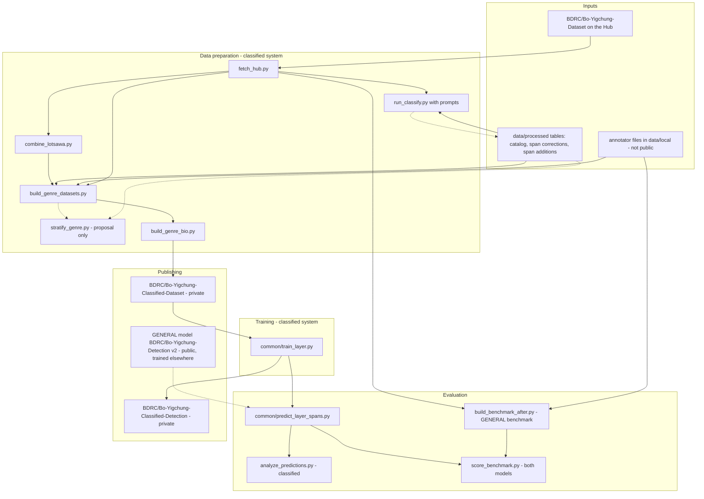

# Yigchung layer (ཡིག་ཆུང་)

Yigchung is the small-print interlinear note written under or beside the main line of a pecha. This folder holds everything for the Yigchung layer, which has **two separate systems**:

- **General system** (in production): `BDRC/Bo-Yigchung-Detection` (v2), trained on all genres. It was trained elsewhere (from `karma689/mmbert-yigchung-v2`), so this folder holds no training code for it, only its benchmark: the corrected 77-book test set and the scoring script.
- **Classified (genre) system** (private, experimental): `BDRC/Bo-Yigchung-Classified-Detection`, trained on four genres only (liturgy, prayer, sadhana, songs). Almost every script in `src/` belongs to this system: it builds the genre dataset and analyses the model. The training itself uses `common/train_layer.py`.

The genre model is **not a replacement** for the general model (see [Results](#results)). Inference for the general model lives in `detect/` (`detect/layer_config.py`).

Both systems start from the public dataset [`BDRC/Bo-Yigchung-Dataset`](https://huggingface.co/datasets/BDRC/Bo-Yigchung-Dataset) (762 books, 601 / 84 / 77), which the code reads at revision `778c059b`.

## Hugging Face

Visibility read from the Hub on 2026-11-17 (the two classified repos answer "not found" without a login, and `HfApi.repo_info` with the owner login reports private).

| System | Model repo | Dataset repo | Visibility | Cards in `docs/` |
|---|---|---|---|---|
| General | [`BDRC/Bo-Yigchung-Detection`](https://huggingface.co/BDRC/Bo-Yigchung-Detection) | [`BDRC/Bo-Yigchung-Dataset`](https://huggingface.co/datasets/BDRC/Bo-Yigchung-Dataset) | model public, dataset public | [`model_card.md`](docs/model_card.md), [`dataset_card.md`](docs/dataset_card.md) |
| Classified | `BDRC/Bo-Yigchung-Classified-Detection` | `BDRC/Bo-Yigchung-Classified-Dataset` | model private, dataset private | [`classified_model_card.md`](docs/classified_model_card.md), [`classified_dataset_card.md`](docs/classified_dataset_card.md) |

Both pairs are listed in [`docs/huggingface.md`](docs/huggingface.md).

- The general model was trained on an earlier version of the data than the published one (`karma689/yigchung_detection`, tag `v2.0`, no longer available; window counts differ, see its card). It decodes with break penalty 8, stride 4914 and first-window stitching, set in `detect/layer_config.py`.
- The classified model is for the four genres only and decodes differently: stride 5120 instead of 4914, windows averaged instead of first-window-only, and break penalty 5 instead of 8.

## Flowchart

Nodes marked "GENERAL" belong to the **general** system; the rest belong to the **classified** system. `common/` scripts are shared with the other layers.



Dashed arrows: `run_classify.py` writes a jsonl file whose labels were then entered into the catalog (the catalog column `label_source` is `gemini_v4` for 217 books and `claude_checked` for 80; no script in this folder does that copy); `stratify_genre.py` only writes a proposal that no current model uses.

## Script reference

All scripts are in `src/` and import `paths.py`. Run them from the repository root. Needs `YIGCHUNG_DATA` only if the local data folder is elsewhere (default `yigchung/data/local`).

### Data preparation (classified system)

| Script | What it does | When to use it | How to run | Reads -> Writes |
|---|---|---|---|---|
| `paths.py` | Not a script: every input and output path. `YIGCHUNG_DATA` overrides the local folder. | Imported by all the others. | `export YIGCHUNG_DATA=/path/to/yigchung_local` (optional) | tracked tables in `data/processed/`; local folder `data/local/` |
| `fetch_hub.py` | Downloads the default config (book text + spans) of the dataset at the pinned revision `778c059b` and copies the three splits. The code names the dataset by its old name `BDRC/yigchung_detection_v2` (renamed to `BDRC/Bo-Yigchung-Dataset`, old name redirects). | First step, once. Also needed by `build_benchmark_after.py` and `score_benchmark.py` (they read `hub/test.parquet`). | `python yigchung/src/fetch_hub.py` | Hub -> `hub/{train,validation,test}.parquet` |
| `combine_lotsawa.py` | Joins the 469 short Lotsawa House books into 26 documents of about 30,000 characters, within each HF split (shuffled with seed 7), shifts the spans (inclusive end) and verifies them. | After `fetch_hub.py`, before `build_genre_datasets.py`. | `python yigchung/src/combine_lotsawa.py` | `hub/*.parquet` -> `lotsawa_combined.parquet` |
| `run_classify.py` | Asks Gemini for one genre label per book (liturgy, prayer, sadhana, songs, other) using a prompt from `prompts/`; resumable (skips books already done with http 200), rotates `GEMINI_KEYS` on 429 and drops keys rejected with 401/403, stops after 12 failures in a row. First argument: `0` all books, `N` a stratified sample of 30 (12 reviewed_opf, 12 bdrc, 6 nalanda), or a comma list of book ids. Second argument: output jsonl. Env: `GEMINI_KEYS` (required), `GEMINI_MODEL` (default `gemini-3.1-flash-lite`), `PROMPT_FILE` (default `prompts/prompt_classify_v5b.txt`), `CATALOG`. | Only to (re)label books. Paid API: state the cost first. | `GEMINI_KEYS=k1,k2 python yigchung/src/run_classify.py 0 classify_all_v5.jsonl` | `data/processed/yigchung_catalog.csv` + prompt -> jsonl (`classify_all_v5.jsonl` by default) |
| `build_genre_datasets.py` | Builds the genre training sets in HF format: `without_lotsawa` (36 genre books) and `with_lotsawa` (plus the 26 combined documents, labelled prayer). Applies the preparation steps below. | After `fetch_hub.py` and `combine_lotsawa.py`, and again whenever the catalog, corrections or additions change. | `python yigchung/src/build_genre_datasets.py` | `hub/`, `lotsawa_combined.parquet`, catalog, `span_corrections.csv`, `span_additions.csv`, `annotator_spans/`, `extra_books/` -> `genre_training/{with,without}_lotsawa/<split>.parquet`, `genre_training/headmark_fixes.csv` |
| `build_genre_bio.py` | Tokenizes with `jhu-clsp/mmBERT-base`, cuts windows of 8192 tokens with stride 5120, labels tokens `O`, `B-YIGCHUNG`, `I-YIGCHUNG` (parquet spans have an inclusive end, so `end+1` is passed). Uses `common/build_tsawa_dataset.py`. Optional 2nd argument: folder with the parquet files; 3rd: comma list of splits. | After `build_genre_datasets.py`; its output is what gets uploaded as the classified dataset. | `python yigchung/src/build_genre_bio.py with_lotsawa` | `genre_training/<name>/` -> `genre_training/bio_<name>/` (a `DatasetDict`) |
| `stratify_genre.py` | Proposes a book-level train/validation/test split per genre: drops under-annotated books, keeps near-duplicate books together (50-char shingles), searches the assignment whose span and character shares fall in a band (default 5-20% for validation and for test), tie-breaks towards better labels and books the previous model never saw. Writes a proposal; the catalog is unchanged. | When the split should be redone. Not applied yet. | `python yigchung/src/stratify_genre.py` | `genre_training/`, `hub/`, catalog -> `data/processed/genre_split_proposal.csv` |

Preparation steps applied by `build_genre_datasets.py`, in order, on every rebuild:

1. Keep the books whose `category` in the catalog is not `other`, and give each its `genre_split`.
2. Where an annotator review exists, use the annotator's spans instead of the HF spans.
3. Apply `span_corrections.csv`: drops and edge edits.
4. End a span before an unmatched closing `)`. This is the annotators' convention: 605 of their 652 edits on 19 reviewed books.
5. Add the spans in `span_additions.csv`. The script stops if an added span overlaps an existing one.
6. Add the four extra books.
7. Head marks (༄༅ ༈ ...) open the next text, so they are never part of a span. A mark at a span edge is trimmed. A mark after a text ending (shad, or ག / ཀ) inside a span splits it in two. A mark inside a sentence is left alone.
8. Write `with_lotsawa/` and `without_lotsawa/` in the HF schema with spans `{id, start, end}` and **inclusive** ends. Extra columns: `category`, `borderline`, `label_note`.

### Training (classified system)

| Script | What it does | When to use it | How to run | Reads -> Writes |
|---|---|---|---|---|
| `common/train_layer.py` (shared) | Fine-tunes mmBERT for one layer. | To train the genre model, on a Vast.ai GPU (see `setup_vast.sh` at the repo root). | see [Step by step](#step-by-step-from-raw-data-to-a-published-model) | `bio_with_lotsawa` -> `<output-dir>/best` |

### Evaluation

| Script | System | What it does | When to use it | How to run | Reads -> Writes |
|---|---|---|---|---|---|
| `common/predict_layer_spans.py` (shared) | both | Predicts token spans per document; overlapping windows averaged per token, then Viterbi decoding with `--break-penalty`. | Before `analyze_predictions.py` or `score_benchmark.py`. | `python common/predict_layer_spans.py --label-name YIGCHUNG --model <dir> --dataset <repo or path> --splits validation,test --break-penalty 5 --out predictions.json` | model + dataset -> predictions json |
| `analyze_predictions.py` | classified | Turns the token spans into character spans and compares with gold. | After predicting on validation and test, to see which books and spans fail. | `python yigchung/src/analyze_predictions.py predictions_validation_test.json with_lotsawa` | `predictions*.json`, `genre_training/<name>/` -> next to the predictions file: `<name>_spans.csv` (one row per gold or predicted span: status, offsets, text, IoU, score), `<name>_by_book.csv` (P / R / F1 at IoU 0.5 per book, with category), `<name>_view.html` (gold vs predicted spans coloured) |
| `build_benchmark_after.py` | general | Builds the corrected ("after") benchmark from the 77-book test split ("before"): (1) the 5 annotator-reviewed BDRC books take the annotator's spans (offsets mapped from the text with ༼༽{} brackets back to the HF text); (2) on the other books, a trailing unmatched `)` is removed and a trailing syllable that starts a new phrase is removed (86% agreement on 101 cases); (3) number-only spans are removed and head marks trimmed or split on every book. Source data is not modified. | Once, or when the annotator files change. | `python yigchung/src/build_benchmark_after.py` | `hub/test.parquet`, `annotator_review/{yaml,zips}/`, `annotator_spans/` -> `benchmark_after/test.parquet`, `changes.csv`, `summary_by_book.csv` |
| `score_benchmark.py` | both | Scores models on the 77-book benchmark against the original gold ("before") and the corrected gold ("after"): predictions mapped to characters with the mmBERT tokenizer, one-to-one matching at IoU >= 0.5. | To compare the general and genre models on the same books. | `python yigchung/src/score_benchmark.py NAME=predictions.json [NAME2=predictions2.json ...]` | `hub/test.parquet`, `benchmark_after/test.parquet`, predictions -> `benchmark_after/benchmark_scores_by_book.csv`, `benchmark_scores.md` |

How to evaluate the general model: predict with `common/predict_layer_spans.py` on the test split of `BDRC/Bo-Yigchung-Dataset` using the general decoding settings (break penalty 8), then run `score_benchmark.py general=<predictions>`. The numbers in `docs/model_card.md` were produced with `score_benchmark.py` and `build_benchmark_after.py`.

### Experiments and one-off scripts

Nothing in `src/` is a legacy script, but two have no caller: `stratify_genre.py` (no caller found; its output is a proposal that no current model uses) and `run_classify.py` (no script calls it; `docs/classified_dataset_card.md` lists it as step 3 of the dataset, so it is run by hand).

### Prompts (`prompts/`)

Genre-classification prompts for `run_classify.py` (pick one with `PROMPT_FILE`). Each fills the book fields into placeholders (`{book_id}`, `{title_tibetan}`, `{opening_text}`, ...) and asks for one JSON object.

| File | What it is |
|---|---|
| `prompt_classify_v4.txt` | Earlier prompt: five categories, decision rules from title and opening text, and `verse_like_pct` as a hint. The catalog column `label_source` is `gemini_v4` for 217 books. |
| `prompt_classify_v5b.txt` | Default of `run_classify.py`. Also uses a middle passage and the colophon; treats khrid-yig (ཁྲིད་ཡིག) practice manuals as "other" unless they are a formal recitation script; ignores publisher back-matter. |
| `prompt_classify_v6.txt` | Adds sub-genres for "other". |

## Data

### Tracked tables (`data/processed/`)

| File | What it is |
|---|---|
| `yigchung_catalog.csv` | One row per book: genre (`category`), `genre_split`, `borderline`, label source, title and text snippets. The split comes from here. |
| `span_corrections.csv` | Hand fixes: spans dropped as "not Yigchung" and edited span edges. |
| `span_additions.csv` | Hand-added spans: section labels and `< >` bracket notes the gold had missed. |
| `headmark_fixes.csv` | Output log of the head-mark rule, one row per changed span. |
| `lotsawa_combined_manifest.csv` | Which Lotsawa book went into which combined document, and at what offset. |
| `genre_split_proposal.csv` | Output of `stratify_genre.py`. A proposal only: not used by the current models. |
| `genre_bio_with_lotsawa_stats.json` | Window, span and label counts of the BIO set the v3 model was trained on. |

### Local inputs (`data/local/`, gitignored)

| Path | Where it comes from |
|---|---|
| `hub/<split>.parquet` | `python yigchung/src/fetch_hub.py` |
| `lotsawa_combined.parquet` | `python yigchung/src/combine_lotsawa.py` |
| `annotator_spans/<book_id>.json` | Annotator-reviewed spans for a book that is in the HF set (`B-UT1ER2253_0001`). |
| `extra_books/<book_id>.json` | Four annotator-reviewed BDRC books that are not in the HF set (`B-UT1ER1130`, `1210`, `1222`, `1596`): text with brackets removed, plus the annotator spans mapped onto it. |
| `annotator_review/yaml/`, `annotator_review/zips/` | The annotators' layer files and the review OPF zips their offsets refer to. Only `build_benchmark_after.py` needs these. |

The annotator files are not public. Ask the layer owner for them.

### Splits of the classified data (final, with Lotsawa)

| Split | Docs | Spans | Windows |
|---|---:|---:|---:|
| train | 49 | 9,306 | 1,388 |
| validation | 8 | 1,290 | 137 |
| test | 10 | 1,806 | 229 |

5 of the 67 documents carry annotator-reviewed spans: `B-UT1ER2253_0001` and the four extra books. Together they hold about 28% of the spans.

## Step by step: from raw data to a published model

**General system.** There is nothing to build or train here: the model `BDRC/Bo-Yigchung-Detection` (v2) was trained elsewhere, and the dataset `BDRC/Bo-Yigchung-Dataset` is the published one. What this folder adds is the benchmark (steps 1 and 7 below, then `score_benchmark.py`).

**Classified system** (training runs on Vast.ai; give one command at a time):

```bash
export YIGCHUNG_DATA=/path/to/yigchung_local     # optional; default yigchung/data/local

# 1. download the text and spans
python yigchung/src/fetch_hub.py
# 2. combine the Lotsawa books into documents
python yigchung/src/combine_lotsawa.py
# 3. (only to relabel) classify genres with Gemini; the result goes into the catalog
GEMINI_KEYS=k1,k2 python yigchung/src/run_classify.py 0 classify_all_v5.jsonl
# 4. build the genre parquet sets (cleaning steps above)
python yigchung/src/build_genre_datasets.py
# 5. build the BIO windows for mmBERT
python yigchung/src/build_genre_bio.py with_lotsawa  # -> $YIGCHUNG_DATA/genre_training/bio_with_lotsawa

# 6. train on Vast (see setup_vast.sh)
python common/train_layer.py --label-name YIGCHUNG --scheme bio \
    --dataset BDRC/Bo-Yigchung-Classified-Dataset --epochs 20 --lr 1e-5 \
    --break-penalty 5 --stitched-eval --skip-test \
    --run-name yigchung-genre-lotsawa-v3-swap --output-dir /workspace/runs/yigchung_genre_v3
```

The `--dataset` above is the private BDRC copy of `bio_with_lotsawa`. A local path from `build_genre_bio.py` works too. The other training settings are the `train_layer.py` defaults: batch size 2, gradient accumulation 4, weight decay 0.01, gradient clip 0.3, warmup 6%, bf16, seed 42, inverse-frequency class weights, early stopping with patience 3, and the best checkpoint picked on validation span F1 (IoU >= 0.5, per window). The stitched validation score (whole documents, overlapping windows averaged) is computed once at the end and is the one reported below. All of these are recorded in `results/genre_v*/results.json`.

Publishing: `bio_with_lotsawa` and the trained `best` folder go to the two private repos; no script in this folder uploads them.

**How to evaluate** the classified model:

```bash
# predict validation + test on the GPU box
python common/predict_layer_spans.py --label-name YIGCHUNG \
    --model /workspace/runs/yigchung_genre_v3/best \
    --dataset BDRC/Bo-Yigchung-Classified-Dataset --splits validation,test \
    --break-penalty 5 --out /workspace/runs/yigchung_genre_v3/predictions_validation_test.json
# analyse on the Mac
python yigchung/src/analyze_predictions.py predictions_validation_test.json with_lotsawa
# compare with the general model on the 77-book benchmark
python yigchung/src/build_benchmark_after.py
python yigchung/src/score_benchmark.py genre_v3=predictions_benchmark.json
```

(The benchmark test books are windowed from the general dataset; predict them with `predict_layer_spans.py` first. The old results in `results/benchmark/` used the names `karma689_v2` and `genre_v2`.)

## Results

Metric: one-to-one span matching at IoU >= 0.5. Overlapping windows are averaged per token, then Viterbi decoding with break penalty 5.

| Run | Data | Epochs (best epoch) | Validation F1 | Test F1 |
|---|---|---|---:|---:|
| genre v1 | `yigchung-genre-bio-lotsawa` | 10 | 0.665 | not scored |
| genre v2 | `yigchung-genre-bio-lotsawa` | 20 (13, stopped at 16) | 0.737 | 0.768 |
| **genre v3** | `yigchung-genre-bio-lotsawa-v2` | 20 (17) | **0.737** | **0.786** (P 0.772, R 0.800) |

(The data names are the old Hub names; the classified dataset was moved to `BDRC/Bo-Yigchung-Classified-Dataset`.)

v3 against the general model `BDRC/Bo-Yigchung-Detection` (v2, from `karma689/mmbert-yigchung-v2`) on the same test documents:

| Test set | Spans | general (v2) | genre v3 |
|---|---:|---:|---:|
| 8 docs that neither model trained on | 1,663 | 0.62 | **0.81** |
| all 10 test docs | 1,806 | 0.62 | **0.79** |

Two test documents (`I518A01A8`, `B-UT1ER1399_0001`) were in the general model's training data, which is why the fair comparison leaves them out. Per-book scores are in `results/genre_v3/by_book.csv` and `results/previous_model_karma689_v2/`.

### Benchmark (77 books)

`results/benchmark/benchmark_scores.md` scores models on the `BDRC/Bo-Yigchung-Dataset` test split, against the original gold ("before") and the corrected gold ("after": annotator review for the 5 BDRC books, the annotator patterns and the head-mark rule elsewhere; 4,059 -> 3,793 spans).

| Model | Before | After |
|---|---:|---:|
| general, `BDRC/Bo-Yigchung-Detection` (v2) | 0.471 | 0.489 |
| genre v2 | 0.417 | 0.437 |

The genre model wins on liturgy (0.79 against 0.62) but scores 0.06 on the "other" genres, against 0.31 for the general model. **It is not a replacement for the general model.**

The model's source repo `karma689/mmbert-yigchung-v2` reports a BDRC test F1 of 0.980. Those scores were computed on a version of the text that still had ༼༽ brackets around the notes. On the published text the same 5 books score 0.49.

## Folder layout

```
yigchung/
├── README.md                     # this file
├── src/
│   ├── paths.py                  # every input and output path; YIGCHUNG_DATA overrides the local folder
│   ├── fetch_hub.py              # download the dataset (text + spans) at the pinned revision
│   ├── combine_lotsawa.py        # 469 short Lotsawa House books -> 26 documents of ~30k chars, within each HF split
│   ├── run_classify.py           # Gemini genre label per book (prompts in prompts/); needs GEMINI_KEYS
│   ├── build_genre_datasets.py   # genre books + corrections -> parquet, with and without Lotsawa
│   ├── build_genre_bio.py        # parquet -> BIO DatasetDict for mmBERT (8192 tokens, stride 5120)
│   ├── stratify_genre.py         # proposes a book-level split per genre (not applied yet)
│   ├── analyze_predictions.py    # model predictions -> per-span and per-book tables + an HTML viewer
│   ├── build_benchmark_after.py  # the 77-book benchmark with the annotator corrections applied (general system)
│   └── score_benchmark.py        # scores models on the benchmark, before and after the corrections
├── data/processed/               # small tracked tables (above)
├── docs/                         # the four Hugging Face cards and huggingface.md
├── prompts/                      # genre-classification prompts (v4, v5b, v6)
└── results/
    ├── benchmark/                # 77-book scores, before and after the corrections
    ├── genre_v1/, genre_v2/, genre_v3/            # results.json per run (v2 and v3 also by_book.csv)
    └── previous_model_karma689_v2/                # per-book scores of the general model (validation, test)
```

## Known issues

- **Songs can't be measured.** The validation and test songs books have 4 and 1 gold spans.
- **The test set is small and uneven.** Two books hold 86% of the test spans. A bootstrap over test books puts v2 anywhere from 0.50 to 0.85.
- **Not all test gold is annotator-reviewed.** Four of the reviewed-OPF test books (`P000030`, `P000228`, `P000249`, `P000268`) are still waiting for annotator review.
- **The Lotsawa documents are labelled prayer as an assumption.** About 90% of Lotsawa books are prayers by a rough title check.
- **Old names in code and result files.** `fetch_hub.py` and `paths.py` still name the dataset `BDRC/yigchung_detection_v2` (redirects to `BDRC/Bo-Yigchung-Dataset`), and `results/benchmark/benchmark_scores.md` is headed with that name and calls the general model `karma689_v2`.
- **The genre-label step is manual.** `run_classify.py` writes a jsonl file; no script copies the labels into the catalog.
- **No training code for the general model** is in this repository.
